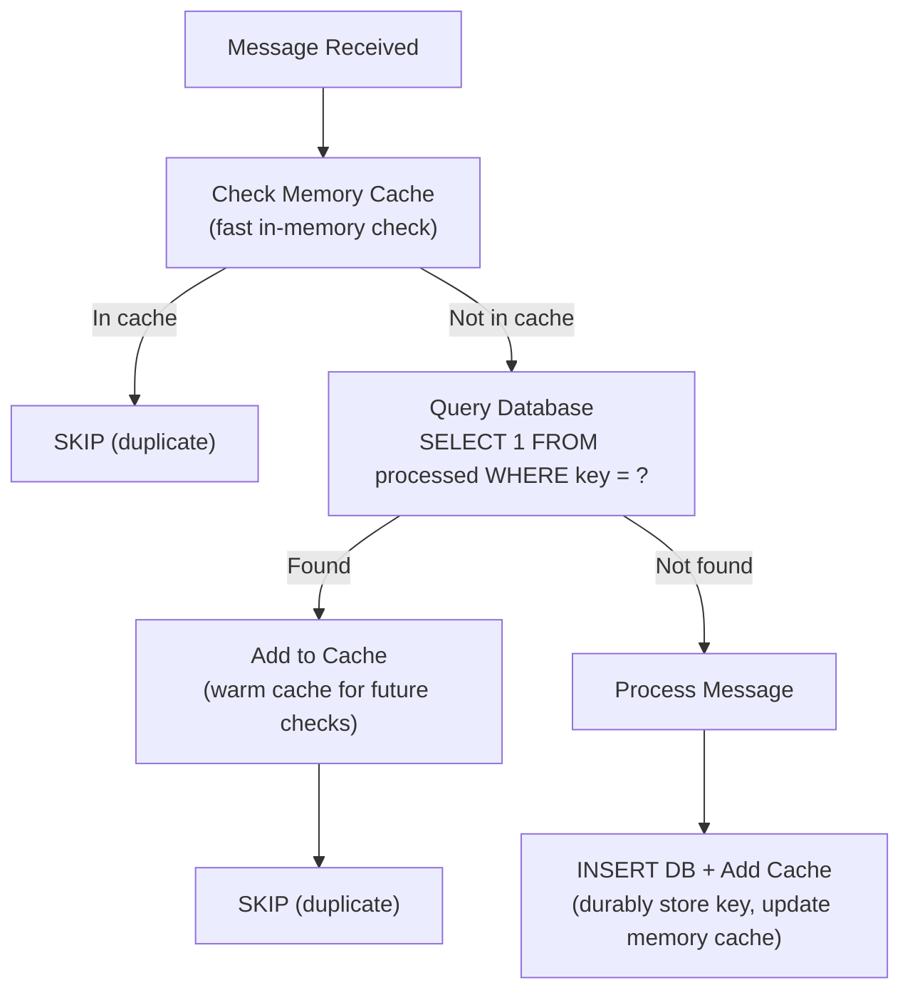

# Lesson 21.3: Persistent Deduplication

> **Difficulty:** Advanced | **Duration:** 45 min | **Prerequisites:** Lesson 21.2

## Overview

Learn how to implement durable deduplication stores that survive application restarts. This lesson covers database-backed stores, compacted topics for distributed state, and checkpointing strategies.

## Learning Objectives

- Implement database-backed deduplication stores
- Use Surgewave compacted topics for distributed deduplication
- Design efficient checkpointing for deduplication state
- Handle recovery scenarios after crashes
- Choose the right persistence strategy for your use case

## Persistence Options Comparison

| Strategy | Durability | Performance | Complexity | Scaling |
|----------|-----------|------------|-----------|---------|
| Database (SQL) | High | Medium | Low | Vertical |
| Key-Value Store | High | High | Low | Horizontal |
| Compacted Topic | High | Medium | Medium | Horizontal |
| Local File | Medium | High | Low | None |
| Hybrid (Cache+DB) | High | High | Medium | Horizontal |

## Database-Backed Deduplication

Table `processed_messages`:

| idempotency_key (PK) | processed_at | result_hash |
|----------------------|--------------|-------------|
| order:001:created | 2024-01-15 10:30:00 | a1b2c3d4 |
| order:002:created | 2024-01-15 10:30:05 | e5f6g7h8 |
| order:003:updated | 2024-01-15 10:30:10 | i9j0k1l2 |

Indexes: `PRIMARY KEY (idempotency_key)`, `INDEX idx_processed_at (processed_at)` (for TTL cleanup).

Cleanup query (run periodically):
```sql
DELETE FROM processed_messages
WHERE processed_at < NOW() - INTERVAL '7 days'
```

## Compacted Topic for Distributed Deduplication

Topic `_dedup-state` (compacted, `retention.bytes=-1`):

**Before Compaction:**

| Key | Value | Offset | Note |
|-----|-------|--------|------|
| order:001 | `{"ts": "10:00"}` | 0 | |
| order:002 | `{"ts": "10:01"}` | 1 | |
| order:001 | `{"ts": "10:05"}` | 2 | Newer value |
| order:003 | `{"ts": "10:06"}` | 3 | |
| order:001 | null | 4 | Tombstone |

**After Compaction** (`order:001` deleted — tombstone — and older versions removed):

| Key | Value | Offset |
|-----|-------|--------|
| order:002 | `{"ts": "10:01"}` | 1 |
| order:003 | `{"ts": "10:06"}` | 3 |

## Checkpointing Strategy

**Normal Processing:** Message 1 → Process → Mark in memory; Message 2 → Process → Mark in memory; … Message N → **CHECKPOINT** → Persist to durable store.

**Checkpoint File/Record:**
```json
{
  "checkpoint_id": "chk-2024-01-15-001",
  "topic": "orders",
  "partition": 0,
  "offset": 1000,
  "timestamp": "2024-01-15T10:30:00Z",
  "processed_keys": ["order:001", "order:002", "..."],
  "key_count": 500
}
```

**Recovery Process:**
1. Load latest checkpoint
2. Restore `processed_keys` to memory
3. Seek consumer to checkpoint offset
4. Resume processing (may re-process some messages)
5. Dedup handles any duplicates from re-processing

## Hybrid Architecture



## Best Practices

| Practice | Description |
|----------|-------------|
| Use transactions | Combine dedup write with business logic |
| Set TTL/retention | Prevent unbounded storage growth |
| Index appropriately | Ensure fast lookups (primary key) |
| Batch writes | Amortize I/O cost across multiple messages |
| Monitor latency | Track dedup check overhead |

## Exercise

In this exercise, you will:

1. Implement a file-based persistent deduplication store
2. Create a compacted topic for distributed deduplication
3. Build a checkpointing system for recovery
4. Implement a hybrid in-memory + persistent store
5. Test recovery after simulated crashes

---

**Instructions:** [INSTRUCTIONS.md](INSTRUCTIONS.md)
