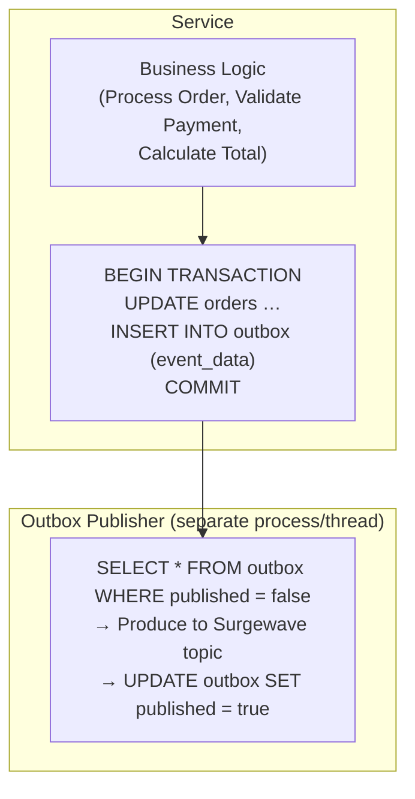
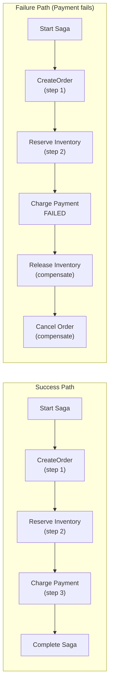
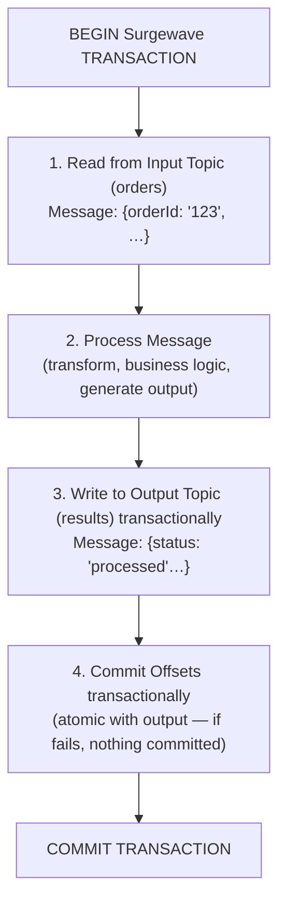
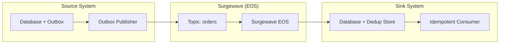

# Lesson 21.5: End-to-End Exactly-Once

> **Difficulty:** Advanced | **Duration:** 60 min | **Prerequisites:** Lesson 21.4

## Overview

Learn how to achieve end-to-end exactly-once processing by combining transactional patterns, the outbox pattern, and saga coordination. This lesson covers the most robust approaches to preventing duplicate processing in distributed systems.

## Learning Objectives

- Implement the transactional outbox pattern
- Coordinate distributed sagas with idempotency
- Use Surgewave transactions for exactly-once semantics
- Combine multiple deduplication strategies
- Handle failure scenarios gracefully

## Exactly-Once Semantics Overview

| Layer | Mechanism | Details |
|-------|-----------|---------|
| **Producer** | Idempotent Producer (`enable.idempotence=true`) | Producer ID + sequence number per partition; broker deduplicates based on sequence; handles network retries transparently |
| **Broker** | Transactional Writes | Atomic commit across multiple partitions; transaction markers for commit/abort; consumer isolation levels (`read_committed`) |
| **Consumer** | Idempotent Processing | Deduplication stores; idempotent operations; transactional offset commits |

End-to-End = all three layers working together.

## Transactional Outbox Pattern

**Outbox Table:**

| id | event_type | payload | published | ts |
|----|-----------|---------|-----------|-----|
| 1 | OrderCreated | `{"orderId": "123"…}` | false | … |
| 2 | PaymentReceived | `{"paymentId": "456"}` | false | … |

## Saga Pattern with Compensation

Order Saga: Create Order → Reserve Inventory → Charge Payment

**Saga State** (stored in database):

| saga_id | status | current_step | data | ts |
|---------|--------|-------------|------|----|
| saga-1 | in_progress | 3 | `{"orderId":…}` | … |
| saga-2 | compensating | 2 | `{"orderId":…}` | … |
| saga-3 | completed | 3 | `{"orderId":…}` | … |

## Read-Process-Write Pattern

**On Failure/Restart:** transaction aborted (nothing committed); consumer resumes from last committed offset; message is reprocessed (exactly-once effective processing).

## Combined Strategy

**Guarantees at each layer:**

| Layer | Guarantees |
|-------|-----------|
| **Source (Outbox)** | Business operation + event write in same DB transaction; publisher retries until delivered; marks published only after successful produce |
| **Surgewave (EOS)** | Idempotent producer prevents duplicate messages; transactions ensure atomic multi-partition writes; `read_committed` isolation for consumers |
| **Sink (Idempotent Consumer)** | Deduplication store tracks processed message IDs; idempotent database operations (upserts); transactional dedup + business operation |

## Best Practices

| Practice | Description |
|----------|-------------|
| Use outbox for external events | Never publish directly from business logic |
| Store saga state durably | Enable recovery after crashes |
| Combine dedup with transactions | Defense in depth |
| Set appropriate timeouts | Handle stuck transactions |
| Monitor transaction metrics | Track commit/abort rates |

## Exercise

In this exercise, you will:

1. Implement the transactional outbox pattern
2. Create a simple saga coordinator
3. Use Surgewave transactions for exactly-once
4. Combine all deduplication strategies
5. Test failure and recovery scenarios

---

**Instructions:** [INSTRUCTIONS.md](INSTRUCTIONS.md)
