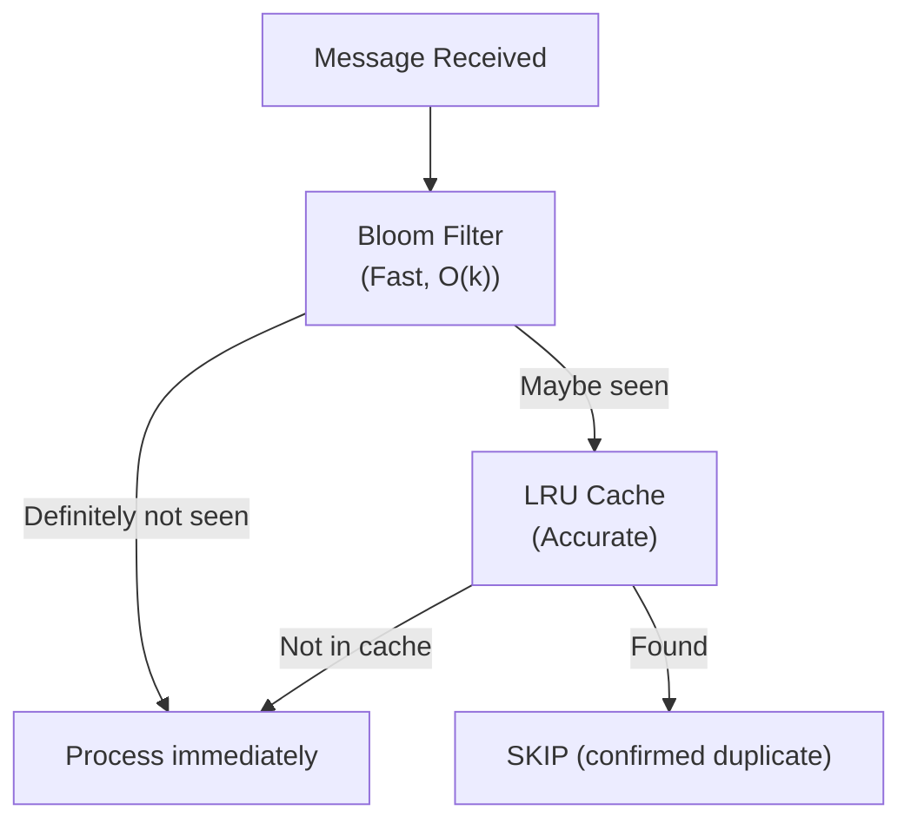

# Unit 21 Project: Idempotent Processor with Bloom Filter

Build a message processor that uses a Bloom filter for efficient deduplication.

## Scenario

You're building an order processing system that must handle message duplicates gracefully. Due to the at-least-once delivery semantics and potential retries, the same order might be received multiple times. You need to:

1. Detect and skip duplicate messages efficiently
2. Process each unique message exactly once
3. Use minimal memory even with millions of processed messages
4. Track deduplication statistics

Your solution will use a Bloom filter as a fast first-pass check, backed by an LRU cache for accurate duplicate detection.

## Requirements

### Functional Requirements

- [ ] Implement a simple Bloom filter for probabilistic duplicate detection
- [ ] Implement an LRU cache as a secondary accurate store
- [ ] Process incoming orders and detect duplicates
- [ ] Track statistics: processed, duplicates detected, false positives
- [ ] Generate idempotency keys from message content

### Technical Requirements

- [ ] Bloom filter with configurable expected items and false positive rate
- [ ] Use multiple hash functions (e.g., MurmurHash variants)
- [ ] LRU cache with configurable max size
- [ ] Thread-safe deduplication checks
- [ ] Memory-efficient bit array implementation

## How Bloom Filters Work

```
Insert "order-123":
  hash1("order-123") = 42    -> set bit 42
  hash2("order-123") = 137   -> set bit 137
  hash3("order-123") = 89    -> set bit 89

Check "order-123":
  All bits [42, 137, 89] are set -> MAYBE exists (check LRU)

Check "order-999":
  Bit 55 is NOT set -> DEFINITELY does not exist
```



## Expected Output

```
=== Idempotent Order Processor ===

[Setup] Bloom filter: 10000 expected items, 1% false positive rate
[Setup] LRU cache size: 1000 items
[Setup] Bit array size: 95851 bits (11982 bytes)

[Surgewave] Starting embedded broker...
[Surgewave] Created topic: orders

--- Producing test orders (with duplicates) ---
[Producer] Sent order-001 (first time)
[Producer] Sent order-002 (first time)
[Producer] Sent order-001 (duplicate!)
[Producer] Sent order-003 (first time)
[Producer] Sent order-002 (duplicate!)
[Producer] Sent order-004 (first time)

--- Processing orders ---
[Processor] Processing order-001: $99.95 for Alice
[Processor] Processing order-002: $149.50 for Bob
[Dedup] Skipping order-001 (duplicate detected by bloom filter + LRU)
[Processor] Processing order-003: $75.00 for Carol
[Dedup] Skipping order-002 (duplicate detected by bloom filter + LRU)
[Processor] Processing order-004: $200.00 for Dave

--- Statistics ---
Total messages received: 6
Unique messages processed: 4
Duplicates detected: 2
False positives: 0
Bloom filter utilization: 0.04%

=== Processor Complete ===
```

## Getting Started

```bash
cd bootcamp/unit-21/project/start
dotnet run
```

## Hints

1. Use `BitArray` for the Bloom filter's bit storage
2. Calculate optimal bit array size: `m = -n * ln(p) / (ln(2)^2)`
3. Calculate optimal hash count: `k = (m/n) * ln(2)`
4. Create multiple hash values from one hash using: `hash_i = hash1 + i * hash2`
5. For LRU cache, use `LinkedList<T>` + `Dictionary<K, LinkedListNode<T>>`

## Bloom Filter Formula Reference

```
n = expected number of items
p = desired false positive rate
m = number of bits = ceil(-n * ln(p) / (ln(2)^2))
k = number of hash functions = round((m/n) * ln(2))
```

Example with n=10000, p=0.01 (1%):
- m = 95851 bits (~12 KB)
- k = 7 hash functions

## Implementation Structure

```csharp
public class BloomFilter
{
    private readonly BitArray _bits;
    private readonly int _hashCount;

    public BloomFilter(int expectedItems, double falsePositiveRate)
    {
        // Calculate optimal size and hash count
    }

    public void Add(string item) { /* Set k bits */ }
    public bool MayContain(string item) { /* Check k bits */ }

    private int[] GetHashPositions(string item)
    {
        // Return k hash positions using double hashing
    }
}

public class LruCache<T>
{
    private readonly int _capacity;
    private readonly LinkedList<(string key, T value)> _list;
    private readonly Dictionary<string, LinkedListNode<(string, T)>> _map;

    public bool TryGet(string key, out T? value) { /* ... */ }
    public void Add(string key, T value) { /* Evict if full */ }
}
```

## Evaluation Criteria

| Criteria | Points |
|----------|--------|
| Bloom filter implemented correctly | 25 |
| LRU cache works properly | 20 |
| Deduplication pipeline functional | 25 |
| Idempotency keys generated correctly | 15 |
| Statistics tracking accurate | 15 |

## Solution

Compare your implementation with [completed/](completed/README.md) when done.
