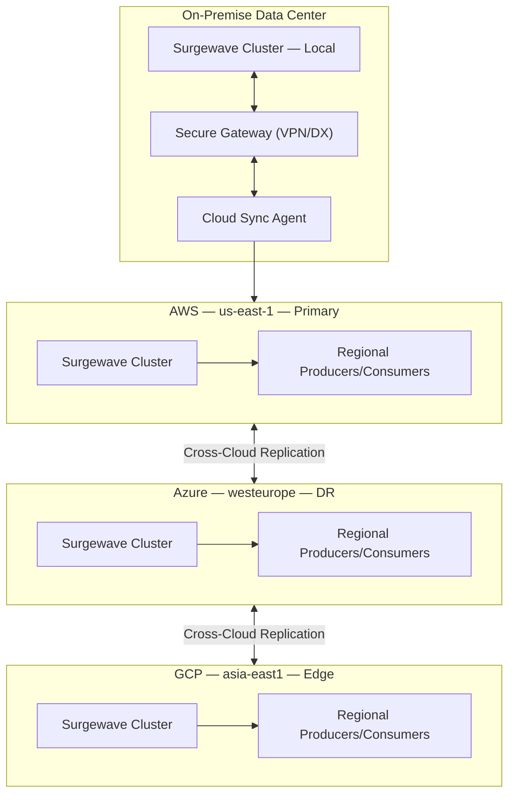

# Unit 32: Hybrid Cloud

Master hybrid and multi-cloud Surgewave deployments to build resilient, globally distributed event streaming systems that span multiple cloud providers and on-premise infrastructure.

## Learning Objectives

By the end of this unit, you will be able to:

- Understand hybrid cloud architecture patterns for event streaming
- Deploy Surgewave across multiple regions for high availability
- Implement cross-cloud replication between AWS, Azure, and GCP
- Configure geo-routing and latency-based optimization
- Design hybrid on-premise and cloud deployments with data sovereignty

## Lessons

| Lesson | Topic | Description |
|--------|-------|-------------|
| [27.1](lesson-1/README.md) | Hybrid Cloud Concepts | Architecture patterns, use cases, design considerations |
| [27.2](lesson-2/README.md) | Multi-Region Deployment | Deploying Surgewave across AWS regions, Azure regions |
| [27.3](lesson-3/README.md) | Cross-Cloud Replication | AWS to Azure to GCP replication strategies |
| [27.4](lesson-4/README.md) | Geo-Routing and Latency Optimization | Latency-based routing, locality awareness |
| [27.5](lesson-5/README.md) | Hybrid On-Premise and Cloud | Data sovereignty, edge computing, cloud bursting |

## Prerequisites

- Completed Unit 1: Surgewave Fundamentals
- Completed Unit 2: Producer & Consumer Basics
- Completed Unit 20: Disaster Recovery and Failover
- Basic understanding of cloud platforms (AWS, Azure, GCP)

## Why Hybrid Cloud Matters

| Benefit | Details |
|---------|---------|
| High Availability | Survive entire cloud provider outages, geographic redundancy across continents, no single point of failure |
| Optimal Latency | Route producers/consumers to nearest region, edge processing for IoT and real-time applications, minimize cross-region data transfer |
| Data Sovereignty | Keep sensitive data in required jurisdictions, comply with GDPR/CCPA and local regulations, hybrid on-premise for regulated industries |
| Cost Optimization | Use spot instances and reserved capacity strategically, avoid vendor lock-in, cloud bursting for peak loads |

## Hybrid Cloud Architecture Overview



## Replication Topologies

| Topology | Use Case | Complexity | Latency |
|----------|----------|------------|---------|
| Active-Passive | Disaster Recovery | Low | High (failover) |
| Active-Active | Global Distribution | High | Low |
| Hub-Spoke | Central aggregation | Medium | Medium |
| Mesh | Full redundancy | Very High | Lowest |

## Key Patterns

### Regional Producer Affinity

```csharp
// Producers connect to nearest Surgewave cluster
var cluster = await ClusterLocator.FindNearestAsync(
    new[] { "us-east-1", "eu-west-1", "ap-southeast-1" });

await using var producer = new SurgewaveProducer<string, string>(opt =>
{
    opt.BootstrapServers = cluster.BootstrapServers;
    opt.ClientId = $"producer-{Environment.MachineName}-{cluster.Region}";
});
```

### Cross-Region Replication

```csharp
// Configure replication to secondary regions
var replicator = new CrossRegionReplicator(new ReplicationConfig
{
    SourceCluster = "surgewave-us-east-1.example.com:9092",
    TargetClusters = new[]
    {
        "surgewave-eu-west-1.example.com:9092",
        "surgewave-ap-southeast-1.example.com:9092"
    },
    TopicPatterns = new[] { "orders-*", "events-*" },
    ReplicationMode = ReplicationMode.Async
});

await replicator.StartAsync();
```

### Geo-Aware Consumer Routing

```csharp
// Consumers read from local replicas when possible
await using var consumer = new SurgewaveConsumer<string, string>(opt =>
{
    opt.BootstrapServers = bootstrapServers;
    opt.GroupId = "order-processor";
    opt.ClientRack = "us-east-1a"; // Prefer local rack/region
    opt.FetchFromFollower = true;  // Read from nearest replica
});
```

## Best Practices

| Practice | Description |
|----------|-------------|
| Use async replication | Avoid cross-region latency in critical path |
| Implement conflict resolution | Handle concurrent writes in active-active |
| Monitor replication lag | Alert on excessive lag between regions |
| Test failover regularly | Validate DR procedures monthly |
| Encrypt cross-cloud traffic | Use TLS for all inter-region communication |
| Use consistent naming | Region-prefixed topics for clarity |

---

**Ready?** [Start Lesson 27.1: Hybrid Cloud Concepts](lesson-1/README.md)
