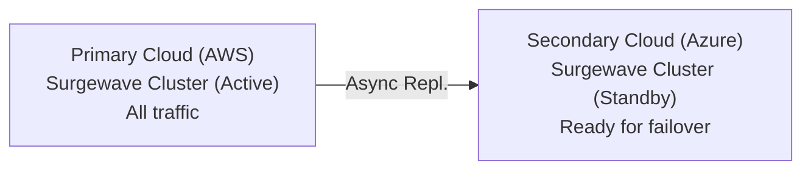
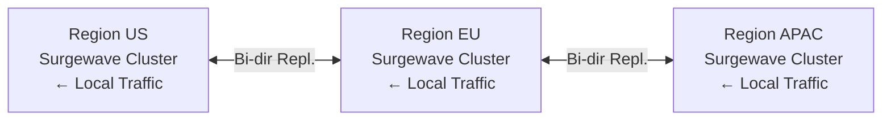
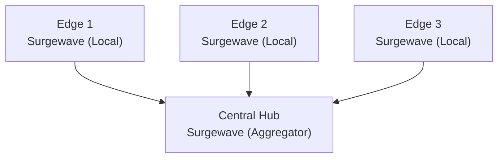

# Lesson 27.1: Hybrid Cloud Concepts

> **Difficulty:** Advanced | **Duration:** 45 min | **Prerequisites:** Unit 20 completion

## Overview

Learn the fundamental concepts of hybrid cloud architectures for event streaming, understand when and why to deploy Surgewave across multiple clouds and regions, and explore the key design patterns that make distributed deployments successful.

## Learning Objectives

- Understand the motivations for hybrid cloud deployments
- Learn key architecture patterns for multi-cloud event streaming
- Explore trade-offs between consistency, availability, and partition tolerance
- Design topic structures for global distribution
- Implement a basic multi-cluster simulation

## Why Hybrid Cloud?

Organizations adopt hybrid cloud strategies for several critical reasons:

| Motivation | Description |
|------------|-------------|
| **Resilience** | Survive entire cloud provider outages |
| **Latency** | Serve users from geographically close regions |
| **Compliance** | Meet data residency requirements (GDPR, CCPA) |
| **Cost** | Optimize spending across providers |
| **Flexibility** | Avoid vendor lock-in |
| **Edge Computing** | Process data close to IoT devices |

## Architecture Patterns

**Pattern 1: Active-Passive (Disaster Recovery)**



Simple to implement; clear ownership model; higher RTO (Recovery Time Objective).

**Pattern 2: Active-Active (Global Distribution)**



Low latency globally; complex conflict resolution; requires careful topic design.

**Pattern 3: Hub-and-Spoke (Aggregation)**



Simple topology; central analytics and ML; hub is single point of failure.

## CAP Theorem Considerations

In distributed systems, you can only guarantee two of three properties:

```
                    Consistency
                        /\
                       /  \
                      /    \
                     /      \
                    /   CP   \
                   /          \
                  /            \
                 +--------------+
                 |              |
        CA      |    Trade     |     AP
    (Single     |    Zone      |  (Multi-Region
     Region)    |              |   Availability)
                +--------------+
               /                \
              /                  \
             /                    \
        Availability -------- Partition Tolerance
```

| Choice | Surgewave Configuration | Use Case |
|--------|---------------------|----------|
| **CP** | Sync replication, wait for acks | Financial transactions |
| **AP** | Async replication, accept eventual consistency | User activity tracking |
| **CA** | Single region, no partitions | Development/testing |

## Topic Design for Hybrid Cloud

| Scope | Topic Names | Description |
|-------|------------|-------------|
| **Global** (replicated everywhere) | `global.users.events`, `global.config.updates`, `global.catalog.products` | User profile changes, configuration changes, product catalog |
| **Regional** (local to region) | `us-east.orders.created`, `eu-west.orders.created`, `ap-south.orders.created` | Region-specific orders (US East, EU West, Asia Pacific) |
| **Aggregate** (collected at hub) | `agg.orders.all`, `agg.metrics.combined` | All orders from all regions, combined metrics |

## Cluster Configuration Model

```csharp
// Model for multi-cluster configuration
public record ClusterConfig
{
    public string ClusterId { get; init; } = "";
    public string Region { get; init; } = "";
    public string CloudProvider { get; init; } = "";
    public string BootstrapServers { get; init; } = "";
    public ClusterRole Role { get; init; } = ClusterRole.Primary;
    public string[] ReplicateToRegions { get; init; } = [];
}

public enum ClusterRole
{
    Primary,    // Handles reads and writes
    Secondary,  // Read-only replica
    Edge,       // Local processing only
    Aggregator  // Collects from multiple sources
}
```

## Best Practices

| Practice | Description |
|----------|-------------|
| Define clear ownership | Each topic should have a single write region |
| Use region prefixes | Make data locality explicit in topic names |
| Plan for partition | Design for network splits between regions |
| Monitor replication lag | Track how far behind replicas are |
| Automate failover | Use health checks and automatic promotion |
| Test regularly | Run chaos engineering exercises |

## Exercise

In this exercise, you will:

1. Model a multi-cluster hybrid cloud configuration
2. Simulate multiple Surgewave clusters (using different ports)
3. Implement regional topic routing
4. Track cross-cluster message flow
5. Demonstrate producer affinity to nearest cluster

---

**Instructions:** [INSTRUCTIONS.md](INSTRUCTIONS.md)
