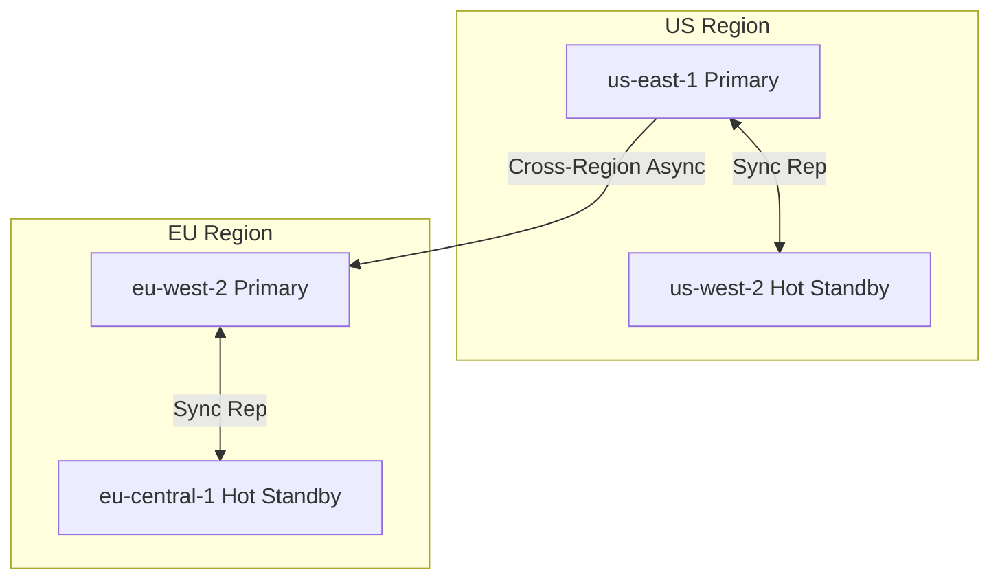

# Knowledge Assessment: Lesson 27.2 - Multi-Region Deployment

## Multiple Choice

### 1. Which failover pattern provides the lowest RTO (Recovery Time Objective)?
- [ ] A) Cold Standby
- [ ] B) Warm Standby
- [ ] C) Hot Standby
- [ ] D) Active-Active

<details>
<summary>Answer</summary>
**D)** Active-Active provides zero RTO because both regions are actively handling traffic. When one fails, the other continues without interruption. Hot Standby is second-best with seconds of RTO.
</details>

### 2. What is the primary advantage of using VPC Peering for cross-region connectivity?
- [ ] A) Lower cost than public internet
- [ ] B) Private connectivity and lower latency
- [ ] C) Simpler setup
- [ ] D) Automatic failover

<details>
<summary>Answer</summary>
**B)** VPC Peering provides private connectivity (traffic never traverses the public internet) and typically lower latency than public internet routes. It's also more secure since data stays within the cloud provider's network.
</details>

### 3. In a latency-based routing strategy, how does the client select a region?
- [ ] A) Random selection
- [ ] B) Based on IP geolocation
- [ ] C) Measures RTT and connects to lowest latency
- [ ] D) Always connects to primary region

<details>
<summary>Answer</summary>
**C)** Latency-based routing measures Round-Trip Time (RTT) to each region and connects to the region with the lowest latency. This ensures the best user experience regardless of geographic location.
</details>

### 4. What does RPO (Recovery Point Objective) measure?
- [ ] A) How long it takes to recover from a failure
- [ ] B) How much data can be lost during a failure
- [ ] C) The number of regions in the deployment
- [ ] D) The cost of the failover infrastructure

<details>
<summary>Answer</summary>
**B)** RPO measures the maximum amount of data that can be lost during a failure, expressed as a time window. For example, an RPO of 5 minutes means you could lose up to 5 minutes of data. Zero RPO means no data loss is acceptable.
</details>

### 5. Why should cross-region replication be asynchronous?
- [ ] A) It's simpler to implement
- [ ] B) To avoid adding cross-region latency to the critical path
- [ ] C) It uses less bandwidth
- [ ] D) It's more secure

<details>
<summary>Answer</summary>
**B)** Synchronous replication would require waiting for acknowledgment from remote regions before confirming a write, adding significant latency (often 50-200ms) to every operation. Async replication allows the primary to acknowledge immediately while replication happens in the background.
</details>

## True/False

### 6. Pre-provisioning capacity in secondary regions is unnecessary if you use auto-scaling.
- [ ] True
- [ ] False

<details>
<summary>Answer</summary>
**False** - Auto-scaling takes time to provision new resources (often minutes). During a failover, you need the secondary region to handle 100% of traffic immediately. Pre-provisioning ensures capacity is available when needed.
</details>

### 7. Circuit breakers help prevent cascade failures by failing fast when a region is unhealthy.
- [ ] True
- [ ] False

<details>
<summary>Answer</summary>
**True** - Circuit breakers detect failures quickly and stop sending requests to unhealthy regions. This prevents timeouts from slowing down the entire system and allows faster failover to healthy regions.
</details>

## Code Challenge

### 8. What's the issue with this failover implementation?

```csharp
public class ConnectionManager
{
    private string _currentRegion = "us-east-1";
    private readonly Dictionary<string, string> _endpoints;

    public string GetEndpoint()
    {
        return _endpoints[_currentRegion];
    }

    public void Failover()
    {
        _currentRegion = "us-west-2";
    }
}
```

<details>
<summary>Answer</summary>
Multiple issues:

1. **No health checking** - Doesn't verify if regions are healthy before connecting
2. **Hardcoded failover** - Only fails over to one specific region
3. **No automatic detection** - Requires manual failover trigger
4. **No recovery** - Cannot fail back to primary when it recovers
5. **Not thread-safe** - `_currentRegion` could have race conditions

Better implementation:

```csharp
public class ConnectionManager
{
    private readonly Dictionary<string, string> _endpoints;
    private readonly RegionHealthMonitor _healthMonitor;
    private string _currentRegion;
    private readonly object _lock = new();

    public ConnectionManager(
        Dictionary<string, string> endpoints,
        RegionHealthMonitor healthMonitor,
        string primaryRegion)
    {
        _endpoints = endpoints;
        _healthMonitor = healthMonitor;
        _currentRegion = primaryRegion;
    }

    public string GetEndpoint()
    {
        lock (_lock)
        {
            // Check if current region is still healthy
            if (_healthMonitor.GetHealth(_currentRegion) != RegionHealth.Healthy)
            {
                // Find another healthy region
                var healthy = _endpoints.Keys
                    .FirstOrDefault(r => _healthMonitor.GetHealth(r) == RegionHealth.Healthy);

                if (healthy != null)
                {
                    Console.WriteLine($"Failing over from {_currentRegion} to {healthy}");
                    _currentRegion = healthy;
                }
                else
                {
                    throw new InvalidOperationException("No healthy regions!");
                }
            }

            return _endpoints[_currentRegion];
        }
    }
}
```
</details>

## Scenario Challenge

### 9. Design a multi-region deployment for a financial trading platform with these requirements:
- Zero data loss acceptable (RPO = 0)
- Maximum 5 seconds downtime acceptable (RTO < 5s)
- Users in New York and London
- Regulatory requirement: US trades must be processed in US

What regions and failover pattern would you recommend?

<details>
<summary>Answer</summary>
**Recommended Architecture:**

**Regions:**
1. `us-east-1` (Virginia) - Primary for US trades
2. `us-west-2` (Oregon) - Hot standby for US
3. `eu-west-2` (London) - Primary for EU trades
4. `eu-central-1` (Frankfurt) - Hot standby for EU

**Pattern: Hot Standby with Synchronous Replication**



**Why this works:**
- **RPO = 0**: Synchronous replication within each geographic area ensures no data loss
- **RTO < 5s**: Hot standby can take over in seconds (already running, data synchronized)
- **Regulatory compliance**: US trades stay in US regions, EU trades in EU regions
- **Low latency**: Users connect to their regional primary (NY to us-east-1, London to eu-west-2)

**Trade-offs:**
- Higher cost (4 regions, all running)
- Sync replication adds ~1-2ms latency within region
- Cross-region is async to avoid 100ms+ latency impact
</details>

## Score
- 9/9: Excellent!
- 7-8/9: Good understanding
- 5-6/9: Review the lesson
- <5/9: Re-do the lesson
