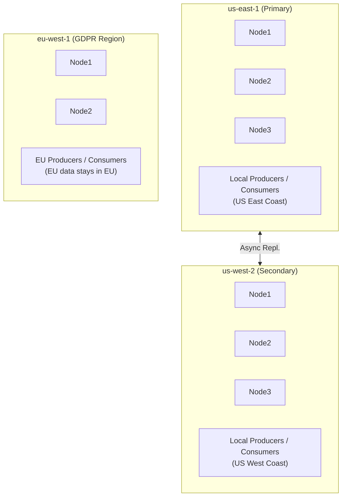

# Lesson 27.2: Multi-Region Deployment

> **Difficulty:** Advanced | **Duration:** 50 min | **Prerequisites:** Lesson 27.1 completion

## Overview

Learn how to deploy Surgewave across multiple regions within a single cloud provider (AWS, Azure, or GCP) to achieve high availability, low latency, and disaster recovery capabilities.

## Learning Objectives

- Deploy Surgewave clusters across multiple regions
- Configure region-aware producers and consumers
- Implement health monitoring and automatic failover
- Design partition-tolerant topic strategies
- Measure and optimize cross-region latency

## Multi-Region Architecture



## Region Selection Strategies

| Strategy | How It Works | Best For |
|----------|-------------|---------|
| **Latency-Based** (Default) | Client measures RTT to each region; connects to lowest-latency; periodic re-evaluation | General workloads, user-facing applications |
| **Geolocation-Based** | Route based on client IP geolocation; DNS-based (Route 53, Traffic Manager); static Country→Region mapping | Compliance requirements, predictable routing |
| **Weighted** | Distribute traffic by weight (e.g. 70% primary / 30% secondary); gradual shifting during migrations; A/B testing | Migrations, capacity management |
| **Failover** | Primary handles all traffic; automatic switch to secondary on failure; health check triggered | Cost optimization, disaster recovery |

## Health Monitoring

```csharp
// Region health check configuration
public record RegionHealthConfig
{
    public string Region { get; init; } = "";
    public string HealthEndpoint { get; init; } = "";
    public TimeSpan CheckInterval { get; init; } = TimeSpan.FromSeconds(10);
    public int FailureThreshold { get; init; } = 3;  // Failures before unhealthy
    public int SuccessThreshold { get; init; } = 2;  // Successes to recover
}

public enum RegionHealth
{
    Healthy,
    Degraded,
    Unhealthy,
    Unknown
}
```

## Failover Patterns

| Pattern | RTO | RPO | Complexity | Cost |
|---------|-----|-----|------------|------|
| **Cold Standby** | Hours | Minutes-Hours | Low | Low |
| **Warm Standby** | Minutes | Seconds-Minutes | Medium | Medium |
| **Hot Standby** | Seconds | Near-zero | High | High |
| **Active-Active** | Zero | Zero | Very High | Highest |

```
RTO = Recovery Time Objective (how long to recover)
RPO = Recovery Point Objective (how much data can be lost)
```

## Cross-Region Networking

| Option | Pros | Cons |
|--------|------|------|
| **Public Internet (Encrypted)** | Simple setup; no additional infrastructure | Variable latency; higher security risk (TLS required) |
| **VPC Peering** | Private connectivity; lower latency; no bandwidth charges (same cloud) | Complex routing tables |
| **Transit Gateway / Virtual WAN** | Hub-and-spoke network model; centralized management; simplified routing | Additional cost |
| **Dedicated Interconnect** | Lowest latency; predictable performance; highest security | Highest cost |

## Best Practices

| Practice | Description |
|----------|-------------|
| Use async replication | Avoid adding cross-region latency to critical path |
| Implement circuit breakers | Fail fast when region is unhealthy |
| Monitor replication lag | Alert when lag exceeds threshold |
| Test failover monthly | Validate DR procedures regularly |
| Use region-local consumers | Read from local replicas when possible |
| Pre-provision capacity | Ensure secondary can handle full load |

## Exercise

In this exercise, you will:

1. Deploy Surgewave clusters simulating multiple AWS regions
2. Implement health monitoring for each region
3. Create a region-aware connection manager
4. Simulate region failure and automatic failover
5. Measure and compare cross-region latency

---

**Instructions:** [INSTRUCTIONS.md](INSTRUCTIONS.md)
