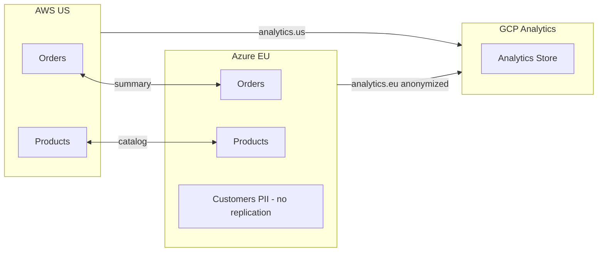

# Knowledge Assessment: Lesson 27.3 - Cross-Cloud Replication

## Multiple Choice

### 1. Which replication mode is simplest to implement because it avoids conflicts entirely?
- [ ] A) Bidirectional
- [ ] B) Unidirectional
- [ ] C) Mesh
- [ ] D) Peer-to-peer

<details>
<summary>Answer</summary>
**B)** Unidirectional replication (Source -> Target) is simplest because only one cluster accepts writes. There's no possibility of conflicting writes, so no conflict resolution is needed.
</details>

### 2. In Last-Write-Wins (LWW) conflict resolution, what determines the winner?
- [ ] A) The message with the highest offset
- [ ] B) The message from the primary cluster
- [ ] C) The message with the latest timestamp
- [ ] D) The message with the smallest payload

<details>
<summary>Answer</summary>
**C)** Last-Write-Wins uses timestamps to determine the winner. The message with the latest timestamp is kept, and older versions are discarded. This requires synchronized clocks across clusters.
</details>

### 3. What is the main disadvantage of using public internet for cross-cloud replication?
- [ ] A) It's too expensive
- [ ] B) Variable latency and security concerns
- [ ] C) It doesn't support TLS
- [ ] D) It's too fast

<details>
<summary>Answer</summary>
**B)** Public internet has variable latency (can spike unpredictably) and higher security risks since traffic traverses untrusted networks. VPN or dedicated interconnects provide more consistent performance and better security.
</details>

### 4. Which conflict resolution strategy is best for counters and aggregations?
- [ ] A) Last-Write-Wins
- [ ] B) Source-Wins
- [ ] C) Merge/CRDT
- [ ] D) Manual resolution

<details>
<summary>Answer</summary>
**C)** Merge/CRDT (Conflict-free Replicated Data Types) is ideal for counters because it can combine changes from multiple sources without losing data. For a counter, you add all deltas together rather than choosing one value.
</details>

### 5. What does replication lag measure?
- [ ] A) Network latency between clusters
- [ ] B) How far behind the target is compared to the source
- [ ] C) The time to resolve conflicts
- [ ] D) CPU usage of the replicator

<details>
<summary>Answer</summary>
**B)** Replication lag measures how far behind the target cluster is compared to the source, typically expressed as the difference in offsets or the time delay. High lag means the target has stale data.
</details>

## True/False

### 6. Synchronous cross-cloud replication is recommended for production workloads.
- [ ] True
- [ ] False

<details>
<summary>Answer</summary>
**False** - Synchronous replication across clouds would add 50-200ms latency to every write operation (the cross-cloud network round-trip). This is typically unacceptable for production workloads. Asynchronous replication is recommended.
</details>

### 7. Topic partitioning by region can eliminate the need for conflict resolution.
- [ ] True
- [ ] False

<details>
<summary>Answer</summary>
**True** - If you partition data so that each cloud "owns" specific data (e.g., AWS owns all US orders, Azure owns all EU orders), there can be no conflicts because each cluster only writes to its own partitions.
</details>

## Code Challenge

### 8. What's wrong with this replication filter implementation?

```csharp
public class TopicFilter
{
    private readonly string[] _includePatterns;

    public bool ShouldReplicate(string topic)
    {
        foreach (var pattern in _includePatterns)
        {
            if (topic.Contains(pattern))
                return true;
        }
        return false;
    }
}

var filter = new TopicFilter(new[] { "orders" });
filter.ShouldReplicate("orders.created");     // true - correct
filter.ShouldReplicate("reorders.batch");     // true - WRONG!
filter.ShouldReplicate("my-orders-backup");   // true - WRONG!
```

<details>
<summary>Answer</summary>
The filter uses `Contains()` which matches substrings anywhere in the topic name, leading to false positives. "reorders.batch" matches because it contains "orders".

Better implementation using proper pattern matching:

```csharp
public class TopicFilter
{
    private readonly string[] _includePatterns;
    private readonly string[] _excludePatterns;

    public TopicFilter(string[] includePatterns, string[] excludePatterns = null)
    {
        _includePatterns = includePatterns;
        _excludePatterns = excludePatterns ?? Array.Empty<string>();
    }

    public bool ShouldReplicate(string topic)
    {
        // Check exclusions first
        foreach (var pattern in _excludePatterns)
        {
            if (MatchesPattern(topic, pattern))
                return false;
        }

        // Check inclusions
        foreach (var pattern in _includePatterns)
        {
            if (MatchesPattern(topic, pattern))
                return true;
        }

        return false;
    }

    private bool MatchesPattern(string topic, string pattern)
    {
        // Handle wildcard patterns
        if (pattern.EndsWith(".*"))
        {
            var prefix = pattern[..^2];
            return topic.StartsWith(prefix + ".");
        }

        if (pattern.EndsWith("*"))
        {
            return topic.StartsWith(pattern[..^1]);
        }

        // Exact match
        return topic == pattern;
    }
}

// Now:
var filter = new TopicFilter(new[] { "orders.*" });
filter.ShouldReplicate("orders.created");     // true - correct
filter.ShouldReplicate("reorders.batch");     // false - correct
filter.ShouldReplicate("orders");             // false - correct (need exact or wildcard)
filter.ShouldReplicate("orders.us.created");  // true - correct
```
</details>

## Scenario Challenge

### 9. Design a cross-cloud replication strategy for an e-commerce company with:
- AWS as primary (US operations)
- Azure as secondary (EU operations, GDPR)
- GCP for analytics and ML
- Requirement: EU customer PII must never leave Azure

How would you configure replication?

<details>
<summary>Answer</summary>
**Recommended Strategy: Selective Bidirectional + One-way Analytics Feed**

```
Topic Ownership:
- AWS owns: us.orders.*, us.inventory.*, global.products.*
- Azure owns: eu.orders.*, eu.customers.* (PII), eu.inventory.*
- GCP receives: *.analytics.*, aggregated data only

Replication Configuration:

1. AWS <-> Azure (Bidirectional, filtered)
   Include: global.*, *.orders.summary, *.inventory.*
   Exclude: *.customers.*, *.pii.*, eu.orders.details

2. AWS -> GCP (Unidirectional)
   Include: us.analytics.*, global.products.*
   Transform: topic -> "aws." + topic

3. Azure -> GCP (Unidirectional)
   Include: eu.analytics.* (anonymized only)
   Exclude: eu.customers.*, eu.*.pii
   Transform: topic -> "azure." + topic

Topic Design:
- eu.customers.profiles     -> Azure only (PII, never replicated)
- eu.orders.details        -> Azure only (contains customer refs)
- eu.orders.summary        -> Replicated (anonymized)
- eu.analytics.purchases   -> Replicated to GCP (aggregated, no PII)
- global.products.catalog  -> Replicated everywhere
```

**Data Flow Diagram:**



**Key Design Decisions:**
1. Customer PII stays in Azure (GDPR compliance)
2. Order summaries (without PII) are replicated for global visibility
3. GCP receives only anonymized analytics data
4. Products catalog is global (replicated everywhere)
</details>

## Score
- 9/9: Excellent!
- 7-8/9: Good understanding
- 5-6/9: Review the lesson
- <5/9: Re-do the lesson
