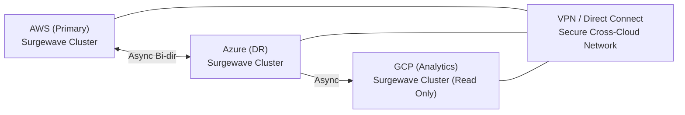

# Lesson 27.3: Cross-Cloud Replication

> **Difficulty:** Advanced | **Duration:** 55 min | **Prerequisites:** Lesson 27.2 completion

## Overview

Learn how to replicate data between Surgewave clusters running on different cloud providers (AWS, Azure, GCP) to achieve true multi-cloud resilience and avoid vendor lock-in.

## Learning Objectives

- Implement cross-cloud replication strategies
- Handle network connectivity between cloud providers
- Design conflict resolution for bidirectional replication
- Monitor replication lag across cloud boundaries
- Implement topic filtering and transformation during replication

## Cross-Cloud Architecture



## Replication Modes

| Mode | Direction | Characteristics | Best For |
|------|-----------|----------------|---------|
| **Unidirectional** (Source → Target) | AWS Writes → Azure Reads | Simple conflict handling (none!); clear data ownership | DR, read replicas, analytics |
| **Bidirectional** (Active-Active) | AWS R/W ↔ Azure R/W | Complex — requires conflict resolution; both clusters accept writes | Global distribution, low latency |
| **Hub-and-Spoke** (Aggregation) | AWS Edge + GCP Edge + Azure Edge → Central Hub | Central aggregation point; edges are write-only to hub | IoT, metrics collection, centralized analytics |

## Conflict Resolution Strategies

| Strategy | How It Works | Pros | Cons |
|----------|-------------|------|------|
| **Last-Write-Wins (LWW)** | AWS updates order-123 at T1; Azure at T2 (T2 > T1) → Azure's version wins | Simple, deterministic | May lose data silently |
| **Source-Wins** | AWS designated as source of truth; AWS version always wins on conflict | Clear ownership, simple | Azure writes may be overwritten |
| **Merge/CRDT** | Both versions merged using CRDT rules (e.g. `Counter += AWS_delta + Azure_delta`) | No data loss | Complex, not suitable for all data types |
| **Topic Partitioning** | AWS owns `orders` where `region = "us-*"`; Azure owns `region = "eu-*"` — no overlap | No conflicts possible | Requires careful data model design |

## Topic Filtering and Transformation

```csharp
// Replication configuration with filters
public record ReplicationConfig
{
    public string SourceCluster { get; init; } = "";
    public string TargetCluster { get; init; } = "";
    public string[] IncludeTopics { get; init; } = Array.Empty<string>();
    public string[] ExcludeTopics { get; init; } = Array.Empty<string>();
    public Func<string, string>? TopicRename { get; init; }
    public Func<string, string, bool>? MessageFilter { get; init; }
}

// Example: Replicate only "orders" topics, rename with prefix
var config = new ReplicationConfig
{
    SourceCluster = "aws-cluster:9092",
    TargetCluster = "azure-cluster:9092",
    IncludeTopics = new[] { "orders.*", "events.*" },
    ExcludeTopics = new[] { "*.internal", "*.debug" },
    TopicRename = topic => $"replicated.{topic}",
    MessageFilter = (topic, value) => !value.Contains("\"sensitive\":true")
};
```

## Best Practices

| Practice | Description |
|----------|-------------|
| Use async replication | Cross-cloud latency (50-200ms) makes sync impractical |
| Implement idempotency | Messages may be replicated multiple times |
| Monitor replication lag | Alert when lag exceeds acceptable threshold |
| Test cloud failure | Simulate entire cloud outage regularly |
| Encrypt all traffic | Use TLS for cross-cloud connections |
| Use VPN/Direct Connect | Avoid public internet when possible |

## Exercise

In this exercise, you will:

1. Set up Surgewave clusters simulating AWS, Azure, and GCP
2. Implement a cross-cloud replicator
3. Handle bidirectional replication with conflict detection
4. Apply topic filtering during replication
5. Monitor and report replication lag

---

**Instructions:** [INSTRUCTIONS.md](INSTRUCTIONS.md)
