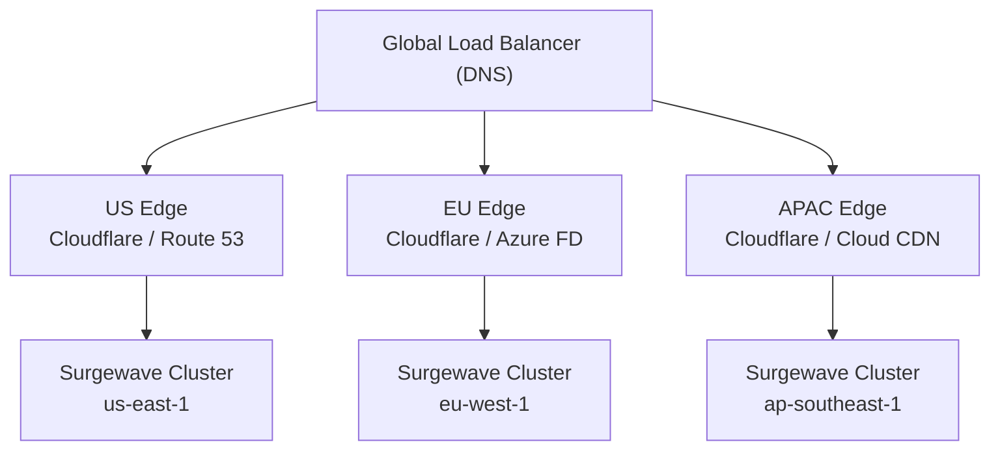

# Lesson 27.4: Geo-Routing and Latency Optimization

> **Difficulty:** Advanced | **Duration:** 50 min | **Prerequisites:** Lesson 27.3 completion

## Overview

Learn how to implement intelligent geo-routing to direct clients to the nearest Surgewave cluster, optimize latency through locality-aware configurations, and implement follower fetching for read optimization.

## Learning Objectives

- Implement latency-based and geo-aware routing
- Configure rack awareness for locality optimization
- Enable follower fetching for read replicas
- Measure and optimize end-to-end latency
- Design latency-optimized topic partitioning

## Geo-Routing Architecture



## Routing Strategies

| Strategy | How It Works | Notes |
|----------|-------------|-------|
| **Latency-Based Routing** | Client measures RTT to each region periodically; routes to lowest-latency; adapts dynamically. Probe every 30s using exponential moving average; failover when latency exceeds threshold. | Dynamic, accurate |
| **Geolocation-Based Routing** | Route based on client IP geolocation; static Country/Region → Surgewave Cluster mapping via GeoDNS or Load Balancer. Examples: US/CA/MX → us-east-1; UK/DE/FR → eu-west-1; JP/AU/SG → ap-southeast-1. | Predictable, compliance-friendly |
| **Anycast Routing** | Same IP announced from multiple regions; BGP routes to nearest announcement; zero client-side logic. Pros: simplest for clients. Cons: less control, requires BGP infrastructure. | Transparent to clients |

## Rack Awareness

Availability Zone Layout (AWS example):

| AZ | Broker | Role |
|----|--------|------|
| us-east-1a | Broker 1 | Leader |
| us-east-1b | Broker 2 | Follower |
| us-east-1c | Broker 3 | Follower |

Consumer configured with `client.rack = "us-east-1a"` reads from the local broker (same AZ).

Benefits: reduced cross-AZ data transfer costs; lower latency (same datacenter); better fault isolation.

## Follower Fetching

```csharp
// Enable reading from follower replicas
await using var consumer = new SurgewaveConsumer<string, string>(opt =>
{
    opt.BootstrapServers = bootstrapServers;
    opt.GroupId = "geo-aware-consumer";

    // Rack awareness - prefer same availability zone
    opt.ClientRack = "us-east-1a";

    // Allow fetching from followers (not just leader)
    opt.FetchFromFollower = true;

    // Replica selector - nearest replica
    opt.ReplicaSelector = ReplicaSelector.RackAware;
});
```

## Latency Optimization Techniques

| Technique | Description |
|-----------|-------------|
| **Connection Pooling** | Reuse TCP connections to avoid handshake overhead; keep-alive to prevent timeouts; configurable pool size per broker |
| **Batching** | Batch multiple messages into a single network request; trade latency for throughput (configurable); linger time controls batch wait |
| **Compression** | Compress messages to reduce network transfer time; LZ4 for speed, ZSTD for ratio; beneficial when network is the bottleneck |
| **Prefetching** | Fetch messages ahead of consumption; configurable fetch size and wait time; reduces consumer-side latency |

## Latency Measurement

```csharp
// Measure end-to-end latency
public class LatencyTracker
{
    private readonly List<long> _samples = new();

    public void RecordLatency(long latencyMs)
    {
        lock (_samples)
        {
            _samples.Add(latencyMs);
        }
    }

    public LatencyStats GetStats()
    {
        lock (_samples)
        {
            if (_samples.Count == 0)
                return new LatencyStats(0, 0, 0, 0, 0);

            var sorted = _samples.OrderBy(x => x).ToList();
            return new LatencyStats(
                Min: sorted.First(),
                Max: sorted.Last(),
                Avg: (long)sorted.Average(),
                P50: sorted[sorted.Count / 2],
                P99: sorted[(int)(sorted.Count * 0.99)]
            );
        }
    }
}

public record LatencyStats(long Min, long Max, long Avg, long P50, long P99);
```

## Best Practices

| Practice | Description |
|----------|-------------|
| Use GeoDNS | Route clients to nearest region automatically |
| Enable rack awareness | Prefer same-AZ reads to reduce costs |
| Monitor P99 latency | Average hides tail latency issues |
| Tune batch settings | Balance throughput vs latency |
| Pre-warm connections | Avoid cold-start latency |
| Use regional endpoints | Don't route all traffic through one region |

## Exercise

In this exercise, you will:

1. Implement latency-based cluster selection
2. Configure rack awareness for consumers
3. Measure latency distribution (P50, P99)
4. Compare performance with/without locality optimization
5. Build a geo-aware producer/consumer setup

---

**Instructions:** [INSTRUCTIONS.md](INSTRUCTIONS.md)
