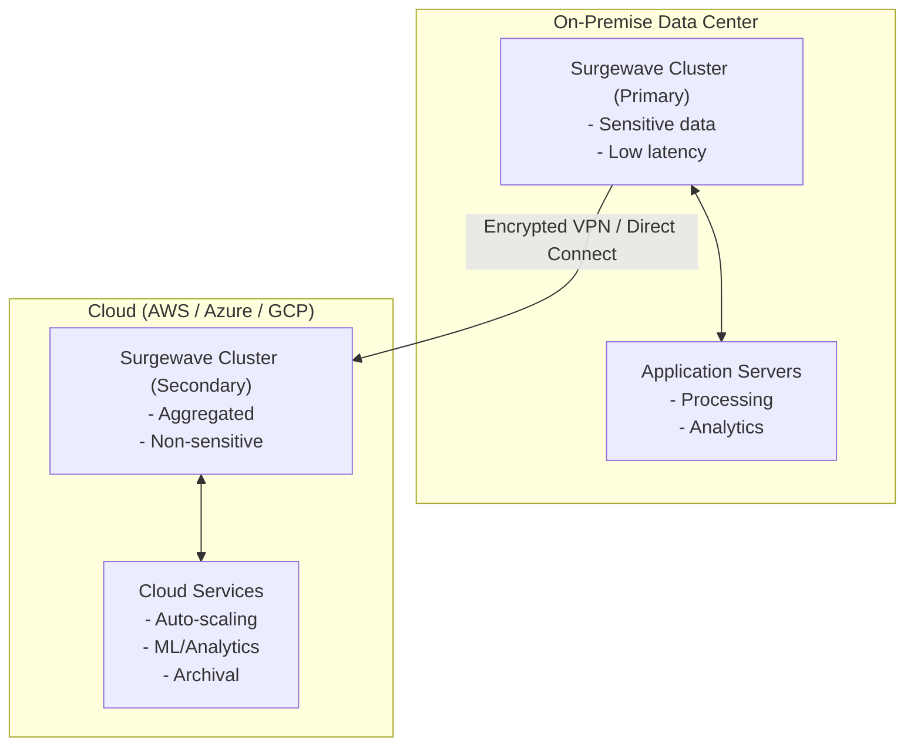
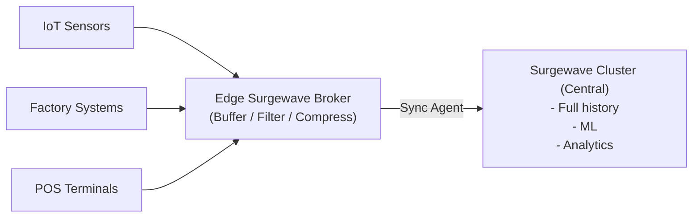

# Lesson 27.5: Hybrid On-Premise and Cloud

> **Difficulty:** Advanced | **Duration:** 45 min | **Prerequisites:** Lesson 27.4

## Overview

Learn to design and implement hybrid deployments that span on-premise data centers and cloud infrastructure. Understand data sovereignty requirements, edge-to-cloud patterns, VPN tunneling for secure connectivity, and cloud bursting strategies for handling peak loads.

## Learning Objectives

- Design hybrid on-premise + cloud Surgewave architectures
- Implement data sovereignty and compliance controls
- Configure secure connectivity (VPN, Direct Connect, ExpressRoute)
- Build edge-to-cloud data pipelines
- Implement cloud bursting for elastic scaling

## Hybrid Architecture

## Data Sovereignty

| Regulation | Key Requirements |
|-----------|----------------|
| **GDPR** (EU) | Personal data must stay within EU/EEA; transfers require adequacy decisions or SCCs; right to erasure; data processing agreements required |
| **CCPA** (California) | Consumer right to know what data is collected; right to delete personal information; right to opt-out of data selling |
| **PCI DSS** | Payment data must be in compliant environments |
| **HIPAA** | Health data requires specific safeguards |
| **SOX** | Financial records must be auditable |

**Implementation Strategy:** topic-level data classification (sensitive vs non-sensitive); routing rules based on classification; on-premise for sensitive data, cloud for aggregated/anonymized; audit logging for all data movement.

## Edge-to-Cloud Patterns

**Data Flow:**
1. Edge devices produce to local Surgewave broker
2. Edge broker buffers, filters, compresses
3. Sync agent replicates to cloud on schedule
4. Cloud processes aggregated data

## Cloud Bursting

| Mode | On-Premise | Cloud | Total Capacity |
|------|-----------|-------|----------------|
| **Normal Load** | 10K msg/s capacity, 6K msg/s usage (60%) | — | 10K msg/s |
| **Peak Load (Cloud Burst)** | 10K msg/s (100%) | 5K msg/s (auto-scaled, elastic workers) | 15K msg/s |

**Trigger Conditions:**
- On-premise CPU > 80% sustained for 5 minutes
- Consumer lag > threshold
- Message rate > on-premise capacity × 0.9

## Best Practices

| Practice | Description |
|----------|-------------|
| Classify data | Tag topics as sensitive/non-sensitive |
| Encrypt everything | TLS for transit, encryption at rest |
| Audit data movement | Log all cross-boundary data transfers |
| Test connectivity | Regular health checks on VPN/Direct Connect |
| Plan for partition | Design for network splits between on-prem and cloud |
| Use store-and-forward | Buffer at edge when cloud connectivity is lost |

## Exercise

In this exercise, you will:

1. Simulate an on-premise Surgewave cluster with data classification
2. Implement data routing based on sensitivity level
3. Build a secure sync agent for cloud replication
4. Handle network partitions with store-and-forward
5. Implement cloud bursting based on load thresholds

---

**Instructions:** [INSTRUCTIONS.md](INSTRUCTIONS.md)
