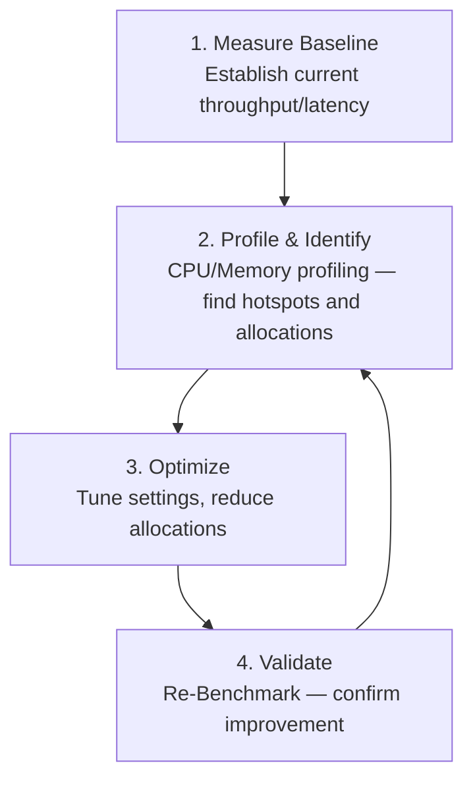

# Unit 33: Performance & Tuning

Master Surgewave performance optimization techniques to build high-throughput, low-latency message streaming applications that rival the performance of Aeron and outperform traditional Kafka deployments.

## Learning Objectives

By the end of this unit, you will be able to:

- Understand throughput, latency, and percentile metrics (P50/P90/P99)
- Identify and eliminate performance bottlenecks in Surgewave applications
- Tune producer settings for maximum throughput with optimal latency
- Optimize consumer parallelism and batch processing
- Leverage zero-copy, Span<T>, and memory pooling for GC-free operation
- Profile and benchmark Surgewave applications using BenchmarkDotNet and PerfView

## Lessons

| Lesson | Topic | Description |
|--------|-------|-------------|
| [26.1](lesson-1/README.md) | Performance Fundamentals | Throughput, latency, P50/P90/P99, bottleneck identification |
| [26.2](lesson-2/README.md) | Producer Optimization | Batching, compression, acks, linger.ms, async patterns |
| [26.3](lesson-3/README.md) | Consumer Optimization | Fetch size, poll intervals, parallelism, partition assignment |
| [26.4](lesson-4/README.md) | Memory Management & GC | Memory pools, Span<T>, zero-copy, GC latency modes |
| [26.5](lesson-5/README.md) | Benchmarking & Profiling | BenchmarkDotNet, dotTrace, PerfView, metrics analysis |

## Prerequisites

- Completed Unit 1: Surgewave Fundamentals
- Completed Unit 2: Producer & Consumer Basics
- Basic understanding of .NET performance concepts
- Familiarity with async/await patterns

## Why Performance Matters

| Dimension | Measured In | Bottlenecks | Surgewave Target |
|-----------|------------|-------------|--------------|
| Throughput | messages/sec or MB/sec | CPU, network, disk I/O, serialization | 1M+ messages/sec per broker |
| Latency | P50, P99 latency (ms) | Network round-trips, serialization | Sub-millisecond P50, <10ms P99 |
| Memory Efficiency | GC pressure, allocations | Buffer management and copying | GC-free hot path |

## Performance Optimization Flow

## Key Performance Settings

| Setting | Impact | Recommended |
|---------|--------|-------------|
| `BatchSize` | Throughput | 16KB-64KB for high throughput |
| `LingerMs` | Latency vs Throughput | 0-5ms (low latency) or 50-100ms (high throughput) |
| `CompressionType` | CPU vs Network | LZ4 for balanced, Zstd for max compression |
| `Acks` | Durability vs Speed | `All` for durability, `Leader` for speed |
| `FetchMinBytes` | Consumer efficiency | 1KB-1MB based on message size |
| `MaxPollRecords` | Batch processing | Match processing capacity |

## Performance Comparison

| Metric | Kafka (Baseline) | Surgewave (Optimized) | Improvement |
|--------|------------------|-------------------|-------------|
| Throughput | 100K msg/s | 1M+ msg/s | 10x |
| P50 Latency | 2-5ms | <1ms | 2-5x |
| P99 Latency | 10-50ms | <5ms | 2-10x |
| Memory/msg | 500-1000 bytes | 0 (pooled) | 100% reduction |
| GC Pauses | 10-50ms | <1ms | 10-50x |

## Best Practices

| Practice | Description |
|----------|-------------|
| Measure first | Always benchmark before optimizing |
| Batch operations | Group messages for network efficiency |
| Pool buffers | Reuse memory to avoid GC pressure |
| Use Span<T> | Avoid copying data unnecessarily |
| Async all the way | Never block on async operations |
| Size partitions | More partitions = more parallelism |
| Monitor continuously | Track P99 latency in production |

---

**Ready?** [Start Lesson 26.1: Performance Fundamentals](lesson-1/README.md)
