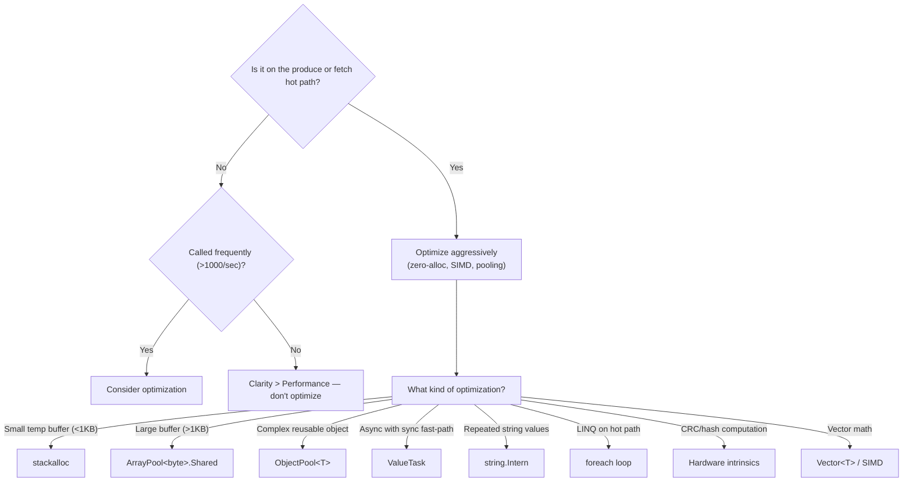

# Unit 34: Performance Engineering

Master Surgewave's performance optimization techniques, zero-allocation patterns, SIMD acceleration, memory pooling strategies, and the automated performance regression suite. Learn to write code that beats Kafka and competes with Aeron on throughput and latency.

## Learning Objectives

By the end of this unit, you will be able to:

- Understand Surgewave's performance architecture and the hot-path design
- Apply zero-allocation patterns using `Span<T>`, `Memory<T>`, and `ArrayPool`
- Leverage SIMD and hardware intrinsics for CRC32C, vector similarity, and batch operations
- Implement memory pooling strategies for buffers, streams, and complex objects
- Identify and eliminate allocations on hot paths
- Use the performance regression suite to detect regressions in CI
- Write and interpret BenchmarkDotNet benchmarks for Surgewave components

## Lessons

| Lesson | Topic | Description |
|--------|-------|-------------|
| 33.1 | Performance Architecture | Goals, metrics, hot paths, and the produce/fetch data flow |
| 33.2 | Zero-Allocation Patterns | Span, Memory, stackalloc, ArrayPool, ValueTask |
| 33.3 | SIMD & Hardware Acceleration | CRC32C intrinsics, Vector cosine similarity, Avx2/Sse2 |
| 33.4 | Memory Pooling Strategies | BufferPool, RecyclableMemoryStream, object pooling patterns |
| 33.5 | Hot-Path Optimizations Applied | LINQ elimination, string interning, compression bypass |
| 33.6 | Performance Regression Suite | RegressionDetector, baselines, Markdown reports, CI workflow |
| 33.7 | Benchmarking with BenchmarkDotNet | Surgewave's 7 benchmark projects, writing and interpreting results |

## Prerequisites

- Completed Unit 1: Surgewave Fundamentals
- Completed Unit 26: Performance & Tuning
- Understanding of .NET memory model and garbage collection
- Familiarity with async/await and `ValueTask`

## Performance Goals

| Dimension | Target |
|-----------|--------|
| Throughput | 1M+ messages/sec per broker — beat Kafka, compete with Aeron |
| P50 Latency | < 1ms (sub-millisecond median) |
| P90 Latency | < 5ms |
| P99 Latency | < 10ms |
| P99.9 Latency | < 50ms (no GC-induced spikes) |
| Allocations on hot path | 0 B/op — GC-free produce and fetch |

## The Hot Paths

**Produce Hot Path:**
Client (Serialize Message) → TCP Transport (Send Bytes via Socket) → Broker (Decode Request) → PartitionLog (Route to Partition) → Storage (Append to Log)

**Fetch Hot Path:**
Storage (Read from Log) → PartitionLog (Assemble Response) → Broker (Encode Response) → TCP Transport (Send Bytes via Socket) → Client (Deserialize Messages)

**Every allocation on these paths becomes a GC pressure point that causes P99 latency spikes.**

---

## Lesson 34.1: Performance Architecture

### Key Metrics

| Metric | What It Measures | Unit | Why It Matters |
|--------|-----------------|------|----------------|
| Throughput | Sustainable message rate | msg/s, MB/s | System capacity |
| P50 Latency | Median delivery time | ms | Typical user experience |
| P90 Latency | 90th percentile | ms | Degraded experience threshold |
| P99 Latency | Tail latency | ms | SLA compliance |
| P99.9 Latency | Extreme tail | ms | Worst-case scenarios |
| Allocations | Memory allocated per operation | B/op | GC pressure |
| GC Pauses | Stop-the-world duration | ms | Latency spikes |

### Architecture for Speed

Surgewave achieves its performance targets through several architectural decisions:

1. **Zero-copy message handling** -- Messages are passed as `ReadOnlyMemory<byte>` from socket to storage without intermediate copies
2. **Memory pooling** -- Buffers are rented from `ArrayPool` and returned after use
3. **SIMD acceleration** -- CRC32C, vector similarity, and batch operations use hardware intrinsics
4. **Lock-free data structures** -- `ConcurrentDictionary`, `Channel<T>`, and atomic operations
5. **ValueTask for sync completion** -- Avoids async state machine allocation when results are immediately available
6. **Object pooling** -- Reusable request/response objects avoid per-message allocation

### Kafka vs Surgewave Performance

| Metric | Kafka (Baseline) | Surgewave (Optimized) | Factor |
|--------|------------------|-------------------|--------|
| Throughput | 100K msg/s | 1M+ msg/s | 10x |
| P50 Latency | 2-5ms | <1ms | 2-5x |
| P99 Latency | 10-50ms | <5ms | 2-10x |
| Memory/msg | 500-1000 B | 0 (pooled) | Eliminated |
| GC Pauses | 10-50ms | <1ms | 10-50x |

---

## Lesson 34.2: Zero-Allocation Patterns

### Why Allocations Matter

Every heap allocation in .NET eventually triggers garbage collection. On the produce/fetch hot path, this means:
- GC pauses cause P99 latency spikes (10-50ms for a Gen2 collection)
- More allocations = more frequent collections = worse tail latency
- Server GC helps but cannot eliminate the problem

### Span<T> and Memory<T>

`Span<T>` is a stack-only view over contiguous memory. It avoids copying data:

```csharp
// BAD: Creates a new byte array (allocation)
byte[] header = data[0..16].ToArray();

// GOOD: Creates a view without allocation
Span<byte> header = data.AsSpan(0, 16);
ReadOnlySpan<byte> readHeader = data.AsSpan(0, 16);
```

`Memory<T>` is the heap-friendly cousin of `Span<T>`, used with async methods:

```csharp
// Span<T> cannot be used in async methods
// Memory<T> can
async ValueTask ProcessAsync(ReadOnlyMemory<byte> data)
{
    // Slice without allocation
    var header = data.Slice(0, 16);
    await socket.SendAsync(header);
}
```

### stackalloc for Small Buffers

For small temporary buffers (typically <1KB), allocate on the stack:

```csharp
// BAD: Heap allocation for temporary buffer
byte[] temp = new byte[64];

// GOOD: Stack allocation (no GC pressure)
Span<byte> temp = stackalloc byte[64];
WriteHeader(temp);
```

### ArrayPool<byte>.Shared

For larger buffers, rent from the shared pool:

```csharp
byte[] buffer = ArrayPool<byte>.Shared.Rent(minimumLength: 4096);
try
{
    int bytesRead = await stream.ReadAsync(buffer);
    ProcessData(buffer.AsSpan(0, bytesRead));
}
finally
{
    ArrayPool<byte>.Shared.Return(buffer);
}
```

### ObjectPool<T> for Complex Objects

```csharp
// Pool reusable request objects
var pool = new ObjectPool<PendingRequest>(() => new PendingRequest());

var request = pool.Get();
try
{
    request.Initialize(correlationId, topic, partition);
    await SendAsync(request);
}
finally
{
    request.Reset();
    pool.Return(request);
}
```

### ValueTask vs Task

`ValueTask` avoids allocating a `Task` object when the result is available synchronously:

```csharp
// BAD: Always allocates a Task
public async Task<int> GetCachedValueAsync(string key)
{
    if (_cache.TryGetValue(key, out var value))
        return value;  // Task allocated just to wrap an int
    return await FetchFromDatabaseAsync(key);
}

// GOOD: No allocation on cache hit
public ValueTask<int> GetCachedValueAsync(string key)
{
    if (_cache.TryGetValue(key, out var value))
        return new ValueTask<int>(value);  // No allocation
    return new ValueTask<int>(FetchFromDatabaseAsync(key));
}
```

---

## Lesson 34.3: SIMD & Hardware Acceleration

### CRC32C with SSE4.2 / ARM CRC Intrinsics

Surgewave uses hardware-accelerated CRC32C for message integrity checks:

```csharp
using System.Runtime.Intrinsics.X86;

// Check for hardware support at runtime
if (Sse42.IsSupported)
{
    // Hardware CRC32C: ~1 cycle per byte
    uint crc = 0xFFFFFFFF;
    crc = Sse42.Crc32(crc, data[0]);
    crc = Sse42.Crc32(crc, data[1]);
    // ...
}
else
{
    // Software fallback: ~10x slower
    crc = SoftwareCrc32C(data);
}
```

### Vector Cosine Similarity

The vector store uses SIMD for cosine similarity calculation:

```csharp
using System.Numerics;

static float CosineSimilarity(ReadOnlySpan<float> a, ReadOnlySpan<float> b)
{
    if (Vector.IsHardwareAccelerated)
    {
        // Process Vector<float>.Count elements per iteration (8 on AVX2)
        var dotProduct = Vector<float>.Zero;
        var normA = Vector<float>.Zero;
        var normB = Vector<float>.Zero;

        int i = 0;
        int vectorSize = Vector<float>.Count;

        for (; i <= a.Length - vectorSize; i += vectorSize)
        {
            var va = new Vector<float>(a.Slice(i, vectorSize));
            var vb = new Vector<float>(b.Slice(i, vectorSize));

            dotProduct += va * vb;
            normA += va * va;
            normB += vb * vb;
        }

        float dot = Vector.Sum(dotProduct);
        float na = Vector.Sum(normA);
        float nb = Vector.Sum(normB);

        // Handle remaining elements
        for (; i < a.Length; i++)
        {
            dot += a[i] * b[i];
            na += a[i] * a[i];
            nb += b[i] * b[i];
        }

        return dot / (MathF.Sqrt(na) * MathF.Sqrt(nb));
    }

    // Scalar fallback
    return ScalarCosineSimilarity(a, b);
}
```

### Checking Hardware Support

```csharp
// x86/x64
Console.WriteLine($"SSE2:    {Sse2.IsSupported}");
Console.WriteLine($"SSE4.2:  {Sse42.IsSupported}");
Console.WriteLine($"AVX2:    {Avx2.IsSupported}");
Console.WriteLine($"Vector:  {Vector.IsHardwareAccelerated}");
Console.WriteLine($"VecSize: {Vector<float>.Count} floats");

// On a modern x64 CPU with AVX2:
// SSE2:    True
// SSE4.2:  True
// AVX2:    True
// Vector:  True
// VecSize: 8 floats (256-bit SIMD)
```

---

## Lesson 34.4: Memory Pooling Strategies

### BufferPool

Surgewave's custom buffer pool for network I/O:

```csharp
var pool = new BufferPool(
    initialSize: 4096,
    maxPooled: 100
);

byte[] buffer = pool.Rent(minSize: 8192);
try
{
    // Use buffer for network read/write
}
finally
{
    pool.Return(buffer);
}
```

### RecyclableMemoryStreamManager

Pooled `MemoryStream` instances for serialization:

```csharp
private static readonly RecyclableMemoryStreamManager StreamManager = new();

using var stream = StreamManager.GetStream();
// Write to stream without allocating a new MemoryStream each time
serializer.Serialize(stream, message);
```

### PartitionWriteRequest Object Pooling Pattern

```csharp
// A reusable request object that avoids per-message allocation
public sealed class PartitionWriteRequest
{
    public string Topic { get; set; } = "";
    public int Partition { get; set; }
    public ReadOnlyMemory<byte> Data { get; set; }
    public TaskCompletionSource<long>? Completion { get; set; }

    public void Reset()
    {
        Topic = "";
        Partition = 0;
        Data = default;
        Completion = null;
    }
}
```

### PooledCompletionSource<T>

Uses `ManualResetValueTaskSourceCore<T>` to avoid allocating a `TaskCompletionSource` per operation:

```csharp
// Standard approach: allocates per operation
var tcs = new TaskCompletionSource<long>();  // ALLOCATION

// Pooled approach: reuses from pool
var source = pool.Get();  // NO ALLOCATION
source.Reset();
// ... use source.GetTask() ...
pool.Return(source);
```

### When NOT to Pool

Pooling has overhead (tracking, returning, thread-safety). Do not pool:
- Small, short-lived value types (use `stackalloc` instead)
- Objects created once at startup
- Objects with complex initialization that cannot be reset cheaply
- Situations where pool contention exceeds allocation cost

---

## Lesson 34.5: Hot-Path Optimizations Applied

### LINQ Elimination

LINQ methods allocate iterator objects and delegates. On hot paths, replace with loops:

```csharp
// BAD: Allocates IEnumerable iterator + delegate
int totalSize = batches.Sum(b => b.Length);

// GOOD: Zero allocation
int totalSize = 0;
foreach (var batch in batches)
    totalSize += batch.Length;
```

### String Interning for Topic Names

Topic names are repeated millions of times. Interning avoids duplicate string allocations:

```csharp
// Without interning: each deserialized topic name is a new string object
string topic = Encoding.UTF8.GetString(topicBytes);

// With interning: all identical topic names share one string instance
string topic = string.Intern(Encoding.UTF8.GetString(topicBytes));
```

### .ToArray() Elimination

Avoid creating intermediate arrays when the consumer accepts a span or enumerable:

```csharp
// BAD: Allocates a new array
byte[] compressed = compressor.Compress(data.ToArray());

// GOOD: Pass through without copying
ReadOnlyMemory<byte> compressed = compressor.Compress(data);
```

### ValueTask Synchronous Completion Bypass

When a `ValueTask` completes synchronously, bypass the async state machine:

```csharp
public ValueTask<int> ReadAsync(Memory<byte> buffer)
{
    // Check if data is already available (common case)
    if (_buffered > 0)
    {
        int copied = CopyFromBuffer(buffer);
        return new ValueTask<int>(copied);  // No async overhead
    }

    // Rare case: actually need to do async I/O
    return ReadSlowAsync(buffer);
}
```

### PendingRequest Pooling in TCP Transport

The TCP transport pools `PendingRequest` objects to avoid allocation per in-flight request:

```csharp
// Each produce/fetch RPC creates a PendingRequest
// Without pooling: millions of allocations under load
// With pooling: fixed set of reusable objects

var request = _requestPool.Get();
request.Initialize(correlationId, callback);
_pending[correlationId] = request;
// ... await response ...
_requestPool.Return(request);
```

---

## Lesson 34.6: Performance Regression Suite

### Overview

The `Kuestenlogik.Surgewave.Benchmarks.Regression` project is a CLI tool that compares BenchmarkDotNet results against saved baselines to automatically detect performance regressions.

### Commands

```bash
# Compare current results against baseline
dotnet run --project benchmarks/Kuestenlogik.Surgewave.Benchmarks.Regression -- compare \
    --baseline benchmarks/baselines/unit-benchmarks.json \
    --current BenchmarkDotNet.Artifacts/results/report.json

# Update baseline with new results
dotnet run --project benchmarks/Kuestenlogik.Surgewave.Benchmarks.Regression -- update-baseline \
    --source BenchmarkDotNet.Artifacts/results/report.json \
    --target benchmarks/baselines/unit-benchmarks.json

# Generate a Markdown report
dotnet run --project benchmarks/Kuestenlogik.Surgewave.Benchmarks.Regression -- report \
    --baseline benchmarks/baselines/unit-benchmarks.json \
    --current BenchmarkDotNet.Artifacts/results/report.json
```

### RegressionDetector

The core comparison engine with configurable thresholds:

```csharp
var config = new RegressionConfig
{
    LatencyThresholdPercent = 15.0,      // Flag if mean time increases >15%
    ThroughputThresholdPercent = 10.0,   // Flag if ops/sec drops >10%
    AllocationThresholdPercent = 20.0,   // Flag if allocations increase >20%
    ExcludedBenchmarks = ["FlakeyBenchmark"],
    CategoryOverrides = new()
    {
        ["Storage"] = new CategoryThresholds
        {
            LatencyThresholdPercent = 20.0  // More lenient for storage
        }
    }
};

var detector = new RegressionDetector(config);
var results = detector.Compare(baseline, current);
```

### RegressionSeverity

Each comparison result is classified as:

| Severity | Meaning |
|----------|---------|
| `Stable` | Within threshold -- no significant change |
| `Regression` | Performance degraded beyond threshold |
| `Improvement` | Performance improved beyond threshold |
| `New` | Benchmark exists in current but not baseline |

### RegressionReportGenerator

Generates Markdown reports suitable for PR comments:

```csharp
var markdown = RegressionReportGenerator.GenerateMarkdown(results, baseline, current);
// Output:
// ## Performance Regression Report
//
// **Status:** FAIL
// **Benchmarks:** 42 total | 2 regressions | 3 improvements | 35 stable | 2 new
//
// ### Regressions
// | Benchmark | Metric | Baseline | Current | Delta |
// |-----------|--------|----------|---------|-------|
// | ProduceBenchmark.SingleMessage | Mean (ns) | 1.23us | 1.89us | +53.7% |
```

### Baseline Management

Baselines are stored as BenchmarkDotNet JSON exports in `benchmarks/baselines/`:

```
benchmarks/
  baselines/
    unit-benchmarks.json
    storage-benchmarks.json
    integration-benchmarks.json
```

Update baselines after intentional performance changes:

```powershell
# PowerShell script for local updates
.\scripts\update-baselines.ps1
```

### CI Integration

The regression suite runs in GitHub Actions on pull requests:

1. PR triggers benchmark run
2. Results are compared against baselines in the repository
3. A Markdown report is posted as a PR comment
4. The check fails if any regression is detected
5. Developers fix the regression or update the baseline if the change is intentional

---

## Lesson 34.7: Benchmarking with BenchmarkDotNet

### Surgewave's 7 Benchmark Projects

| Project | Focus | Category |
|---------|-------|----------|
| `Kuestenlogik.Surgewave.Benchmarks` | Core operations (produce, fetch, serialize) | General |
| `Kuestenlogik.Surgewave.Benchmarks.Unit` | Individual component micro-benchmarks | Unit |
| `Kuestenlogik.Surgewave.Benchmarks.Storage` | Log segment read/write, compaction | Storage |
| `Kuestenlogik.Surgewave.Benchmarks.Integration` | End-to-end produce/consume flows | Integration |
| `Kuestenlogik.Surgewave.Benchmarks.Comparison` | Kafka vs Surgewave head-to-head | Comparison |
| `Kuestenlogik.Surgewave.Benchmarks.Latency` | P50/P90/P99 latency measurement | Latency |
| `Kuestenlogik.Surgewave.Benchmarks.Streams` | Stream processing throughput | Streams |

### Writing a Benchmark

```csharp
[MemoryDiagnoser]                        // Track allocations
[BenchmarkCategory("Unit")]              // Categorize for regression thresholds
public class Crc32CBenchmark
{
    private byte[] _data = null!;

    [Params(64, 256, 1024, 4096)]       // Test multiple input sizes
    public int DataSize { get; set; }

    [GlobalSetup]
    public void Setup()
    {
        _data = new byte[DataSize];
        Random.Shared.NextBytes(_data);
    }

    [Benchmark(Baseline = true)]
    public uint SoftwareCrc32C()
    {
        return Crc32C.ComputeSoftware(_data);
    }

    [Benchmark]
    public uint HardwareCrc32C()
    {
        return Crc32C.Compute(_data);
    }
}
```

### Running Benchmarks

```bash
# Run all benchmarks in Release mode
dotnet run -c Release --project benchmarks/Kuestenlogik.Surgewave.Benchmarks

# Run a specific benchmark class
dotnet run -c Release --project benchmarks/Kuestenlogik.Surgewave.Benchmarks -- --filter "*Crc32C*"

# Export results as JSON (for regression comparison)
dotnet run -c Release --project benchmarks/Kuestenlogik.Surgewave.Benchmarks -- --exporters json
```

### Interpreting Results

```
|          Method |  DataSize |        Mean |     Median |    StdDev |  Allocated |
|---------------- |---------- |------------:|-----------:|----------:|-----------:|
| SoftwareCrc32C  |        64 |    45.23 ns |   44.89 ns |  1.23 ns |        0 B |
|  HardwareCrc32C |        64 |     4.56 ns |    4.52 ns |  0.12 ns |        0 B |
| SoftwareCrc32C  |      4096 |  2,345.6 ns | 2,340.1 ns | 15.23 ns |        0 B |
|  HardwareCrc32C |      4096 |   234.5 ns  |  233.8 ns  |  2.34 ns |        0 B |
```

**Key columns:**
- **Mean** -- Average execution time (lower is better)
- **Median** -- Middle value, less sensitive to outliers
- **StdDev** -- Variation between runs (lower = more stable)
- **Allocated** -- Heap bytes allocated per operation (0 B = GC-free)

### Benchmark Categories

Surgewave uses `[BenchmarkCategory]` attributes aligned with the regression detector's category overrides:

| Category | Latency Threshold | Throughput Threshold | Allocation Threshold |
|----------|-------------------|----------------------|----------------------|
| Unit | 15% (default) | 10% (default) | 20% (default) |
| Storage | 20% (lenient) | 10% | 20% |
| Integration | 15% | 10% | 20% |
| Comparison | 15% | 10% | 20% |
| Latency | 10% (strict) | 10% | 20% |
| Streams | 15% | 10% | 20% |

---

## Optimization Decision Tree



## Exercises

1. **BenchmarkDotNet Profiling:** Write a benchmark that measures produce throughput at different batch sizes (1, 10, 100, 1000 messages). Use `[MemoryDiagnoser]` to track allocations and identify the optimal batch size.

2. **Hot-Path Allocation Hunt:** Take a piece of code that uses LINQ on a hot path (e.g., `.Select().ToList()`, `.Sum()`, `.Where().First()`) and rewrite it using zero-allocation patterns. Benchmark both versions and compare allocations.

3. **Regression Suite:** Run the performance regression suite against the current baselines. Generate a Markdown report and interpret the results. If there are regressions, identify the root cause.

4. **Zero-Allocation Parser:** Implement a message header parser that reads a 16-byte header (magic number, version, CRC32, length) from a `ReadOnlySpan<byte>` without any heap allocations. Use `BinaryPrimitives.ReadInt32BigEndian` for field extraction and benchmark against a version that uses `BinaryReader`.

## Best Practices

| Practice | Description |
|----------|-------------|
| Measure first | Always benchmark before and after optimization |
| Profile allocations | Use `[MemoryDiagnoser]` to find hidden allocations |
| Avoid premature optimization | Only optimize code that is provably on the hot path |
| Return pooled buffers | Always use try/finally to prevent pool exhaustion |
| Check hardware support | Use runtime feature checks before SIMD paths |
| Maintain baselines | Update baselines only after intentional changes |
| Watch P99, not just mean | Mean can hide tail latency problems |

---

**Ready?** Start with Lesson 34.1 to understand Surgewave's performance architecture and optimization strategy.
