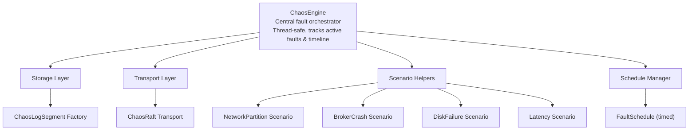

# Unit 35: Chaos Testing & Resilience

Master Surgewave's chaos engineering framework to build resilient distributed systems by proactively testing for failures. Learn to inject faults, partition networks, crash brokers, and verify that your system recovers correctly under adverse conditions.

## Learning Objectives

By the end of this unit, you will be able to:

- Understand chaos engineering principles and why proactive failure testing matters
- Use the ChaosEngine to activate, deactivate, and scope faults
- Inject storage faults using ChaosLogSegment and ChaosLogSegmentFactory
- Inject transport faults using ChaosRaftTransport
- Compose high-level failure scenarios with built-in scenario helpers
- Run multi-broker chaos integration tests with ChaosCluster
- Schedule timed faults with FaultSchedule
- Apply circuit breaker patterns to stream processors for fast-fail resilience

## Lessons

| Lesson | Topic | Description |
|--------|-------|-------------|
| 31.1 | Introduction to Chaos Engineering | Principles, motivation, and Surgewave's chaos architecture |
| 31.2 | The ChaosEngine | Core orchestrator: activating, deactivating, and scoping faults |
| 31.3 | Storage Fault Injection | ChaosLogSegment wrappers for disk, corruption, and write faults |
| 31.4 | Transport Fault Injection | ChaosRaftTransport for network, election, and crash faults |
| 31.5 | Scenario Helpers | High-level composable failure scenarios |
| 31.6 | ChaosCluster for Integration Tests | Multi-broker chaos cluster with convenience methods |
| 31.7 | FaultSchedule for Timed Chaos | Time-delayed fault activation and automatic deactivation |
| [35.8](lesson-8/README.md) | Circuit Breaker | Closed/Open/HalfOpen states, StreamsRetryConfig, RetryExhaustedException |

## Prerequisites

- Completed Unit 1: Surgewave Fundamentals
- Completed Unit 2: Producer & Consumer Basics
- Completed Unit 10: Clustering & Replication (recommended)
- Familiarity with xUnit or similar test frameworks

## Why Chaos Engineering?

| Approach | Method | Result |
|----------|--------|--------|
| Reactive (Traditional) | Wait for production failures; debug under pressure; hope redundancy works | Surprises, outages, data loss |
| Proactive (Chaos Engineering) | Intentionally inject failures in controlled environments; verify recovery before incidents | Known failure modes, tested recovery paths |

**Pioneers:** Netflix Chaos Monkey (random instance termination), Jepsen (distributed systems correctness), Surgewave ChaosEngine (integrated fault injection for Surgewave apps).

## Surgewave's Chaos Architecture



## The 9 Fault Types

| Fault Type | Layer | Effect |
|------------|-------|--------|
| `NetworkPartition` | Transport | Blocks communication between specific peers |
| `NodeCrash` | Both | All operations throw exceptions |
| `DiskIoError` | Storage | Read/write operations throw `IOException` |
| `SlowNetwork` | Both | Configurable latency injected per operation |
| `MessageCorruption` | Storage | Random bit flips in CRC/data on read |
| `LeaderElectionDisruption` | Transport | Drops or rejects vote requests |
| `StorageFullError` | Storage | Write operations throw "No space left" `IOException` |
| `ConnectionReset` | Transport | Throws `IOException` simulating TCP reset |
| `PartialWrite` | Storage | Only half the data is persisted |

---

## Lesson 35.1: Introduction to Chaos Engineering

### What Is Chaos Engineering?

Chaos engineering is the discipline of experimenting on a distributed system to build confidence in the system's capability to withstand turbulent conditions in production. Rather than waiting for failures to happen, you intentionally inject them in controlled environments.

**Core Principles:**
1. Define a "steady state" (normal system behavior)
2. Hypothesize that steady state continues during fault injection
3. Introduce real-world failure events (network partitions, disk errors, crashes)
4. Look for differences between control and experiment groups
5. Minimize the blast radius of experiments

### Surgewave's ChaosEngine Architecture

Surgewave provides a purpose-built chaos testing framework in the `Kuestenlogik.Surgewave.Testing.Chaos` package. The architecture centers around the `ChaosEngine` class, which acts as a central orchestrator for all fault injection.

```csharp
// The core chaos flow
var engine = new ChaosEngine();

// 1. Activate a fault
var faultId = engine.ActivateFault(FaultType.DiskIoError, new FaultScope { BrokerId = 1 });

// 2. Run your test — storage operations on broker 1 will now throw IOException
await RunTestScenario();

// 3. Deactivate the fault
engine.DeactivateFault(faultId);

// 4. Inspect what happened
engine.Timeline.DumpToOutput(Console.WriteLine);
```

**Key Components:**
- `ChaosEngine` — Central orchestrator managing active faults
- `ChaosLogSegment` / `ChaosLogSegmentFactory` — Storage layer fault injection
- `ChaosRaftTransport` — Transport layer fault injection
- Scenario helpers — High-level failure composition (partition, crash, disk failure, latency)
- `FaultSchedule` — Time-delayed fault activation
- `ChaosCluster` — Multi-broker test cluster with integrated chaos
- `ChaosTimeline` — Event recorder for diagnostics and assertions

---

## Lesson 35.2: The ChaosEngine

### Creating and Configuring a ChaosEngine

The `ChaosEngine` is thread-safe and manages all active faults via a `ConcurrentDictionary`. Every fault activation is recorded in the engine's `ChaosTimeline`.

```csharp
var engine = new ChaosEngine();
```

### Activating Faults

`ActivateFault` returns a unique fault ID (a GUID) used for targeted deactivation:

```csharp
// Activate a disk I/O error on broker 1
var faultId = engine.ActivateFault(
    FaultType.DiskIoError,
    new FaultScope { BrokerId = 1 }
);

// Activate slow network with 200ms latency
var latencyId = engine.ActivateFault(
    FaultType.SlowNetwork,
    new FaultScope { BrokerId = 2 },
    latency: TimeSpan.FromMilliseconds(200)
);
```

### Deactivating Faults

```csharp
// Deactivate a specific fault
engine.DeactivateFault(faultId);

// Deactivate ALL active faults
engine.DeactivateAll();
```

### FaultScope Targeting

The `FaultScope` record controls which operations are affected. Null properties act as wildcards:

```csharp
public sealed record FaultScope
{
    public int? BrokerId { get; init; }        // null = all brokers
    public string? Topic { get; init; }         // null = all topics
    public int? Partition { get; init; }         // null = all partitions
    public int? TargetPeerId { get; init; }      // null = all peers
    public double Probability { get; init; } = 1.0; // 0.0 to 1.0
}
```

**Examples:**

```csharp
// Target only broker 1
new FaultScope { BrokerId = 1 }

// Target broker 1 communicating with peer 2
new FaultScope { BrokerId = 1, TargetPeerId = 2 }

// 50% probability of triggering
new FaultScope { BrokerId = 1, Probability = 0.5 }

// Global scope (affects everything)
new FaultScope()
```

### ChaosTimeline for Diagnostics

Every fault activation, deactivation, and trigger is recorded:

```csharp
// Get all events
IReadOnlyList<ChaosEvent> events = engine.Timeline.GetEvents();

// Filter by fault type
var diskEvents = engine.Timeline.GetEvents(FaultType.DiskIoError);

// Filter by event type (Activated, Deactivated, Triggered)
var triggered = engine.Timeline.GetEvents(ChaosEventType.Triggered);

// Dump to console for debugging
engine.Timeline.DumpToOutput(Console.WriteLine);
// Output:
// === Chaos Timeline (3 events) ===
// [14:32:01.234] Activated | DiskIoError | DiskIoError fault on broker=1, ...
// [14:32:01.567] Triggered | DiskIoError | Triggered: DiskIoError on broker=1, peer=-1
// [14:32:02.890] Deactivated | DiskIoError | Deactivated: DiskIoError fault on broker=1, ...
// === End Timeline ===
```

### Querying Active Faults

```csharp
// Check if a specific fault type is active for a broker
bool active = engine.IsFaultActive(FaultType.DiskIoError, brokerId: 1);

// Get injected latency for a fault type
TimeSpan? latency = engine.GetInjectedLatency(FaultType.SlowNetwork, brokerId: 2);

// Snapshot of all active faults
IReadOnlyCollection<ActiveFault> faults = engine.ActiveFaults;
```

---

## Lesson 35.3: Storage Fault Injection

### ChaosLogSegmentFactory and ChaosLogSegment

The `ChaosLogSegmentFactory` wraps an `ILogSegmentFactory` so that every segment it creates is a `ChaosLogSegment`. The chaos segment delegates to the real segment but checks for active faults before each operation.

```csharp
var innerFactory = new MemoryLogSegmentFactory();
var chaosFactory = new ChaosLogSegmentFactory(innerFactory, engine, brokerId: 0, loggerFactory);
```

### Integration via SurgewaveRuntimeBuilder

The easiest way to wire chaos into a runtime:

```csharp
var engine = new ChaosEngine();
var runtime = await SurgewaveRuntime.CreateBuilder()
    .WithBrokerId(0)
    .WithStorageMode(StorageMode.Memory)
    .WithChaosEngine(engine, loggerFactory)  // Wraps storage with chaos
    .Build()
    .StartAsync();
```

### Intercepted Operations

The `ChaosLogSegment` intercepts these storage operations:

| Operation | DiskIoError | StorageFullError | MessageCorruption | SlowNetwork | PartialWrite | NodeCrash |
|-----------|-------------|------------------|-------------------|-------------|--------------|-----------|
| `AppendBatchAsync` | IOException | IOException | -- | Delay | Truncates data | IOException |
| `ReadBatchesAsync` | IOException | -- | Bit flips in CRC | Delay | -- | IOException |
| `FlushAsync` | IOException | -- | -- | Delay | -- | IOException |
| `GetFirstMessageOffset` | IOException | -- | -- | -- | -- | IOException |

### How Each Fault Works

**DiskIoError** -- Throws `IOException` on any read or write:
```csharp
engine.ActivateFault(FaultType.DiskIoError, new FaultScope { BrokerId = 0 });
// All storage operations on broker 0 now throw:
// IOException: "Chaos: Disk I/O error simulated on broker 0"
```

**StorageFullError** -- Throws `IOException` on writes only:
```csharp
engine.ActivateFault(FaultType.StorageFullError, new FaultScope { BrokerId = 0 });
// Write operations throw:
// IOException: "Chaos: No space left on device (simulated) on broker 0"
```

**MessageCorruption** -- Flips 1-3 random bits in read data:
```csharp
engine.ActivateFault(FaultType.MessageCorruption, new FaultScope { BrokerId = 0 });
// ReadBatchesAsync returns data with subtle CRC corruption
// This tests whether consumers detect and handle corrupt messages
```

**SlowNetwork** -- Injects configurable latency:
```csharp
engine.ActivateFault(FaultType.SlowNetwork, new FaultScope { BrokerId = 0 },
    latency: TimeSpan.FromMilliseconds(500));
// Every storage operation is delayed by 500ms
```

**PartialWrite** -- Truncates write data to half:
```csharp
engine.ActivateFault(FaultType.PartialWrite, new FaultScope { BrokerId = 0 });
// AppendBatchAsync writes only the first half of the data
// Tests recovery from incomplete writes
```

---

## Lesson 35.4: Transport Fault Injection

### ChaosRaftTransport

The `ChaosRaftTransport` wraps an `IRaftTransport` to inject faults into Raft consensus communication between brokers.

```csharp
var chaosTransport = new ChaosRaftTransport(innerTransport, engine, brokerId: 0, loggerFactory);
```

### Intercepted Raft RPCs

| RPC | NetworkPartition | LeaderElectionDisruption | NodeCrash | ConnectionReset | SlowNetwork |
|-----|------------------|--------------------------|-----------|-----------------|-------------|
| `SendPreVoteAsync` | IOException | Returns VoteGranted=false | InvalidOperationException | IOException | Delay |
| `SendRequestVoteAsync` | IOException | Returns VoteGranted=false | InvalidOperationException | IOException | Delay |
| `SendAppendEntriesAsync` | IOException | -- | InvalidOperationException | IOException | Delay |
| `IsPeerReachableAsync` | Returns false | -- | InvalidOperationException | -- | -- |

### How Each Fault Works

**NetworkPartition** -- Blocks specific peer communication:
```csharp
engine.ActivateFault(FaultType.NetworkPartition, new FaultScope
{
    BrokerId = 0,
    TargetPeerId = 1
});
// Broker 0 cannot communicate with peer 1
// Throws IOException on send, returns false on reachability check
```

**LeaderElectionDisruption** -- Drops vote requests:
```csharp
engine.ActivateFault(FaultType.LeaderElectionDisruption, new FaultScope
{
    BrokerId = 0,
    TargetPeerId = 1
});
// PreVote and RequestVote to peer 1 return VoteGranted=false
// AppendEntries is NOT affected (only election traffic)
```

**NodeCrash** -- All operations throw:
```csharp
engine.ActivateFault(FaultType.NodeCrash, new FaultScope { BrokerId = 0 });
// Every transport operation throws InvalidOperationException
// Every storage operation throws IOException
```

**ConnectionReset** -- Simulates TCP connection reset:
```csharp
engine.ActivateFault(FaultType.ConnectionReset, new FaultScope
{
    BrokerId = 0,
    TargetPeerId = 2
});
// Throws IOException: "Connection reset by peer 2 (simulated)"
```

**SlowNetwork** -- Per-peer configurable latency:
```csharp
engine.ActivateFault(FaultType.SlowNetwork, new FaultScope { BrokerId = 0 },
    latency: TimeSpan.FromMilliseconds(300));
// Every RPC from broker 0 is delayed by 300ms
```

---

## Lesson 35.5: Scenario Helpers

Surgewave provides high-level scenario classes that compose multiple fault activations into meaningful failure patterns. Each scenario implements `IDisposable` for automatic cleanup.

### NetworkPartitionScenario

Creates a bidirectional partition isolating a broker from specified peers:

```csharp
var scenario = NetworkPartitionScenario.Create(engine, isolatedBrokerId: 1, otherBrokerIds: [0, 2]);
// Broker 1 is now isolated from brokers 0 and 2 (both directions)

// Restore communication
scenario.Heal();

// Or use with `using` for automatic cleanup
using var partition = NetworkPartitionScenario.Create(engine, 1, [0, 2]);
// Partition is healed when disposed
```

### BrokerCrashScenario

Simulates a complete broker crash:

```csharp
var crash = BrokerCrashScenario.Create(engine, brokerId: 1);
// All operations on broker 1 now fail

// Recover the broker
crash.Recover();
```

### DiskFailureScenario

Injects disk I/O errors on a broker:

```csharp
// Standard disk failure
var diskFail = DiskFailureScenario.Create(engine, brokerId: 1);

// Or disk-full scenario
var diskFull = DiskFailureScenario.CreateStorageFull(engine, brokerId: 1);

// Repair the disk
diskFail.Repair();
```

### LatencyInjectionScenario

Injects configurable latency:

```csharp
// Add 200ms latency to all operations on broker 1
var latency = LatencyInjectionScenario.Create(engine, brokerId: 1,
    latency: TimeSpan.FromMilliseconds(200));

// Or target a specific peer
var peerLatency = LatencyInjectionScenario.CreateForPeer(engine,
    brokerId: 0, targetPeerId: 1,
    latency: TimeSpan.FromMilliseconds(500));

// With probability (50% of operations are slow)
var probabilistic = LatencyInjectionScenario.Create(engine, brokerId: 1,
    latency: TimeSpan.FromMilliseconds(200), probability: 0.5);

// Remove latency
latency.Remove();
```

---

## Lesson 35.6: ChaosCluster for Integration Tests

### Creating a Multi-Broker Chaos Cluster

The `ChaosCluster` provides a complete multi-broker environment with integrated chaos injection. Each broker gets its own `ChaosEngine`.

```csharp
await using var cluster = await ChaosCluster.CreateAsync(brokerCount: 3, loggerFactory);
```

Each broker is created with:
- In-memory storage wrapped in `ChaosLogSegmentFactory`
- Auto-created topics enabled
- A unique `ChaosEngine` per broker

### Convenience Methods

```csharp
// Isolate broker 1 from the cluster
var partition = cluster.PartitionBroker(brokerId: 1);

// Simulate a crash on broker 2
var crash = cluster.CrashBroker(brokerId: 2);

// Add 100ms latency to broker 0
cluster.InjectLatency(brokerId: 0, TimeSpan.FromMilliseconds(100));

// Heal everything
cluster.HealAll();
```

### Producing and Consuming

```csharp
// Create a topic on broker 0
await cluster.CreateTopicAsync("test-topic", partitions: 3);

// Produce 100 messages through broker 0
await cluster.ProduceAsync("test-topic", messageCount: 100, brokerId: 0);

// Consume messages from broker 1
var messages = await cluster.ConsumeAsync("test-topic",
    expectedCount: 100,
    timeout: TimeSpan.FromSeconds(10),
    brokerId: 1);
```

### Full Integration Test Example

```csharp
[Fact]
public async Task Leader_Failover_After_Network_Partition()
{
    await using var cluster = await ChaosCluster.CreateAsync(3);

    // Create topic and produce initial data
    await cluster.CreateTopicAsync("failover-test");
    await cluster.ProduceAsync("failover-test", 50);

    // Partition broker 0 (the initial leader)
    using var partition = cluster.PartitionBroker(0);

    // Verify remaining brokers can still produce
    await cluster.ProduceAsync("failover-test", 50, brokerId: 1);

    // Heal the partition
    partition.Heal();

    // Verify all data is accessible
    var messages = await cluster.ConsumeAsync("failover-test",
        expectedCount: 100, timeout: TimeSpan.FromSeconds(15));

    Assert.Equal(100, messages.Count);

    // Inspect the chaos timeline
    var engine = cluster.GetEngine(0);
    engine.Timeline.DumpToOutput(output.WriteLine);
}
```

### Accessing Individual Engines and Runtimes

```csharp
// Get a broker's chaos engine for custom fault injection
var engine = cluster.GetEngine(brokerId: 1);
engine.ActivateFault(FaultType.MessageCorruption, new FaultScope { BrokerId = 1 });

// Get a broker's runtime for direct access
var runtime = cluster.GetRuntime(brokerId: 0);

// Get bootstrap servers for Kafka client configuration
var servers = cluster.GetBootstrapServers(brokerId: 0);

// List all broker IDs
IReadOnlyList<int> ids = cluster.BrokerIds; // [0, 1, 2]
```

---

## Lesson 35.7: FaultSchedule for Timed Chaos

### Scheduling Faults with Delays

The `FaultSchedule` activates a fault after a specified delay and optionally deactivates it after a duration. This is useful for simulating transient failures during long-running tests.

```csharp
// Activate a disk error after 5 seconds, lasting 10 seconds
var schedule = FaultSchedule.Create(
    engine,
    FaultType.DiskIoError,
    new FaultScope { BrokerId = 0 },
    activateAfter: TimeSpan.FromSeconds(5),
    duration: TimeSpan.FromSeconds(10)
);

// The fault will:
// - Activate at T+5s
// - Deactivate at T+15s (5s delay + 10s duration)

// Cancel the schedule early if needed
schedule.Dispose();
```

### Permanent Delayed Faults

Omit the `duration` parameter for faults that activate after a delay but stay active indefinitely:

```csharp
var schedule = FaultSchedule.Create(
    engine,
    FaultType.NetworkPartition,
    new FaultScope { BrokerId = 1, TargetPeerId = 2 },
    activateAfter: TimeSpan.FromSeconds(30)
);
// Partition activates at T+30s and stays active until manually deactivated
```

### Composing Multiple Schedules

```csharp
// Simulate cascading failures
var schedules = new List<FaultSchedule>
{
    // Network gets slow at T+5s for 20s
    FaultSchedule.Create(engine, FaultType.SlowNetwork,
        new FaultScope { BrokerId = 0 },
        activateAfter: TimeSpan.FromSeconds(5),
        duration: TimeSpan.FromSeconds(20)),

    // Disk fails at T+10s for 15s
    FaultSchedule.Create(engine, FaultType.DiskIoError,
        new FaultScope { BrokerId = 1 },
        activateAfter: TimeSpan.FromSeconds(10),
        duration: TimeSpan.FromSeconds(15)),

    // Broker crashes at T+20s for 10s
    FaultSchedule.Create(engine, FaultType.NodeCrash,
        new FaultScope { BrokerId = 2 },
        activateAfter: TimeSpan.FromSeconds(20),
        duration: TimeSpan.FromSeconds(10))
};

// Run test workload during the chaos window
await RunLongTestWorkload(TimeSpan.FromSeconds(45));

// Cleanup
foreach (var s in schedules) s.Dispose();
```

---

## NuGet Package

Install the chaos testing package:

```
dotnet add package Kuestenlogik.Surgewave.Testing.Chaos
```

All chaos types live in the `Kuestenlogik.Surgewave.Testing.Chaos` namespace.

## Exercises

1. **Leader Failover Test:** Write a test that creates a 3-broker `ChaosCluster`, produces messages, partitions the leader broker, and verifies that a new leader is elected and can serve produce and consume requests.

2. **Data Durability Test:** Use `BrokerCrashScenario` to crash a broker after producing messages, then recover it and verify all messages are still accessible.

3. **Consumer Resilience Test:** Inject `DiskIoError` faults on a broker while a consumer is reading, and verify the consumer retries or fails gracefully without data loss.

4. **Timed Chaos Test:** Use `FaultSchedule` to create a cascading failure scenario: slow network at T+2s, disk failure at T+5s, and broker crash at T+10s. Run a producer workload throughout and verify the system recovers after all faults deactivate.

## Best Practices

| Practice | Description |
|----------|-------------|
| Start small | Begin with single fault types before composing scenarios |
| Assert on timeline | Use `ChaosTimeline` to verify faults were actually triggered |
| Clean up faults | Always use `using` or `DeactivateAll()` to prevent fault leaks |
| Test recovery | Verify the system returns to steady state after healing |
| Use probability | Set `Probability < 1.0` for realistic intermittent failures |
| Log everything | Pass a `LoggerFactory` to chaos wrappers for diagnostic output |
| Pair with circuit breakers | Use `EnableCircuitBreaker` in `StreamsRetryConfig` to prevent retry surgewaves during extended outages |

---

**Ready?** Start with Lesson 35.1 and work through the chaos engineering concepts progressively.
