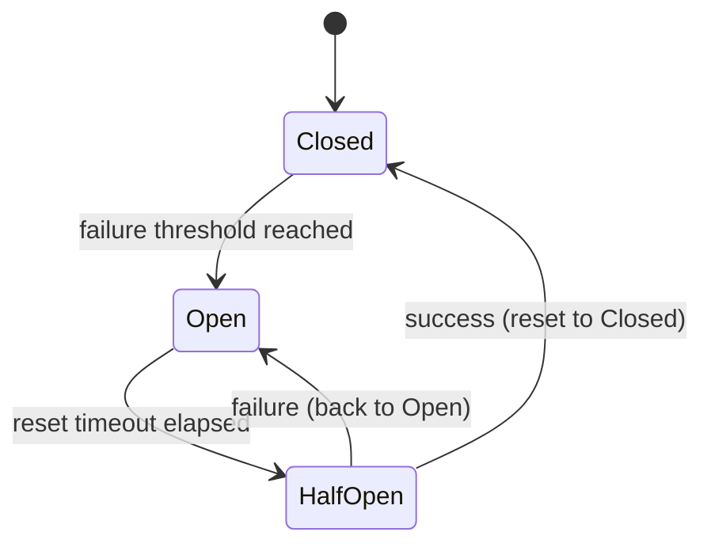
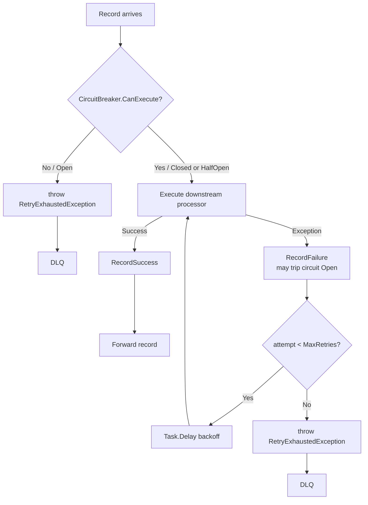

# Lesson 35.8: Circuit Breaker for Stream Processors

The circuit breaker pattern prevents a repeatedly failing operation from being retried indefinitely, protecting downstream systems and reducing latency. Surgewave integrates circuit breaker logic directly into `StreamsRetryConfig` so it can be combined with any retry policy.

## Learning Objectives

- Understand the circuit breaker state machine (Closed, Open, HalfOpen)
- Enable circuit breaker support via `StreamsRetryConfig.EnableCircuitBreaker`
- Use the `CircuitBreaker` class directly for custom logic
- Handle `RetryExhaustedException` when the circuit is open
- Integrate circuit breakers with Streams retry policies

## Circuit Breaker State Machine



| State | Behavior |
|-------|----------|
| **Closed** | Requests pass through normally |
| **Open** | Requests fail fast (no downstream call attempted) |
| **HalfOpen** | One probe request allowed to test if service recovered |

## StreamsRetryConfig with Circuit Breaker

```csharp
public class StreamsRetryConfig
{
    public bool Enabled { get; set; } = false;
    public int MaxRetries { get; set; } = 3;
    public TimeSpan InitialDelay { get; set; } = TimeSpan.FromMilliseconds(100);
    public TimeSpan MaxDelay { get; set; } = TimeSpan.FromSeconds(30);
    public BackoffStrategy Strategy { get; set; } = BackoffStrategy.ExponentialWithJitter;

    // Circuit breaker settings
    public bool EnableCircuitBreaker { get; set; } = false;
    public int CircuitBreakerFailureThreshold { get; set; } = 5;
    public TimeSpan CircuitBreakerResetTimeout { get; set; } = TimeSpan.FromSeconds(30);
}
```

## Enabling Circuit Breaker on a Stream

```csharp
builder.Stream<string, Order>("orders")
    .WithRetry(new StreamsRetryConfig
    {
        Enabled = true,
        MaxRetries = 3,
        InitialDelay = TimeSpan.FromMilliseconds(200),
        MaxDelay = TimeSpan.FromSeconds(5),
        Strategy = BackoffStrategy.ExponentialWithJitter,

        // Circuit breaker: trip after 5 consecutive failures
        // and reset after 30 seconds
        EnableCircuitBreaker = true,
        CircuitBreakerFailureThreshold = 5,
        CircuitBreakerResetTimeout = TimeSpan.FromSeconds(30)
    })
    .MapAsync(async (key, order) =>
    {
        // If the circuit is open this throws RetryExhaustedException immediately
        // (no network call is attempted)
        return await EnrichFromApiAsync(order);
    })
    .To("enriched-orders");
```

## CircuitBreaker Class

For custom usage outside of stream topologies:

```csharp
var breaker = new CircuitBreaker(
    failureThreshold: 5,
    resetTimeout: TimeSpan.FromSeconds(30)
);

// Execute an operation through the circuit breaker
try
{
    var result = await breaker.ExecuteAsync(async ct =>
    {
        return await httpClient.GetFromJsonAsync<Enrichment>(
            $"/api/enrich/{order.CustomerId}", ct);
    }, cancellationToken);
}
catch (CircuitBreakerOpenException ex)
{
    // Circuit is open; fail fast without attempting the call
    logger.LogWarning("Circuit breaker open: {Reason}", ex.Message);
    return FallbackEnrichment(order);
}
```

### CircuitBreaker State Properties

```csharp
Console.WriteLine(breaker.State);           // CircuitBreakerState.Closed|Open|HalfOpen
Console.WriteLine(breaker.FailureCount);    // consecutive failures
Console.WriteLine(breaker.LastFailureTime); // DateTimeOffset? of last failure
Console.WriteLine(breaker.CanExecute);      // false when Open
```

## Async Retry with Task.Delay

Inside the `RetryNode`, delays are implemented with `Task.Delay` using the configured backoff:

```csharp
// Simplified RetryNode logic (internal)
for (int attempt = 0; attempt <= config.MaxRetries; attempt++)
{
    try
    {
        if (config.EnableCircuitBreaker && !circuitBreaker.CanExecute)
            throw new RetryExhaustedException("Circuit breaker is open.");

        var result = await ProcessAsync(key, value);
        circuitBreaker.RecordSuccess();
        return result;
    }
    catch (RetryExhaustedException)
    {
        throw; // Fast-fail; don't count against retry budget
    }
    catch (Exception ex) when (attempt < config.MaxRetries)
    {
        circuitBreaker.RecordFailure();
        var delay = CalculateDelay(config, attempt);
        await Task.Delay(delay, cancellationToken);
    }
}

throw new RetryExhaustedException($"All {config.MaxRetries} retries exhausted.");
```

## RetryExhaustedException

Thrown when all retry attempts are consumed or the circuit is open:

```csharp
try
{
    await streams.ProcessRecordAsync(record, cancellationToken);
}
catch (RetryExhaustedException ex)
{
    logger.LogError(ex, "Record {Key} sent to DLQ after retries exhausted.", record.Key);
    await dlqProducer.ProduceAsync("dead-letter-queue", record.Key, record.Value);
}
```

## Integration with Streams Retry Policy

Circuit breakers and retry work together in the `RetryNode` pipeline:



## When to Enable: EnableCircuitBreaker = true

| Decision | Conditions |
|----------|-----------|
| **Enable** | Downstream service may be down for extended periods; you want fail-fast behavior during outages (avoid retry surgewaves); recovery is detectable (service returns healthy after timeout); DLQ or fallback path is acceptable for affected records |
| **Skip** | Transient failures are very short-lived (<1s); every record must succeed (no DLQ is acceptable); external service has no concept of a "healthy" state |

## Exercise

1. Configure `StreamsRetryConfig` with `EnableCircuitBreaker = true`, threshold of 3 failures, and a 15-second reset timeout
2. Build a mock HTTP service that always returns `503` for the first 60 seconds, then recovers
3. Run a stream processor that calls the mock service and observe the circuit tripping to Open after 3 failures
4. Verify records are routed to the DLQ while the circuit is Open (fast-fail without HTTP call)
5. Wait 15 seconds and verify the circuit transitions to HalfOpen and one probe request is attempted
6. After recovery, confirm the circuit resets to Closed and normal processing resumes

---

[Back to Unit 31](../README.md)
