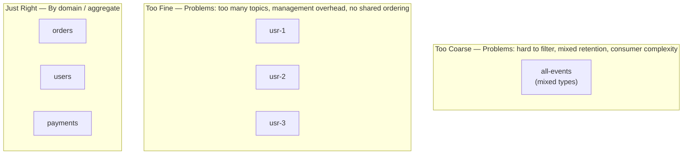
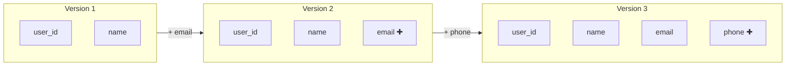
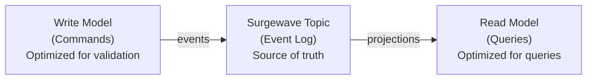

# Unit 4: Architecture & Design

Make informed architectural decisions for event-driven systems with Surgewave.

## Learning Objectives

By the end of this unit, you will be able to:

- Design topic structures that scale with your organization
- Choose partitioning strategies for different use cases
- Evolve schemas without breaking consumers
- Apply event-driven patterns (CQRS, Event Sourcing, Saga)
- Plan capacity for production workloads

## Lessons

| Lesson | Topic | Description |
|--------|-------|-------------|
| [6.1](lesson-1/README.md) | Topic Design | Naming, granularity, boundaries |
| [6.2](lesson-2/README.md) | Partitioning Strategies | Key selection, scaling, hot partitions |
| [6.3](lesson-3/README.md) | Event Schema Design | Versioning, compatibility, evolution |
| [6.4](lesson-4/README.md) | Event-Driven Patterns | CQRS, Event Sourcing, Saga |
| [6.5](lesson-5/README.md) | Capacity Planning | Sizing, retention, throughput |

## Prerequisites

- Completed Unit 1: Surgewave Fundamentals
- Completed Unit 3: Advanced Messaging (recommended)
- Understanding of distributed systems concepts (helpful)

## Why Architecture Matters

Poor architectural decisions create technical debt that's expensive to fix:

| Bad Decision | Consequence | Fix Cost |
|--------------|-------------|----------|
| Wrong topic granularity | Coupling or coordination overhead | High |
| Poor partition key | Hot partitions, ordering issues | Very High |
| No schema strategy | Breaking changes, version hell | Extreme |
| Undersized cluster | Outages, data loss | High |

## Key Concepts

### Topic Design Principles

### Partitioning Trade-offs

| Strategy | Ordering | Scalability | Use Case |
|----------|----------|-------------|----------|
| Entity ID | Per-entity | High | Most CRUD operations |
| Tenant ID | Per-tenant | High | Multi-tenant systems |
| Random | None | Very High | Logs, metrics |
| Time-based | None | Moderate | Time-series data |

### Schema Evolution

### Event-Driven Patterns

## Decision Framework

When designing your Surgewave architecture, ask:

1. **What are the domain boundaries?** → Topic structure
2. **What ordering guarantees do we need?** → Partition key
3. **How will schemas evolve?** → Compatibility strategy
4. **What are the read patterns?** → CQRS consideration
5. **What's the expected scale?** → Capacity planning

---

**Ready?** → [Start Lesson 6.1: Topic Design](lesson-1/README.md)
