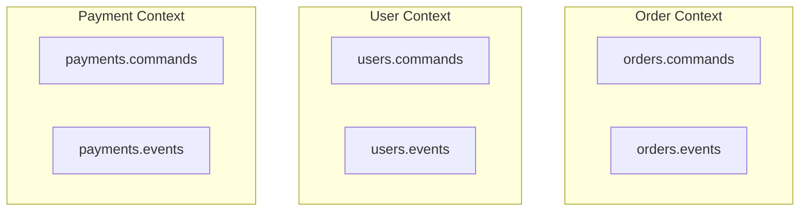

# Lesson 6.1: Topic Design

> **Difficulty:** Intermediate | **Duration:** 30 min | **Prerequisites:** Unit 5 completion

## Overview

Learn how to design topic structures that scale with your organization and use cases.

## Learning Objectives

- Apply topic naming conventions
- Choose appropriate topic granularity
- Define topic boundaries based on domain
- Avoid common topic design mistakes

## Why Topic Design Matters

Topics are the backbone of your event-driven architecture. Poor design leads to:

- Tight coupling between services
- Scaling bottlenecks
- Operational complexity
- Difficult schema evolution

## Key Concepts

### Naming Conventions

```
<domain>.<entity>.<event-type>

Examples:
- orders.order.created
- orders.order.shipped
- inventory.stock.updated
- payments.payment.processed
```

### Granularity Spectrum

| Level | Example | Pros | Cons |
|-------|---------|------|------|
| **Coarse** | `all-events` | Simple | Mixed concerns, hard to filter |
| **Domain** | `orders`, `users` | Balanced | May need filtering |
| **Entity** | `orders.created` | Specific | More topics to manage |
| **Instance** | `user-123-events` | Isolated | Explosion of topics |

### Domain-Driven Topic Design

Align topics with bounded contexts:



## Exercise

In this exercise, you'll:

1. Design a topic structure for an e-commerce domain
2. Implement naming conventions
3. Evaluate trade-offs between designs

---

**Instructions:** → [INSTRUCTIONS.md](INSTRUCTIONS.md)
