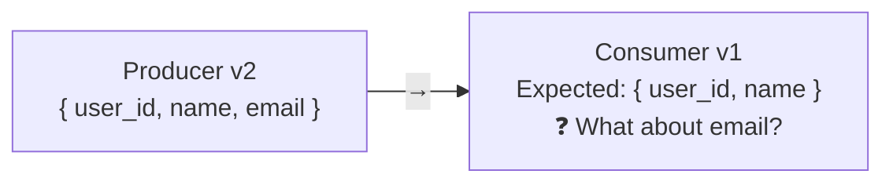

# Lesson 6.3: Event Schema Design

> **Difficulty:** Intermediate | **Duration:** 30 min | **Prerequisites:** Lesson 6.2

## Overview

Learn how to design event schemas that evolve gracefully without breaking consumers.

## Learning Objectives

- Design schemas for forward and backward compatibility
- Implement schema versioning strategies
- Handle schema evolution in production
- Choose between schema formats (JSON, Protobuf, Avro)

## Why Schema Design Matters

Schema changes can break consumers:



## Key Concepts

### Compatibility Types

| Type | Description | Safe Changes |
|------|-------------|--------------|
| **Backward** | New consumers read old messages | Add optional fields |
| **Forward** | Old consumers read new messages | Remove optional fields |
| **Full** | Both directions work | Add/remove optional only |

### Evolution Rules

```
SAFE (Backward + Forward Compatible):
✅ Add optional field with default
✅ Remove optional field
✅ Rename field (with alias)

UNSAFE:
❌ Add required field
❌ Remove required field
❌ Change field type
❌ Rename field without alias
```

## Exercise

In this exercise, you'll:

1. Design a versioned event schema
2. Implement backward-compatible evolution
3. Handle unknown fields gracefully

---

**Instructions:** → [INSTRUCTIONS.md](INSTRUCTIONS.md)
