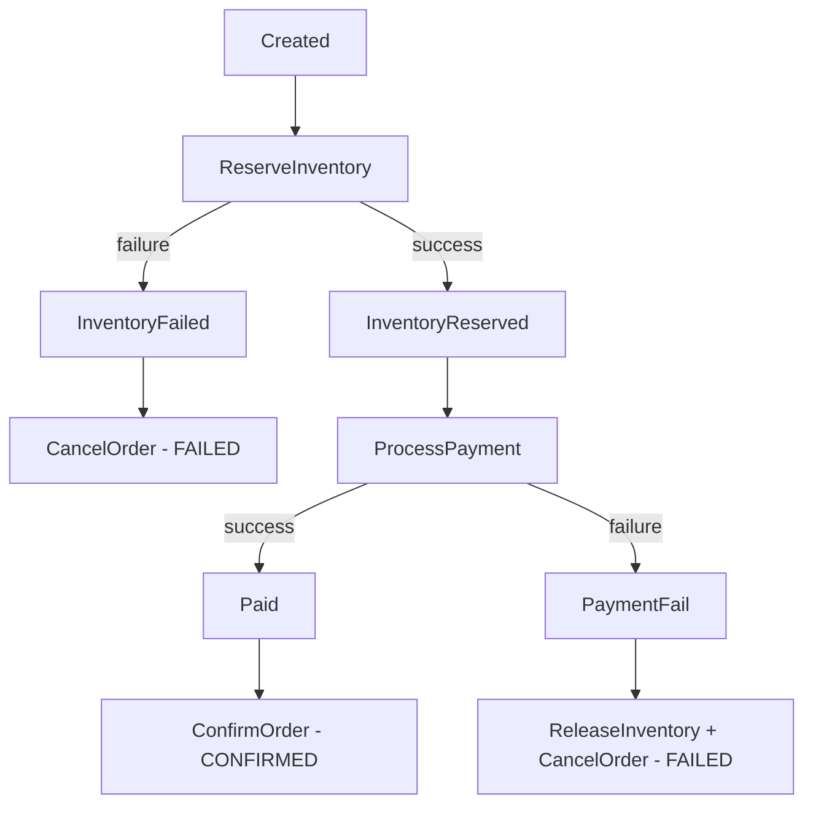

# Knowledge Assessment: Lesson 6.4 - Event-Driven Patterns

## Multiple Choice

### 1. What does CQRS stand for?
- [ ] A) Create Query Read Store
- [ ] B) Command Query Responsibility Segregation
- [ ] C) Consumer Queue Routing System
- [ ] D) Coordinated Query Response Service

<details>
<summary>Answer</summary>
**B)** CQRS stands for Command Query Responsibility Segregation. It separates read and write models, using events (via Surgewave) to synchronize them.
</details>

### 2. In Event Sourcing, what is the source of truth?
- [ ] A) The current state in the database
- [ ] B) The event log (sequence of events)
- [ ] C) The read model
- [ ] D) The latest snapshot

<details>
<summary>Answer</summary>
**B)** In Event Sourcing, the event log is the source of truth. Current state is derived by replaying all events. This allows full audit history and the ability to rebuild state.
</details>

### 3. What is a Saga pattern used for?
- [ ] A) Database transactions
- [ ] B) Coordinating distributed transactions across services
- [ ] C) Schema validation
- [ ] D) Message routing

<details>
<summary>Answer</summary>
**B)** The Saga pattern coordinates distributed transactions across services using events. Each step produces an event, and compensating actions handle failures (e.g., ReleaseInventory if payment fails).
</details>

## True/False

### 4. In CQRS, the write model and read model must use the same database.
- [ ] True
- [ ] False

<details>
<summary>Answer</summary>
**False** - CQRS specifically allows different storage for read and write models. The write model might use a normalized relational database while the read model uses a denormalized document store optimized for queries.
</details>

### 5. Event Sourcing allows you to rebuild the current state by replaying events.
- [ ] True
- [ ] False

<details>
<summary>Answer</summary>
**True** - A key benefit of Event Sourcing is that you can replay events to rebuild current state. This enables debugging, auditing, and building new read models from historical data.
</details>

## Code Challenge

### 6. Design an Event Sourcing solution for a bank account. Show the events and how to derive current balance.

<details>
<summary>Answer</summary>
**Event Definitions:**

```csharp
public abstract record AccountEvent
{
    public string AccountId { get; init; }
    public DateTime Timestamp { get; init; }
}

public record AccountCreated : AccountEvent
{
    public string OwnerName { get; init; }
    public decimal InitialBalance { get; init; }
}

public record MoneyDeposited : AccountEvent
{
    public decimal Amount { get; init; }
    public string Description { get; init; }
}

public record MoneyWithdrawn : AccountEvent
{
    public decimal Amount { get; init; }
    public string Description { get; init; }
}
```

**Event Log (Source of Truth):**
```
1. AccountCreated(id=123, balance=0)
2. MoneyDeposited(id=123, amount=100)
3. MoneyWithdrawn(id=123, amount=30)
4. MoneyDeposited(id=123, amount=50)
```

**State Reconstruction:**
```csharp
public class AccountAggregate
{
    public string AccountId { get; private set; }
    public decimal Balance { get; private set; }

    public void Apply(AccountEvent evt)
    {
        switch (evt)
        {
            case AccountCreated e:
                AccountId = e.AccountId;
                Balance = e.InitialBalance;
                break;
            case MoneyDeposited e:
                Balance += e.Amount;
                break;
            case MoneyWithdrawn e:
                Balance -= e.Amount;
                break;
        }
    }

    public static AccountAggregate Replay(IEnumerable<AccountEvent> events)
    {
        var account = new AccountAggregate();
        foreach (var evt in events)
            account.Apply(evt);
        return account;
    }
}

// Replay: 0 + 100 - 30 + 50 = 120
var account = AccountAggregate.Replay(events);
Console.WriteLine(account.Balance); // 120
```
</details>

### 7. Design a Saga for an order processing flow: CreateOrder -> ReserveInventory -> ProcessPayment -> ConfirmOrder. Include compensation logic for failures.

<details>
<summary>Answer</summary>
**Order Saga Design:**

**Happy Path:**
```
1. CreateOrder      -> orders.order.created
2. ReserveInventory -> inventory.reserved
3. ProcessPayment   -> payment.completed
4. ConfirmOrder     -> orders.order.confirmed
```

**Compensation (Rollback) Logic:**

```csharp
public class OrderSaga
{
    public async Task HandleEvent(object evt)
    {
        switch (evt)
        {
            case OrderCreated e:
                // Step 2: Try to reserve inventory
                await Publish(new ReserveInventoryCommand(e.OrderId, e.Items));
                break;

            case InventoryReserved e:
                // Step 3: Try to process payment
                await Publish(new ProcessPaymentCommand(e.OrderId, e.Amount));
                break;

            case PaymentCompleted e:
                // Step 4: Confirm the order
                await Publish(new ConfirmOrderCommand(e.OrderId));
                break;

            // COMPENSATION HANDLERS

            case PaymentFailed e:
                // Payment failed -> Release inventory and cancel order
                await Publish(new ReleaseInventoryCommand(e.OrderId));
                await Publish(new CancelOrderCommand(e.OrderId, "Payment failed"));
                break;

            case InventoryReservationFailed e:
                // No inventory -> Cancel order (no inventory to release)
                await Publish(new CancelOrderCommand(e.OrderId, "Out of stock"));
                break;
        }
    }
}
```

**Saga State Machine:**


</details>

## Score
- 7/7: Excellent! You understand event-driven patterns
- 5-6/7: Good understanding
- 4/7: Review the lesson
- <4/7: Re-do the lesson
