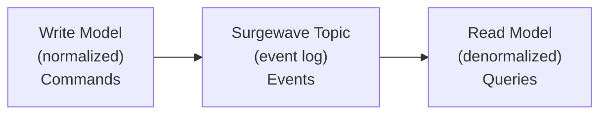
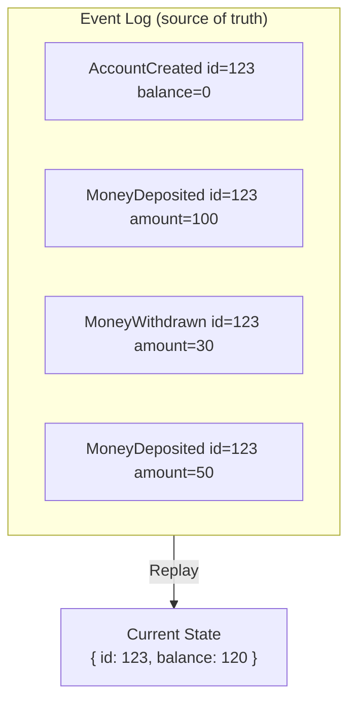

# Lesson 6.4: Event-Driven Patterns

> **Difficulty:** Intermediate | **Duration:** 45 min | **Prerequisites:** Lesson 6.3

## Overview

Learn architectural patterns for building event-driven systems with Surgewave.

## Learning Objectives

- Implement CQRS (Command Query Responsibility Segregation)
- Apply Event Sourcing patterns
- Design Saga/Choreography for distributed transactions
- Choose the right pattern for your use case

## Key Patterns

### CQRS (Command Query Responsibility Segregation)

Separate read and write models:



### Event Sourcing

Store state as a sequence of events:



### Saga Pattern

Coordinate distributed transactions:

```
Order Saga:
  1. CreateOrder → orders.created
  2. ReserveInventory → inventory.reserved (or inventory.failed)
  3. ProcessPayment → payment.completed (or payment.failed)
  4. ConfirmOrder → orders.confirmed

Compensation (if step 3 fails):
  → ReleaseInventory
  → CancelOrder
```

## Exercise

In this exercise, you'll:

1. Implement a simple CQRS flow
2. Build an event-sourced aggregate
3. Design a saga for order processing

---

**Instructions:** → [INSTRUCTIONS.md](INSTRUCTIONS.md)
