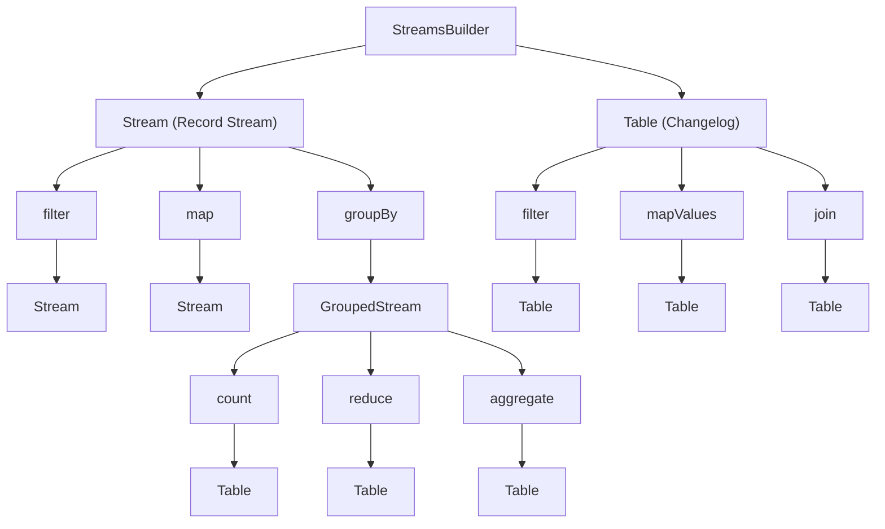

# Unit 5: Stream Processing

Master real-time stream processing with Surgewave Streams.

## Overview

Surgewave Streams is a powerful stream processing library that enables:
- Real-time data transformations
- Stateful aggregations with windowing
- Stream and table joins
- Exactly-once processing semantics

## Architecture

## Lessons

| Lesson | Topic | What You'll Learn |
|--------|-------|-------------------|
| [7.1](lesson-1/README.md) | Streams Basics | StreamsBuilder, Stream, basic topology |
| [7.2](lesson-2/README.md) | Transformations | map, filter, flatMap, branch, merge |
| [7.3](lesson-3/README.md) | Aggregations & Windowing | groupBy, count, windows, grace periods |
| [7.4](lesson-4/README.md) | Joins & Suppression | Stream/table joins, suppression for final results |
| [7.5](lesson-5/README.md) | State Stores | KeyValueStore, WindowStore, interactive queries |

## Prerequisites

- Completed Unit 1 (Fundamentals)
- Understanding of producer/consumer patterns
- Basic knowledge of functional programming (map, filter, reduce)

## Key Concepts

### Stream vs Table

| Aspect | Stream | Table |
|--------|---------|--------|
| Semantics | Record stream (insert) | Changelog (upsert) |
| State | Stateless by default | Stateful |
| Use Case | Events, logs | Entities, lookups |
| Example | Order placed | Current inventory |

### Windowing Types

| Window | Description | Use Case |
|--------|-------------|----------|
| Tumbling | Fixed, non-overlapping | Hourly reports |
| Hopping | Fixed, overlapping | Moving averages |
| Session | Gap-based, dynamic | User sessions |
| Sliding | For joins only | Correlate events |

### Grace Period & Suppression

| Feature | Description | Use Case |
|---------|-------------|----------|
| Grace Period | Accept late records within buffer time | Handle out-of-order events |
| Suppression | Control when aggregation results are emitted | Emit final results only |
| UntilWindowClose | Suppress until window + grace expires | Final window totals |
| UntilTimeLimit | Rate-limit update frequency | Dashboard throttling |

## Learning Objectives

By the end of this unit, you will be able to:

1. Build stream processing topologies with StreamsBuilder
2. Transform data with map, filter, and flatMap
3. Aggregate data with groupBy, count, and reduce
4. Apply windowing for time-based aggregations
5. Handle late-arriving records with grace periods
6. Use suppression to emit final aggregation results
7. Join streams and tables for enrichment
8. Query state stores for interactive queries
