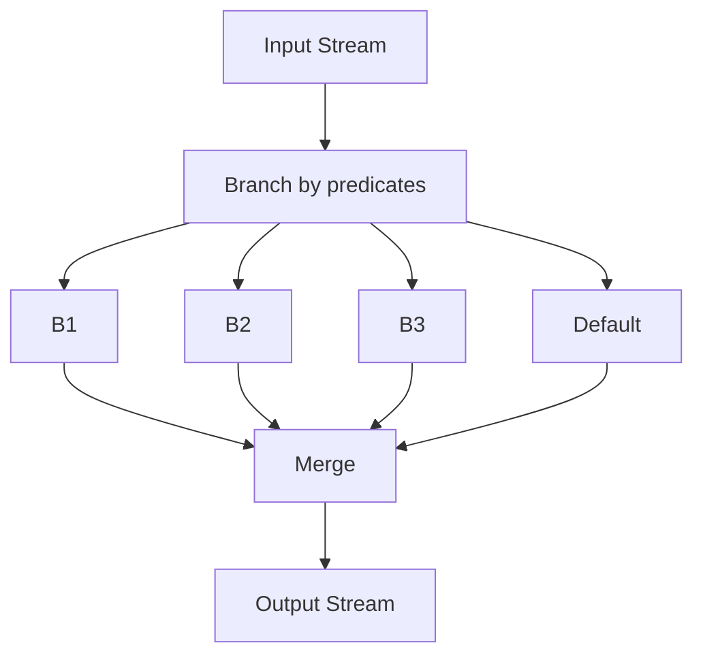

# Lesson 7.2: Transformations

> **Difficulty:** Intermediate | **Duration:** 45 min | **Prerequisites:** Lesson 7.1

## Learning Objectives

- Master stateless transformation operations
- Use map and flatMap for data restructuring
- Split streams with branch
- Combine streams with merge

## Key Concepts

### Stateless Transformations

Operations that process each record independently:

| Operation | Input | Output | Use Case |
|-----------|-------|--------|----------|
| `Filter` | 1 record | 0-1 records | Remove unwanted |
| `Map` | 1 record | 1 record | Transform key+value |
| `MapValues` | 1 record | 1 record | Transform value only |
| `FlatMap` | 1 record | 0-N records | Expand records |
| `FlatMapValues` | 1 record | 0-N records | Expand values |
| `SelectKey` | 1 record | 1 record | Change key |

### Branching and Merging

## Exercise

Build a log processor that:
1. Parses log levels from messages
2. Routes ERROR/WARN/INFO to separate topics
3. Enriches messages with metadata
4. Merges processed streams

## Time Estimate

~45 minutes
