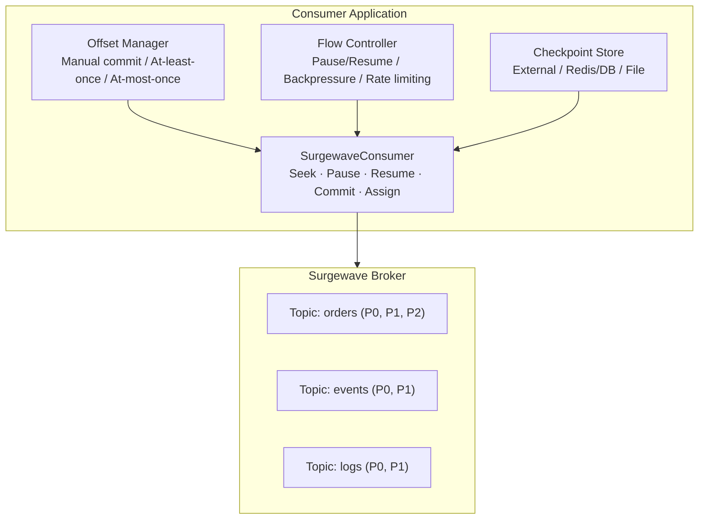

# Unit 6: Advanced Consumer Patterns

Master advanced consumer patterns in Surgewave to build robust, production-ready message processing applications with fine-grained control over offset management, flow control, and partition assignment.

## Learning Objectives

By the end of this unit, you will be able to:

- Implement manual offset management with at-least-once and at-most-once semantics
- Use seek operations to navigate to specific offsets, timestamps, or boundaries
- Control message flow with pause and resume for backpressure handling
- Build custom checkpointing solutions with external systems
- Understand and implement custom partition assignment strategies
- Use push-based consumption via SurgewaveStreamingConsumer and IAsyncEnumerable

## Lessons

| Lesson | Topic | Description |
|--------|-------|-------------|
| [18.1](lesson-1/README.md) | Manual Offset Management | Disabling auto-commit, manual commit strategies, delivery guarantees |
| [18.2](lesson-2/README.md) | Seek Operations | Seeking to offset, timestamp, beginning/end |
| [18.3](lesson-3/README.md) | Pause & Resume | Pausing partitions, flow control, backpressure handling |
| [18.4](lesson-4/README.md) | Custom Checkpointing | External checkpoint stores, exactly-once with external systems |
| [18.5](lesson-5/README.md) | Partition Assignment | Custom assignors, sticky assignment, cooperative rebalancing |
| [18.6](lesson-6/README.md) | Streaming Consumer | Push-based vs poll-based, IAsyncEnumerable, credit-based flow control |

## Prerequisites

- Completed Unit 1: Surgewave Fundamentals
- Completed Unit 2: Producer & Consumer Basics
- Understanding of consumer groups and partitions

## Advanced Consumer Architecture Overview



## Offset Management Strategies

| Strategy | Steps | Failure Behavior |
|----------|-------|-----------------|
| **At-Most-Once** (commit before processing) | 1. Receive → 2. Commit → 3. Process | Crash during processing = message lost |
| **At-Least-Once** (commit after processing) | 1. Receive → 2. Process → 3. Commit | Crash before commit = message reprocessed |
| **Exactly-Once** (transactional) | 1. Begin tx → 2. Receive → 3. Process + produce → 4. Commit atomically | Crash = entire transaction rolled back |

## Seek Operations Flow

Partition timeline: `[Earliest: 0] -------- [Current: 200] -------- [Latest: 500]`

| Operation | Target | Description |
|-----------|--------|-------------|
| `SeekToBeginning()` | Offset 0 | Reprocess all messages from the start |
| `SeekToEnd()` | Offset 500 | Skip to next incoming message |
| `Seek(offset: 200)` | Offset 200 | Jump to a specific offset |
| `SeekToTimestamp(t)` | First offset ≥ t | Seek to first message at or after timestamp |

## Pause & Resume Flow

| Partition | Normal Flow | Paused Flow | Resumed Flow |
|-----------|-------------|-------------|--------------|
| Partition 0 | flowing | paused | flowing |
| Partition 1 | flowing | flowing | flowing |
| Partition 2 | flowing | paused | flowing |

**Use Cases:** backpressure handling (downstream slow), priority processing (pause low-priority), resource management (reduce load), error recovery (pause failing partition).

## Key Patterns

### Manual Offset Management

```csharp
await using var consumer = new SurgewaveConsumer<string, string>(options =>
{
    options.BootstrapServers = "localhost:9092";
    options.GroupId = "advanced-consumer-group";
    options.EnableAutoCommit = false; // Manual commit
    options.AutoOffsetReset = AutoOffsetReset.Earliest;
});

consumer.Subscribe("orders");

while (!cancellationToken.IsCancellationRequested)
{
    var result = await consumer.ConsumeAsync(cancellationToken);
    if (result == null) continue;

    // Process message
    await ProcessMessageAsync(result);

    // Commit after successful processing (at-least-once)
    await consumer.CommitAsync(result, cancellationToken);
}
```

### Seek Operations

```csharp
// Seek to specific offset
consumer.Seek("orders", partition: 0, offset: 100);

// Seek to beginning (reprocess all messages)
consumer.Seek("orders", partition: 0, offset: 0);

// Seek to end (skip to latest)
var latestOffset = await consumer.GetLatestOffsetAsync("orders", 0);
consumer.Seek("orders", 0, latestOffset);
```

### Pause & Resume

```csharp
// Pause specific partitions
consumer.Pause(("orders", 0), ("orders", 1));

// Check if partition is paused
var isPaused = consumer.PausedPartitions.Contains(("orders", 0));

// Resume partitions
consumer.Resume(("orders", 0), ("orders", 1));
```

## Delivery Guarantees Summary

| Guarantee | Commit Strategy | Trade-off |
|-----------|----------------|-----------|
| At-most-once | Commit before processing | May lose messages |
| At-least-once | Commit after processing | May reprocess messages |
| Exactly-once | Transactional commit | Higher latency |

---

**Ready?** [Start Lesson 18.1: Manual Offset Management](lesson-1/README.md)
