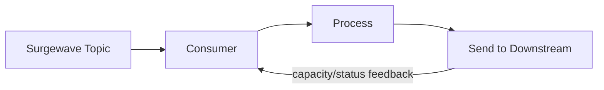

# Lesson 18.3: Pause & Resume

> **Difficulty:** Advanced | **Duration:** 30 min | **Prerequisites:** Lesson 18.2

## Overview

Learn how to pause and resume consumption from specific partitions for flow control, backpressure handling, and priority-based processing.

## Learning Objectives

- Pause consumption from specific partitions
- Resume paused partitions
- Implement backpressure handling patterns
- Control flow based on downstream system capacity

## Why Pause & Resume?

Pause and resume allow you to temporarily stop processing from specific partitions:

| Use Case | Benefit |
|----------|---------|
| Backpressure | Slow down when downstream can't keep up |
| Priority processing | Pause low-priority, process high-priority |
| Resource management | Reduce load during maintenance |
| Error isolation | Pause failing partition while others continue |
| Rate limiting | Control overall processing rate |

## Key Concepts

### Pause & Resume Flow

| State | Partition 0 | Partition 1 | Partition 2 |
|-------|------------|------------|------------|
| **Normal** | active → Consumer | active → Consumer | active → Consumer |
| **After Pause(P0, P2)** | PAUSED (no consume) | active → Consumer | PAUSED (no consume) |
| **After Resume(P0, P2)** | active → Consumer | active → Consumer | active → Consumer |

### Backpressure Handling Pattern

When the downstream system is slow or full: 1. Pause partition(s); 2. Wait for capacity; 3. Resume when ready.

**Metrics to monitor:** queue depth (pause if > threshold); response time (pause if > threshold); error rate (pause if > threshold).

### Priority Processing Pattern

| State | orders-priority | orders-normal |
|-------|----------------|---------------|
| **Normal operation** | active | active |
| **High-priority backlog grows** | active (process only this) | PAUSED |
| **Backlog cleared** | active | active (resumed) |

### Rate Limiting Pattern

**Rate Limiting Pattern (target: max 100 messages/second):**

1. Count messages processed within a 1-second window
2. When the count reaches 100, pause all partitions
3. Wait for the window to reset (end of the second)
4. Resume all partitions for the next window

## Pause & Resume Methods

| Method | Description |
|--------|-------------|
| `Pause(partitions)` | Pause specified partitions |
| `Resume(partitions)` | Resume specified partitions |
| `PausedPartitions` | Get set of currently paused partitions |

## Exercise

In this exercise, you'll:

1. Pause and resume specific partitions
2. Implement backpressure handling based on queue depth
3. Implement priority-based processing
4. Create a rate limiter using pause/resume

---

**Instructions:** [INSTRUCTIONS.md](INSTRUCTIONS.md)
