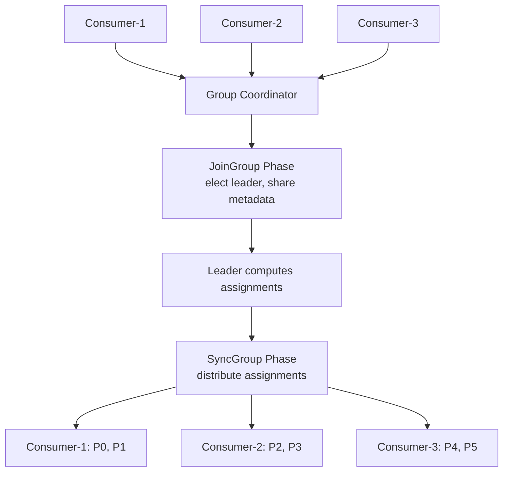

# Lesson 18.5: Partition Assignment

> **Difficulty:** Advanced | **Duration:** 45 min | **Prerequisites:** Lesson 18.4

## Overview

Learn about partition assignment strategies in consumer groups, including built-in assignors and how to implement custom assignment logic for advanced use cases.

## Learning Objectives

- Understand partition assignment in consumer groups
- Learn about built-in assignment strategies (Range, RoundRobin)
- Implement custom partition assignment logic
- Handle rebalancing events with PartitionsAssigned/Revoked

## Why Custom Partition Assignment?

Default assignment strategies may not fit all use cases:

| Strategy | Behavior | Best For |
|----------|----------|----------|
| Range | Assigns consecutive partitions | Co-partitioned topics |
| RoundRobin | Distributes partitions evenly | General workloads |
| Sticky | Minimizes partition movement | Stateful consumers |
| Custom | Your logic | Specific requirements |

## Key Concepts

### Consumer Group Assignment Flow



### Range Assignment Strategy

Topic `orders` (6 partitions), consecutive blocks assigned per consumer:

| Consumers | C1 | C2 | C3 |
|-----------|----|----|-----|
| **2 consumers** | P0, P1, P2 | P3, P4, P5 | — |
| **3 consumers** | P0, P1 | P2, P3 | P4, P5 |
| **3 consumers, 7 partitions** | P0, P1, P2 (extra) | P3, P4 | P5, P6 |

### RoundRobin Assignment Strategy

Topic `orders` (6 partitions), partitions distributed by alternating across consumers:

| Consumer | Assigned Partitions |
|----------|-------------------|
| C1 | P0, P2, P4 |
| C2 | P1, P3, P5 |

RoundRobin provides more even distribution across multiple topics than Range assignment.

### Sticky Assignment Strategy

Goal: minimize partition movement during rebalance. Before rebalance: C1 = P0, P1, P2; C2 = P3, P4, P5. When C3 joins:

| Strategy | C1 | C2 | C3 | Partitions moved |
|----------|----|----|----|--------------------|
| **Without sticky** (full reassignment) | P0, P3 | P1, P4 | P2, P5 | 4 |
| **With sticky** (minimal movement) | P0, P1 | P3, P4 | P2, P5 | 2 |

### Rebalance Events

**`PartitionsRevoked`** — called before partitions are taken away. Use to commit offsets, flush buffers, and save state:

```csharp
consumer.PartitionsRevoked += (sender, e) =>
{
    Console.WriteLine($"Revoking: {e.Partitions.Count}");
    // Commit any pending work
    await CommitAsync();
};
```

**`PartitionsAssigned`** — called after new partitions are assigned. Use to initialize state and seek to saved positions:

```csharp
consumer.PartitionsAssigned += (sender, e) =>
{
    Console.WriteLine($"Assigned: {e.Partitions.Count}");
    // Load state for new partitions
    foreach (var tp in e.Partitions)
        LoadStateFor(tp);
};
```

### Manual Assignment

Skip the consumer group entirely and assign partitions directly (no `GroupId`):

```csharp
await using var consumer = new SurgewaveConsumer<string, string>(options =>
{
    options.BootstrapServers = "localhost:9092";
    // No GroupId!
});

// Assign specific partitions
consumer.Assign("orders", 0, offset: 0);
consumer.Assign("orders", 1, offset: 0);
consumer.Assign("orders", 2, offset: 0);
```

Use cases: exactly-once processing; partition affinity; testing and debugging; custom orchestration.

## Exercise

In this exercise, you'll:

1. Observe partition assignment with consumer groups
2. Handle PartitionsAssigned and PartitionsRevoked events
3. Implement manual partition assignment
4. Compare different assignment approaches

---

**Instructions:** [INSTRUCTIONS.md](INSTRUCTIONS.md)
