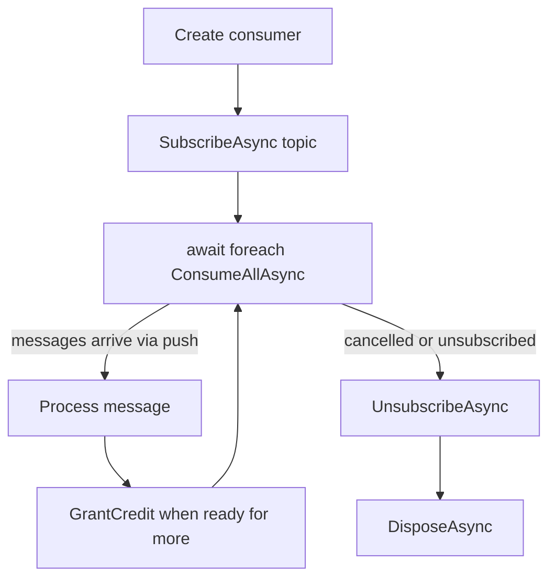

# Lesson 18.6: Streaming Consumer

> **Difficulty:** Advanced | **Duration:** 45 min | **Prerequisites:** Lesson 18.5

## Overview

Learn how to use Surgewave's push-based streaming consumer API via `SurgewaveStreamingConsumer`, which delivers messages as an `IAsyncEnumerable<ReceivedMessage>` stream. Understand when push-based consumption is preferable to traditional poll-based loops and how to apply credit-based flow control.

## Learning Objectives

- Understand the difference between push-based and poll-based consumption
- Use `SurgewaveStreamingConsumer` and the `IAsyncEnumerable<ReceivedMessage>` API
- Manage Subscribe/Unsubscribe lifecycle correctly
- Apply credit-based flow control to prevent memory pressure
- Choose the right consumption model for your use case

## Push-Based vs Poll-Based Consumption

| Aspect | Poll-Based (`SurgewaveConsumer`) | Push-Based (`SurgewaveStreamingConsumer`) |
|--------|------------------------------|---------------------------------------|
| Control | Consumer drives the loop | Broker pushes records |
| API style | `await consumer.ConsumeAsync()` | `await foreach` on `IAsyncEnumerable` |
| Backpressure | Implicit (loop speed) | Explicit credit-based flow control |
| Use case | Batch processing, manual offset control | Real-time pipelines, reactive systems |
| Cancellation | `CancellationToken` in poll loop | Cancel the enumerable |

## Key Concepts

### Push vs Poll Architecture

**Poll-Based (`SurgewaveConsumer`):** Consumer → `ConsumeAsync()` → Broker → message → Consumer → `ConsumeAsync()` → ... (consumer drives the loop)

**Push-Based (`SurgewaveStreamingConsumer`):** Consumer → `Subscribe()` → Broker → message → Consumer (broker pushes); Consumer → `credit(50)` → Broker → 50 messages → Consumer (consumer requests more via credits)

### Credit-Based Flow Control

1. Consumer subscribes with initial credit (e.g., 100). The broker pushes messages, decrementing the credit count with each delivery. When credit reaches zero, the broker pauses.
2. Consumer processes messages and calls `GrantCredit(50)`. The broker resumes pushing up to 50 more messages.

The broker never overwhelms a slow consumer because it can only send as many messages as the consumer has granted credit for.

### Subscribe / Unsubscribe Lifecycle



### SurgewaveStreamingConsumer API

```csharp
await using var consumer = new SurgewaveStreamingConsumer(options =>
{
    options.BootstrapServers = "localhost:9092";
    options.GroupId = "streaming-group";
    options.InitialCredits = 200;          // how many messages to buffer
    options.AutoCommit = true;
});

// Subscribe to one or more topics
await consumer.SubscribeAsync("orders", cancellationToken);

// Consume as an async stream
await foreach (var msg in consumer.ConsumeAllAsync(cancellationToken))
{
    Console.WriteLine($"[{msg.Topic}:{msg.Partition}] {msg.Key} = {msg.Value}");

    await ProcessAsync(msg);

    // Grant credit so the broker can push more records
    consumer.GrantCredit(50);
}

// Unsubscribe gracefully (optional before dispose)
await consumer.UnsubscribeAsync("orders", cancellationToken);
```

### Subscribing to Multiple Topics

```csharp
await consumer.SubscribeAsync("orders", cancellationToken);
await consumer.SubscribeAsync("returns", cancellationToken);
await consumer.SubscribeAsync("shipments", cancellationToken);

// ConsumeAllAsync interleaves messages from all subscribed topics
await foreach (var msg in consumer.ConsumeAllAsync(cancellationToken))
{
    switch (msg.Topic)
    {
        case "orders":    await HandleOrder(msg);    break;
        case "returns":   await HandleReturn(msg);   break;
        case "shipments": await HandleShipment(msg); break;
    }
}
```

### Credit-Based Flow Control in Practice

```csharp
var options = new StreamingConsumerOptions
{
    BootstrapServers = "localhost:9092",
    GroupId = "controlled-group",
    InitialCredits = 50,   // start with 50 messages buffered
    AutoCommit = false
};

await using var consumer = new SurgewaveStreamingConsumer(options);
await consumer.SubscribeAsync("sensor-data", cancellationToken);

var batch = new List<ReceivedMessage>(50);

await foreach (var msg in consumer.ConsumeAllAsync(cancellationToken))
{
    batch.Add(msg);

    if (batch.Count >= 50)
    {
        // Process the batch
        await ProcessBatchAsync(batch);

        // Commit offsets for the whole batch
        await consumer.CommitAsync(batch, cancellationToken);
        batch.Clear();

        // Now request the next batch
        consumer.GrantCredit(50);
    }
}
```

### When to Use Push vs Poll

| Decision | Conditions |
|----------|-----------|
| **Use `SurgewaveStreamingConsumer` (push)** | Building reactive/event-driven pipelines; using `IAsyncEnumerable<T>` composition (LINQ, channels); need fine-grained flow control via credits; processing at low latency with minimal overhead |
| **Use `SurgewaveConsumer` (poll)** | Need manual offset management (`Seek`, `Assign`); implementing exactly-once with transactional commits; integrating with existing poll-loop patterns; need custom partition assignment strategies |

## Exercise

In this exercise, you'll:

1. Create a `SurgewaveStreamingConsumer` and subscribe to a topic
2. Consume messages using `await foreach`
3. Implement credit-based flow control with batch processing
4. Unsubscribe from one topic at runtime and subscribe to another
5. Compare throughput of push vs poll using a simple benchmark

---

**Instructions:** [INSTRUCTIONS.md](INSTRUCTIONS.md)
