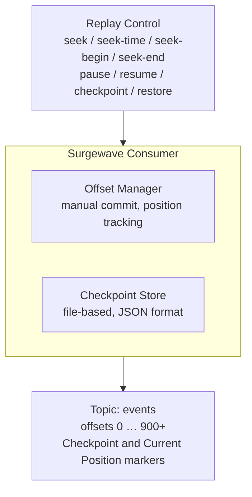

# Unit 18 Project: Replay System - Time-Travel Consumer

Build a message replay system that allows seeking to specific positions, timestamps, and replaying historical data.

## Scenario

You're building a debugging and audit system that needs to:
1. Replay messages from specific points in history
2. Seek to timestamps for point-in-time analysis
3. Pause and resume consumption for investigation
4. Track consumption progress with custom checkpoints
5. Support "time travel" for debugging production issues

## Requirements

### Functional Requirements

- [ ] Seek to specific offsets in topic partitions
- [ ] Seek to timestamps for point-in-time replay
- [ ] Pause/resume consumption for flow control
- [ ] Maintain custom checkpoints for recovery
- [ ] Display replay progress and statistics

### Technical Requirements

- [ ] Manual offset management (no auto-commit)
- [ ] Implement checkpoint persistence
- [ ] Support seeking to beginning, end, or specific position
- [ ] Handle partition assignment changes
- [ ] Track replay statistics (messages, duration, rate)

## Architecture



## Expected Output

```
=== Time-Travel Replay System ===

[Setup] Creating events topic with historical data...
[Setup] Produced 1000 events spanning 24 hours
[Setup] Earliest: 2024-01-01 00:00:00, Latest: 2024-01-01 23:59:00

[Replay] Starting replay consumer...
[Replay] Current position: offset 0 (earliest)

[Command] seek-time 2024-01-01T12:00:00
[Seek] Searching for timestamp 2024-01-01 12:00:00...
[Seek] Found: offset 500 (closest match)
[Seek] Position set to offset 500

[Replay] Consuming from offset 500...
[Event] offset=500 | 2024-01-01 12:00:00 | UserLogin { user: "alice" }
[Event] offset=501 | 2024-01-01 12:01:00 | PageView { page: "/dashboard" }
[Event] offset=502 | 2024-01-01 12:02:00 | Purchase { amount: 99.99 }

[Command] pause
[Replay] Consumption paused at offset 503
[Stats] Processed: 3 messages, Duration: 2s, Rate: 1.5 msg/s

[Command] checkpoint save
[Checkpoint] Saved position: { partition: 0, offset: 503, timestamp: ... }

[Command] seek 100
[Seek] Position set to offset 100

[Replay] Consuming from offset 100...
[Event] offset=100 | 2024-01-01 02:30:00 | UserLogin { user: "bob" }

[Command] checkpoint restore
[Checkpoint] Restored position: { partition: 0, offset: 503 }
[Seek] Position set to offset 503

[Replay] Resuming from checkpoint...
[Event] offset=503 | 2024-01-01 12:03:00 | Logout { user: "alice" }

[Command] seek-end
[Seek] Position set to latest: offset 999

[Stats] Replay Summary:
  - Total seeks: 4
  - Messages replayed: 25
  - Checkpoints saved: 1
  - Time range covered: 21 hours

=== Replay System Complete ===
```

## Event Message Format

```csharp
public record EventMessage(
    long Offset,
    DateTime Timestamp,
    string EventType,
    string Payload
);

public record Checkpoint(
    int Partition,
    long Offset,
    DateTime SavedAt,
    string Description
);

public record ReplayStats(
    int TotalSeeks,
    long MessagesReplayed,
    TimeSpan TotalDuration,
    DateTime? EarliestSeen,
    DateTime? LatestSeen
);
```

## Getting Started

```bash
cd bootcamp/unit-18/project/start
dotnet run
```

## Hints

1. Use `Seek(topicPartition, offset)` for direct offset seeking
2. For timestamp seeking, binary search or scan messages
3. Store checkpoints as JSON file in local directory
4. Use `Pause()` and `Resume()` for flow control
5. Track statistics with `Stopwatch` for accurate timing

## Evaluation Criteria

| Criteria | Points |
|----------|--------|
| Seek to offset works | 20 |
| Seek to timestamp works | 25 |
| Pause/resume functions | 20 |
| Checkpoint save/restore | 20 |
| Statistics accurate | 15 |

## Solution

Compare your implementation with [completed/](completed/README.md) when done.
