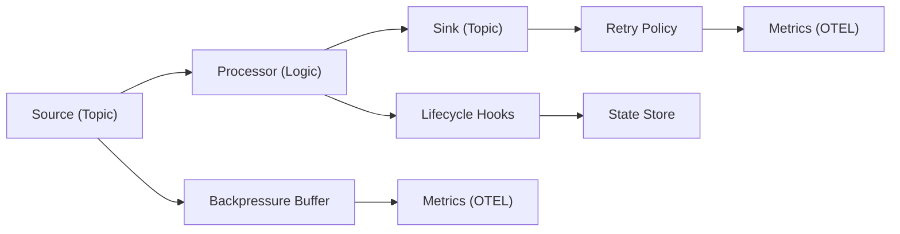
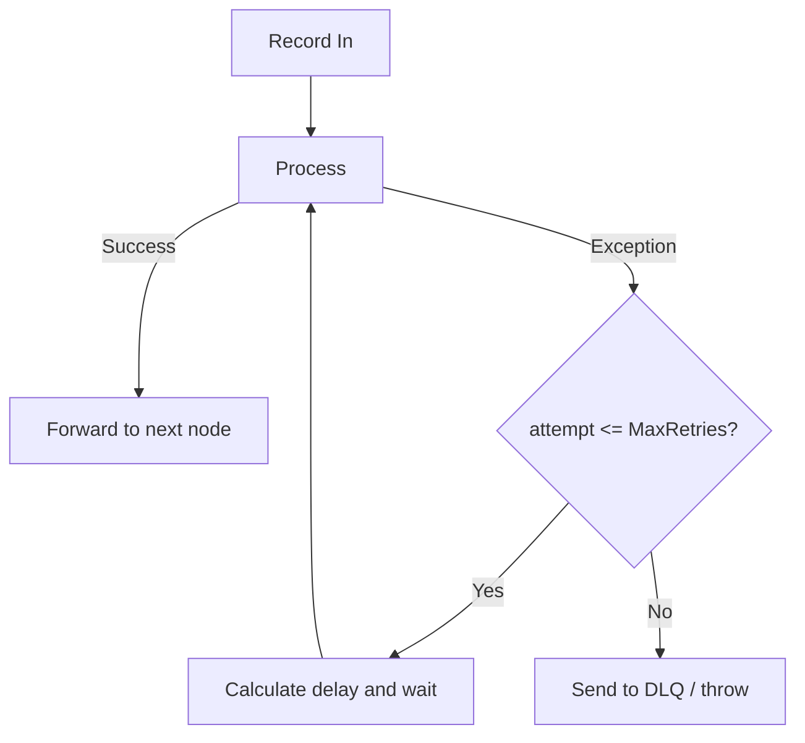

# Unit 7: Advanced Stream Processing

Master the advanced Streams features in Surgewave including processor lifecycle hooks, per-processor metrics, backpressure flow control, foreign key table-table joins, and retry with backoff strategies.

## Learning Objectives

By the end of this unit, you will be able to:

- Implement processor lifecycle hooks for resource initialization and cleanup
- Monitor per-node processing metrics using OpenTelemetry counters and histograms
- Configure backpressure strategies to handle high-throughput scenarios
- Build foreign key table-table joins for complex data relationships
- Add retry logic with configurable backoff strategies for transient failures
- Query stream state stores directly via the Interactive Query Service REST API

## Lessons

| Lesson | Topic | Description |
|--------|-------|-------------|
| [7.1](lesson-1/README.md) | Processor Lifecycle Hooks | OnInit, OnClose, graceful shutdown orchestration |
| [7.2](lesson-2/README.md) | Per-Processor Metrics | OTEL counters, histograms, state store metrics |
| [7.3](lesson-3/README.md) | Backpressure & Flow Control | Bounded buffers, watermarks, drop strategies |
| [7.4](lesson-4/README.md) | Foreign Key Table-Table Joins | FK joins, left joins, subscription tracking |
| [7.5](lesson-5/README.md) | Retry & Backoff Integration | Retry policies, backoff strategies, exhaustion handling |
| [7.6](lesson-6/README.md) | Interactive Query Service (IQS) | REST API for KV/Window/Session stores, StateStoreRegistry, real-time dashboards |

## Prerequisites

- Completed Unit 1: Surgewave Fundamentals
- Completed Unit 2: Surgewave Control UI Mastery
- Completed Unit 5: Stream Processing
- Familiarity with OpenTelemetry concepts (recommended)

## Why Advanced Streams?

Unit 5 covered the fundamentals of stream processing: filtering, mapping, aggregation, and windowing. Real-world production systems demand more:

| | Basic Streams (Unit 5) | Advanced Streams (Unit 7) |
|---|---|---|
| Transformations | Filter, Map, FlatMap | Lifecycle hooks for init/cleanup of external resources |
| Aggregation | GroupBy, Aggregate | Per-node metrics for granular observability |
| Windowing | Tumbling, Sliding, Session | Backpressure to prevent OOM under load spikes |
| Joins | Simple KTable joins | Foreign key joins for non-key relationships |
| State | Basic state stores | Retry with backoff for transient external failures |
| Queries | — | Interactive Query Service (IQS) for real-time state queries |

### SQL Windowed Aggregations

As an alternative to the Streams API for windowed aggregations, Surgewave's SQL engine supports SQL-based windowed queries that run continuously over topic data. This can be more accessible for teams familiar with SQL:

```sql
SELECT
    value->>'sensorId' AS sensor,
    AVG(CAST(value->>'temperature' AS DOUBLE)) AS avg_temp,
    MAX(CAST(value->>'temperature' AS DOUBLE)) AS max_temp,
    COUNT(*) AS readings
FROM sensor_data
WINDOW TUMBLING (SIZE 5 MINUTES)
GROUP BY value->>'sensorId'
EMIT CHANGES
```

SQL windowed aggregations support tumbling, sliding, and session windows with the same semantics as the Streams API. Results can be emitted to a destination topic or queried interactively. For complex stateful processing (foreign key joins, custom backpressure, lifecycle hooks), the Streams API remains the recommended approach.

## Advanced Streams Architecture



---

## Lesson 7.1: Processor Lifecycle Hooks

Processor lifecycle hooks let you initialize resources when a processor starts and clean them up when it shuts down. This is essential for managing database connections, HTTP clients, file handles, and other external resources.

### IProcessorLifecycle Interface

```csharp
public interface IProcessorLifecycle
{
    /// <summary>
    /// Called when the processor node is initialized, before processing begins.
    /// Use this to open connections, warm caches, or allocate resources.
    /// </summary>
    Task OnInit(ProcessorLifecycleContext context);

    /// <summary>
    /// Called when the processor node is shutting down, after processing stops.
    /// Use this to flush buffers, close connections, or release resources.
    /// </summary>
    Task OnClose(ProcessorLifecycleContext context);
}
```

### ProcessorLifecycleContext

The context provides information about the processor node and access to the processing context:

```csharp
public class ProcessorLifecycleContext
{
    /// <summary>The name of this processor node in the topology.</summary>
    public string NodeName { get; }

    /// <summary>The processor context for accessing state stores and forwarding.</summary>
    public ProcessorContext ProcessorContext { get; }

    /// <summary>Token that is cancelled when the processor is shutting down.</summary>
    public CancellationToken ShutdownToken { get; }
}
```

### Example: HTTP Client Lifecycle

```csharp
public class EnrichmentProcessor : IProcessor<string, Order>, IProcessorLifecycle
{
    private HttpClient _httpClient = null!;
    private IMemoryCache _cache = null!;

    public async Task OnInit(ProcessorLifecycleContext context)
    {
        _httpClient = new HttpClient
        {
            BaseAddress = new Uri("https://api.enrichment.example.com"),
            Timeout = TimeSpan.FromSeconds(5)
        };

        _cache = new MemoryCache(new MemoryCacheOptions
        {
            SizeLimit = 10_000
        });

        // Warm the cache with frequently accessed data
        await WarmCacheAsync(context.ShutdownToken);
    }

    public Task OnClose(ProcessorLifecycleContext context)
    {
        _httpClient.Dispose();
        _cache.Dispose();
        return Task.CompletedTask;
    }

    public async Task Process(string key, Order value, ProcessorContext context)
    {
        var enrichedOrder = await EnrichOrderAsync(value);
        context.Forward(key, enrichedOrder);
    }
}
```

### ShutdownOrchestrator

The `ShutdownOrchestrator` ensures processors shut down in reverse-topological order. This means sink nodes close first, then transforms, then sources -- preventing data loss during shutdown.

| Phase | Order | Action |
|-------|-------|--------|
| Startup | Source → Transform → Sink | Initialize resources in topological order |
| Shutdown Step 1 | Sink.OnClose() | Flush pending writes |
| Shutdown Step 2 | Transform.OnClose() | Release resources |
| Shutdown Step 3 | Source.OnClose() | Stop consuming, commit offsets |

> Timeout: 30 seconds (configurable via `StreamsConfig.GracefulShutdownTimeout`)

### Configuring Shutdown Timeout

```csharp
var config = new StreamsConfig
{
    ApplicationId = "order-enrichment",
    BootstrapServers = "localhost:9092",
    GracefulShutdownTimeout = TimeSpan.FromSeconds(60) // default: 30s
};
```

If a processor's `OnClose` exceeds the timeout, the orchestrator logs a warning and proceeds to the next node to prevent indefinite hangs.

---

## Lesson 7.2: Per-Processor Metrics

Surgewave exposes per-processor OpenTelemetry metrics so you can monitor each node's performance individually rather than only at the topology level.

### ProcessorNodeMetrics

Each processor node automatically tracks four metrics:

```csharp
public class ProcessorNodeMetrics
{
    /// <summary>Increment when a record enters the processor.</summary>
    public void RecordIn();

    /// <summary>Increment when a record exits the processor (forwarded).</summary>
    public void RecordOut();

    /// <summary>Record the processing duration for a single record.</summary>
    public void RecordLatency(double milliseconds);

    /// <summary>Increment when processing a record throws an exception.</summary>
    public void RecordError();
}
```

### OTEL Instruments

| Metric Name | Type | Unit | Description |
|-------------|------|------|-------------|
| `surgewave.streams.processor.records_in` | Counter | records | Total records received by this node |
| `surgewave.streams.processor.records_out` | Counter | records | Total records forwarded by this node |
| `surgewave.streams.processor.latency` | Histogram | ms | Processing time per record |
| `surgewave.streams.processor.errors` | Counter | records | Total processing errors |

All metrics are tagged with `processor_name` and `topology_id` labels for filtering and grouping.

### StateStoreMetrics

State stores also expose per-operation metrics:

```csharp
public class StateStoreMetrics
{
    /// <summary>Record a put operation and its duration.</summary>
    public void RecordPut(double milliseconds);

    /// <summary>Record a get operation and its duration.</summary>
    public void RecordGet(double milliseconds);

    /// <summary>Record a delete operation and its duration.</summary>
    public void RecordDelete(double milliseconds);
}
```

| Metric Name | Type | Unit | Description |
|-------------|------|------|-------------|
| `surgewave.streams.store.put_latency` | Histogram | ms | Put operation duration |
| `surgewave.streams.store.get_latency` | Histogram | ms | Get operation duration |
| `surgewave.streams.store.delete_latency` | Histogram | ms | Delete operation duration |
| `surgewave.streams.store.entries` | ObservableGauge | entries | Current entry count in the store |

### Accessing Metrics via StreamsMetrics

```csharp
var topology = builder.Build();
var streams = new SurgewaveStreams(topology, config);
await streams.StartAsync();

// Access metrics for a specific processor
var metrics = streams.Metrics;
var filterMetrics = metrics.GetProcessorMetrics("filter-orders");

Console.WriteLine($"Records In:  {filterMetrics.RecordsIn}");
Console.WriteLine($"Records Out: {filterMetrics.RecordsOut}");
Console.WriteLine($"Error Count: {filterMetrics.Errors}");

// Access state store metrics
var storeMetrics = metrics.GetStoreMetrics("order-counts-store");
Console.WriteLine($"Store Entries: {storeMetrics.EntryCount}");
```

### Visualizing Metrics

Per-processor metrics integrate with any OTEL-compatible backend:

| Processor | Records In | Records Out | Latency P50 | Latency P99 | Error Rate |
|-----------|-----------|------------|------------|------------|-----------|
| filter-orders | 45,230/s | 12,100/s (73% filtered) | 0.8 ms | 3.2 ms | 0.001% |
| enrich-orders | 12,100/s | 12,098/s (2 errors) | 4.5 ms (HTTP) | 45 ms | 0.016% |

---

## Lesson 7.3: Backpressure & Flow Control

When a downstream processor is slower than the upstream, records pile up in memory. Backpressure mechanisms prevent out-of-memory conditions by bounding internal buffers and applying flow control.

### BackpressureBuffer

The `BackpressureBuffer` uses a `System.Threading.Channels.Channel<T>` internally to implement a bounded, thread-safe buffer between processor nodes:

```csharp
public class BackpressureBuffer<TKey, TValue>
{
    private readonly Channel<KeyValuePair<TKey, TValue>> _channel;

    public BackpressureBuffer(BackpressureConfig config)
    {
        _channel = Channel.CreateBounded<KeyValuePair<TKey, TValue>>(
            new BoundedChannelOptions(config.MaxBufferedRecords)
            {
                FullMode = config.Strategy switch
                {
                    BackpressureStrategy.Block => BoundedChannelFullMode.Wait,
                    BackpressureStrategy.DropOldest => BoundedChannelFullMode.DropOldest,
                    BackpressureStrategy.DropNewest => BoundedChannelFullMode.DropNewest,
                    _ => BoundedChannelFullMode.Wait
                }
            });
    }
}
```

### BackpressureConfig

```csharp
public class BackpressureConfig
{
    /// <summary>Maximum number of records buffered between nodes.</summary>
    public int MaxBufferedRecords { get; set; } = 10_000;

    /// <summary>When buffer reaches this percentage, begin slowing the producer.</summary>
    public double HighWatermark { get; set; } = 0.8; // 80%

    /// <summary>When buffer drops to this percentage, resume normal speed.</summary>
    public double LowWatermark { get; set; } = 0.4; // 40%

    /// <summary>Strategy to apply when the buffer is full.</summary>
    public BackpressureStrategy Strategy { get; set; } = BackpressureStrategy.Block;
}
```

### Backpressure Strategies

| Strategy | Behavior | Data Loss | Use Case |
|----------|----------|-----------|----------|
| Block | Upstream pauses until space is available | None | Financial, transactional (must not lose data) |
| DropOldest | Oldest buffered record is discarded | Yes (oldest) | Real-time analytics (latest data matters most) |
| DropNewest | Incoming record is discarded | Yes (newest) | Sensor telemetry (prefer older readings) |

### Watermark Flow Control

| Buffer Level | Action |
|-------------|--------|
| 100% (Full) | Strategy applied (Block / Drop) |
| 80% (High Watermark) | Slow down upstream |
| 40%–80% | Normal operation (pass-through) |
| 40% (Low Watermark) | Resume full speed |
| 0% (Empty) | No backpressure applied |

The hysteresis between high and low watermarks prevents oscillation.

The hysteresis between high and low watermarks prevents oscillation (rapidly switching between throttled and unthrottled states).

### Configuring Backpressure on a Stream

```csharp
var builder = new StreamsBuilder();

builder.Stream<string, SensorReading>("sensor-data")
    .WithBackpressure(new BackpressureConfig
    {
        MaxBufferedRecords = 50_000,
        HighWatermark = 0.75,
        LowWatermark = 0.3,
        Strategy = BackpressureStrategy.DropOldest
    })
    .Filter((key, value) => value.Temperature > 100)
    .To("high-temp-alerts");
```

### Backpressure Metrics

| Metric Name | Type | Description |
|-------------|------|-------------|
| `surgewave.streams.backpressure.buffer_size` | ObservableGauge | Current records in buffer |
| `surgewave.streams.backpressure.dropped_total` | Counter | Total records dropped (DropOldest/DropNewest) |

---

## Lesson 7.4: Foreign Key Table-Table Joins

Standard KTable joins require both tables to be keyed by the same key. Foreign key joins allow you to join two tables where one table references the other by a non-key field.

### The Problem

**Orders Table** (keyed by OrderId):

| OrderId | CustomerId | Amount |
|---------|-----------|--------|
| ord-1 | cust-42 | 99.99 |
| ord-2 | cust-17 | 249.50 |
| ord-3 | cust-42 | 35.00 |

**Customers Table** (keyed by CustomerId):

| CustomerId | Name | Region |
|-----------|------|--------|
| cust-42 | Alice | US-West |
| cust-17 | Bob | EU-West |
| cust-89 | Charlie | AP-East |

How do we join Orders with Customers when Orders is keyed by OrderId, not CustomerId?

### Foreign Key Join API

```csharp
var builder = new StreamsBuilder();

var orders = builder.Table<string, Order>("orders");       // keyed by OrderId
var customers = builder.Table<string, Customer>("customers"); // keyed by CustomerId

// Join orders to customers using Order.CustomerId as the foreign key
var enrichedOrders = orders.Join<string, Customer, EnrichedOrder>(
    foreignTable: customers,
    keyExtractor: order => order.CustomerId,  // extract FK from left record
    joiner: (order, customer) => new EnrichedOrder
    {
        OrderId = order.OrderId,
        CustomerName = customer.Name,
        Region = customer.Region,
        Amount = order.Amount
    }
);

enrichedOrders.ToStream().To("enriched-orders");
```

### Left Join for Optional Matches

Use `LeftJoin` when the foreign key might not have a match in the right table:

```csharp
var enrichedOrders = orders.LeftJoin<string, Customer, EnrichedOrder>(
    foreignTable: customers,
    keyExtractor: order => order.CustomerId,
    joiner: (order, customer) => new EnrichedOrder
    {
        OrderId = order.OrderId,
        CustomerName = customer?.Name ?? "Unknown",
        Region = customer?.Region ?? "N/A",
        Amount = order.Amount
    }
);
```

### How It Works Internally

1. Order arrives: `{ OrderId: "ord-1", CustomerId: "cust-42" }`
2. `ForeignKeyJoinNode` extracts FK: `"cust-42"`
3. `ForeignKeySubscriptionStore` records: `"cust-42" → ["ord-1"]`
4. Lookup `"cust-42"` in Customers table → `{ Name: "Alice", Region: "US-West" }`
5. Joiner produces: `{ OrderId: "ord-1", CustomerName: "Alice", Region: "US-West", Amount: 99.99 }`

When Customer `"cust-42"` updates:
6. SubscriptionStore looks up: `"cust-42" → ["ord-1", "ord-3"]`
7. Re-joins all orders referencing this customer
8. Updated results are emitted downstream

### ForeignKeySubscriptionStore

The `ForeignKeySubscriptionStore` tracks which primary keys (orders) reference each foreign key (customer). When the foreign table updates, all affected primary records are re-joined:

```csharp
// Internal subscription tracking
public class ForeignKeySubscriptionStore<TPrimaryKey, TForeignKey>
{
    // FK -> Set of PKs that reference this FK
    // e.g., "cust-42" -> { "ord-1", "ord-3" }
    private readonly Dictionary<TForeignKey, HashSet<TPrimaryKey>> _subscriptions;

    public void Subscribe(TPrimaryKey primaryKey, TForeignKey foreignKey);
    public void Unsubscribe(TPrimaryKey primaryKey, TForeignKey foreignKey);
    public IReadOnlySet<TPrimaryKey> GetSubscribers(TForeignKey foreignKey);
}
```

### Example: Orders Joined with Products

A more complex example joining orders with a products catalog by ProductId:

```csharp
public record Order(string OrderId, string ProductId, int Quantity);
public record Product(string ProductId, string Name, decimal Price);
public record OrderDetail(string OrderId, string ProductName, int Quantity, decimal LineTotal);

var orders = builder.Table<string, Order>("orders");
var products = builder.Table<string, Product>("products");

var orderDetails = orders.Join<string, Product, OrderDetail>(
    foreignTable: products,
    keyExtractor: order => order.ProductId,
    joiner: (order, product) => new OrderDetail(
        order.OrderId,
        product.Name,
        order.Quantity,
        product.Price * order.Quantity
    )
);
```

---

## Lesson 7.5: Retry & Backoff Integration

When stream processors call external services (HTTP APIs, databases, third-party systems), transient failures are inevitable. Surgewave's retry integration provides configurable retry policies with multiple backoff strategies.

### StreamsRetryConfig

```csharp
public class StreamsRetryConfig
{
    /// <summary>Enable retry logic for this processor.</summary>
    public bool Enabled { get; set; } = false;

    /// <summary>Maximum number of retry attempts before giving up.</summary>
    public int MaxRetries { get; set; } = 3;

    /// <summary>Initial delay before the first retry.</summary>
    public TimeSpan InitialDelay { get; set; } = TimeSpan.FromMilliseconds(100);

    /// <summary>Maximum delay between retries (caps exponential growth).</summary>
    public TimeSpan MaxDelay { get; set; } = TimeSpan.FromSeconds(30);

    /// <summary>Backoff strategy to calculate delay between retries.</summary>
    public BackoffStrategy Strategy { get; set; } = BackoffStrategy.ExponentialWithJitter;
}
```

### Backoff Strategies

| Strategy | Formula | Example (InitialDelay=100ms) | Use Case |
|----------|---------|------------------------------|----------|
| Fixed | `delay = InitialDelay` | 100, 100, 100 ms | Simple retry, known recovery time |
| Linear | `delay = InitialDelay * attempt` | 100, 200, 300 ms | Gradually increasing backoff |
| Exponential | `delay = InitialDelay * 2^attempt` | 100, 200, 400 ms | API rate limits, server overload |
| ExponentialWithJitter | `delay = random(0, InitialDelay * 2^attempt)` | 73, 156, 312 ms | Multiple clients retrying (prevents thundering herd) |

| Attempt | Fixed (100ms) | Linear (100ms × n) | Exponential (100ms × 2^n) |
|---------|--------------|-------------------|--------------------------|
| 1 | 100 ms | 100 ms | 100 ms |
| 2 | 100 ms | 200 ms | 200 ms |
| 3 | 100 ms | 300 ms | 400 ms |
| 4 | 100 ms | 400 ms | 800 ms |
| 5 | 100 ms | 500 ms | 1,600 ms |

`ExponentialWithJitter` adds random variance to prevent multiple clients from retrying at the exact same moment (thundering herd).

### Using WithRetry on a Stream

```csharp
var builder = new StreamsBuilder();

builder.Stream<string, Order>("orders")
    .WithRetry(maxRetries: 5)
    .MapAsync(async (key, order) =>
    {
        // This HTTP call will be retried on transient failures
        var enrichment = await _httpClient.GetFromJsonAsync<Enrichment>(
            $"/api/enrich/{order.CustomerId}");
        return order with { Region = enrichment.Region };
    })
    .To("enriched-orders");
```

### Full Retry Configuration

```csharp
builder.Stream<string, Order>("orders")
    .WithRetry(new StreamsRetryConfig
    {
        Enabled = true,
        MaxRetries = 5,
        InitialDelay = TimeSpan.FromMilliseconds(200),
        MaxDelay = TimeSpan.FromSeconds(10),
        Strategy = BackoffStrategy.ExponentialWithJitter
    })
    .MapAsync(async (key, order) =>
    {
        // Retried up to 5 times with exponential jitter backoff
        return await EnrichAsync(order);
    })
    .To("enriched-orders");
```

### RetryNode Wrapper

Internally, `WithRetry` wraps the downstream processor in a `RetryNode` that catches exceptions and applies the backoff policy:



### Retry Metrics

| Metric Name | Type | Description |
|-------------|------|-------------|
| `surgewave.streams.retry.retries_total` | Counter | Total retry attempts across all records |
| `surgewave.streams.retry.retries_exhausted_total` | Counter | Records that exhausted all retries |

### Example: Handling Transient API Errors

```csharp
public class WeatherEnrichmentProcessor : IProcessor<string, SensorReading>, IProcessorLifecycle
{
    private HttpClient _client = null!;

    public Task OnInit(ProcessorLifecycleContext context)
    {
        _client = new HttpClient
        {
            BaseAddress = new Uri("https://api.weather.example.com"),
            Timeout = TimeSpan.FromSeconds(5)
        };
        return Task.CompletedTask;
    }

    public async Task Process(string key, SensorReading value, ProcessorContext context)
    {
        // This call may throw HttpRequestException on transient failures.
        // The RetryNode wrapper will catch it and retry with backoff.
        var weather = await _client.GetFromJsonAsync<WeatherData>(
            $"/v1/current?lat={value.Latitude}&lon={value.Longitude}");

        var enriched = value with { Temperature = weather!.Temperature };
        context.Forward(key, enriched);
    }

    public Task OnClose(ProcessorLifecycleContext context)
    {
        _client.Dispose();
        return Task.CompletedTask;
    }
}

// Wire it up with retry
builder.Stream<string, SensorReading>("sensor-data")
    .WithRetry(new StreamsRetryConfig
    {
        Enabled = true,
        MaxRetries = 3,
        InitialDelay = TimeSpan.FromMilliseconds(500),
        MaxDelay = TimeSpan.FromSeconds(5),
        Strategy = BackoffStrategy.ExponentialWithJitter
    })
    .Process<WeatherEnrichmentProcessor>()
    .To("enriched-sensor-data");
```

---

## Exercises

### Exercise 1: Build a Stream Topology with Lifecycle Hooks

1. Create a processor that connects to an external resource (e.g., a cache or HTTP client) in `OnInit`
2. Process records using the external resource
3. Clean up the resource in `OnClose`
4. Start and stop the topology, verifying that `OnInit` and `OnClose` are called in the correct order
5. Test with a multi-node topology (3+ processors) and confirm reverse-topological shutdown order

### Exercise 2: Monitor Per-Node Processing Metrics

1. Build a 3-node topology: Source -> Filter -> Enrichment -> Sink
2. Export metrics to the console using `ConsoleExporter` or a local OTEL collector
3. Observe `records_in` and `records_out` for the Filter node to calculate filter-out ratio
4. Track `latency` histograms for the Enrichment node to identify slow external calls
5. Monitor `store.entries` gauge to watch state store growth over time

### Exercise 3: Configure Backpressure for a High-Throughput Pipeline

1. Create a topology with a fast producer (10,000 records/s) and a slow consumer (1,000 records/s)
2. Run without backpressure and observe memory growth
3. Add `WithBackpressure` with `MaxBufferedRecords = 5000` and `Strategy = Block`
4. Observe that the producer throttles to match consumer speed
5. Switch to `DropOldest` and verify records are dropped when the buffer fills
6. Monitor `backpressure.buffer_size` and `backpressure.dropped_total` metrics

### Exercise 4: Implement a Foreign Key Join

1. Create an `orders` topic keyed by OrderId with a `ProductId` field
2. Create a `products` topic keyed by ProductId with `Name` and `Price` fields
3. Build a foreign key join: `orders.Join(products, o => o.ProductId, ...)`
4. Produce orders and products, verifying joined output
5. Update a product's price and verify all orders referencing that product re-emit with the new price
6. Test with `LeftJoin` by producing an order referencing a non-existent product

### Exercise 5: Add Retry Logic for an HTTP-Calling Processor

1. Create a mock HTTP server that fails 50% of requests with `503 Service Unavailable`
2. Build a stream processor that calls the mock server for each record
3. Configure `WithRetry` using `ExponentialWithJitter` with 3 max retries
4. Process 100 records and verify that all eventually succeed (no records lost)
5. Monitor `retries_total` and `retries_exhausted_total` metrics
6. Reduce `MaxRetries` to 1 and verify some records are sent to the DLQ

## Key Concepts Summary

| Concept | Purpose | Key Class |
|---------|---------|-----------|
| Lifecycle Hooks | Init/cleanup external resources | `IProcessorLifecycle` |
| Processor Metrics | Per-node observability | `ProcessorNodeMetrics` |
| Backpressure | Prevent OOM under load | `BackpressureBuffer` |
| Foreign Key Joins | Join on non-key fields | `ForeignKeyJoinNode` |
| Retry & Backoff | Handle transient failures | `StreamsRetryConfig` |
| Interactive Queries | Query state stores via REST | `QueryExecutor` / IQS API |

## Best Practices

| Practice | Description |
|----------|-------------|
| Always implement OnClose | Leaking resources causes memory issues and connection exhaustion |
| Use ExponentialWithJitter | Prevents thundering herd when multiple instances retry simultaneously |
| Set appropriate watermarks | Too close together causes oscillation; keep at least 20% gap |
| Monitor dropped records | Configure alerts on `dropped_total` to catch silent data loss |
| Choose Block for critical data | Never use Drop strategies for financial or transactional data |
| Test FK joins with updates | Verify that foreign table updates correctly re-emit joined records |

---

**Ready?** [Start Lesson 7.1: Processor Lifecycle Hooks](lesson-1/README.md)
