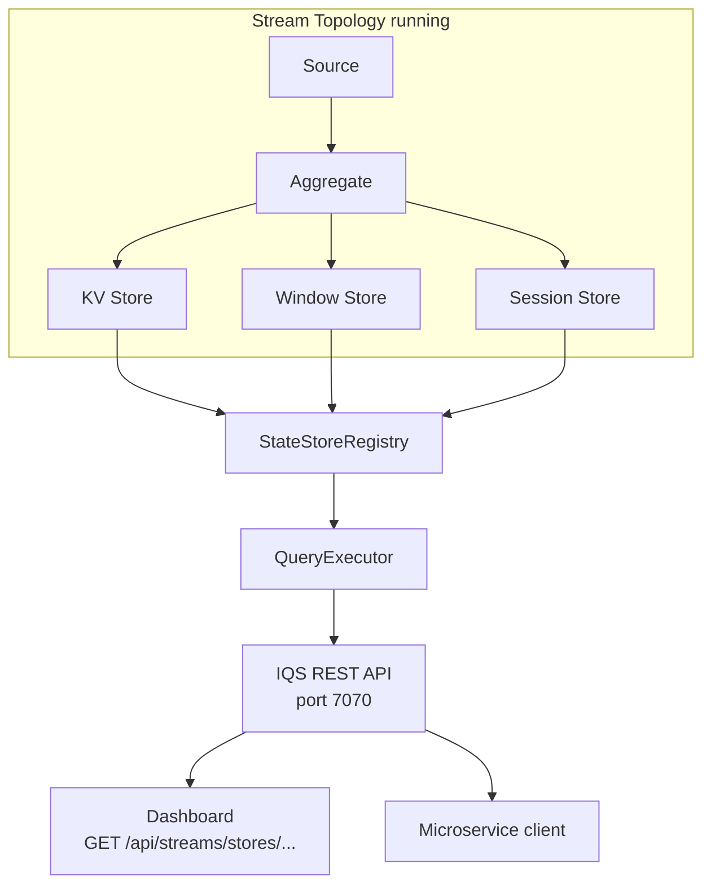

# Lesson 7.6: Interactive Query Service (IQS)

The Interactive Query Service lets you query the state stored inside a running stream topology directly from external clients — no secondary database required. A REST API surfaces KV, Window, and Session stores so that dashboards and microservices can read real-time state without touching Kafka topics.

## Learning Objectives

- Understand what IQS is and when to use it
- Configure IQS via DI and `StreamsConfig`
- Query KV, Window, and Session stores through the REST API
- Use `StateStoreRegistry` and `QueryExecutor` programmatically
- Build a real-time dashboard backed by stream state

## What Is IQS?

In a standard stream topology, the materialized state (aggregation results, join tables, session windows) lives inside the local state stores of the application instance. Without IQS, external services cannot access this state without re-reading the source topic.

IQS exposes the state stores over HTTP, enabling:



## REST API Endpoints

| Method | Path | Description |
|--------|------|-------------|
| `GET` | `/api/streams/stores` | List all registered state stores |
| `GET` | `/api/streams/stores/{storeName}/{key}` | Get a single key from a KV store |
| `GET` | `/api/streams/stores/{storeName}` | Scan all keys in a KV store |
| `GET` | `/api/streams/stores/{storeName}/{key}/windows` | Get all windows for a key |
| `GET` | `/api/streams/stores/{storeName}/{key}/session` | Get the session window for a key |

## StateStoreRegistry and QueryExecutor

```csharp
// StateStoreRegistry: knows about all stores in the topology
public class StateStoreRegistry
{
    public IReadOnlyList<string> StoreNames { get; }
    public IKeyValueStore<TKey, TValue> GetKvStore<TKey, TValue>(string name);
    public IWindowStore<TKey, TValue> GetWindowStore<TKey, TValue>(string name);
    public ISessionStore<TKey, TValue> GetSessionStore<TKey, TValue>(string name);
}

// QueryExecutor: type-safe queries over the registry
public class QueryExecutor
{
    public Task<TValue?> GetAsync<TKey, TValue>(string storeName, TKey key);
    public IAsyncEnumerable<KeyValuePair<TKey, TValue>> ScanAsync<TKey, TValue>(string storeName);
    public Task<IReadOnlyList<WindowedValue<TValue>>> GetWindowsAsync<TKey, TValue>(
        string storeName, TKey key);
    public Task<TValue?> GetSessionAsync<TKey, TValue>(string storeName, TKey key);
}
```

## Configuration and DI Setup

### appsettings.json

```json
{
  "Surgewave": {
    "Streams": {
      "ApplicationId": "order-aggregation",
      "BootstrapServers": "localhost:9092",
      "InteractiveQueries": {
        "Enabled": true,
        "Port": 7070
      }
    }
  }
}
```

### Program.cs

```csharp
builder.Services.AddSurgewaveStreams(config =>
{
    config.ApplicationId = "order-aggregation";
    config.BootstrapServers = "localhost:9092";
    config.InteractiveQueries.Enabled = true;
    config.InteractiveQueries.Port = 7070;
});

// IQS endpoints are registered automatically when Enabled = true
app.MapSurgewaveStreams();
```

### Building the Topology with Named Stores

Stores must be named to be queryable via IQS:

```csharp
var builder = new StreamsBuilder();

builder.Stream<string, Order>("orders")
    .GroupByKey()
    .Count(named: "order-counts-store");   // <-- named store

builder.Stream<string, Order>("orders")
    .GroupByKey()
    .WindowedBy(TumblingWindow.Of(TimeSpan.FromMinutes(5)))
    .Count(named: "order-window-counts");  // <-- named window store

var topology = builder.Build();
```

## Querying the REST API

### List All Stores

```bash
curl http://localhost:7070/api/streams/stores
```

Response:
```json
["order-counts-store", "order-window-counts"]
```

### Get a Single Key from a KV Store

```bash
curl http://localhost:7070/api/streams/stores/order-counts-store/customer-42
```

Response:
```json
{ "key": "customer-42", "value": 17, "storeName": "order-counts-store" }
```

### Scan All Keys in a KV Store

```bash
curl http://localhost:7070/api/streams/stores/order-counts-store
```

Response:
```json
[
  { "key": "customer-17", "value": 5 },
  { "key": "customer-42", "value": 17 },
  { "key": "customer-89", "value": 3 }
]
```

### Query Window Store

```bash
curl "http://localhost:7070/api/streams/stores/order-window-counts/customer-42/windows"
```

Response:
```json
[
  { "windowStart": "2026-03-22T10:00:00Z", "windowEnd": "2026-03-22T10:05:00Z", "value": 4 },
  { "windowStart": "2026-03-22T10:05:00Z", "windowEnd": "2026-03-22T10:10:00Z", "value": 7 }
]
```

## Programmatic Querying with QueryExecutor

```csharp
public class OrderDashboardService(QueryExecutor queryExecutor)
{
    public async Task<long> GetOrderCountAsync(string customerId)
    {
        var count = await queryExecutor.GetAsync<string, long>(
            "order-counts-store", customerId);
        return count ?? 0;
    }

    public async Task<Dictionary<string, long>> GetAllOrderCountsAsync()
    {
        var result = new Dictionary<string, long>();
        await foreach (var kv in queryExecutor.ScanAsync<string, long>("order-counts-store"))
            result[kv.Key] = kv.Value;
        return result;
    }

    public async Task<IReadOnlyList<WindowedValue<long>>> GetWindowedCountsAsync(string customerId)
    {
        return await queryExecutor.GetWindowsAsync<string, long>(
            "order-window-counts", customerId);
    }
}
```

## Use Case: Real-Time Dashboard

```csharp
// Minimal API endpoint backed by IQS
app.MapGet("/dashboard/customer/{id}", async (string id, QueryExecutor qe) =>
{
    var totalOrders = await qe.GetAsync<string, long>("order-counts-store", id);
    var recentWindows = await qe.GetWindowsAsync<string, long>("order-window-counts", id);

    return Results.Ok(new
    {
        CustomerId  = id,
        TotalOrders = totalOrders ?? 0,
        RecentActivity = recentWindows.Select(w => new
        {
            Window = $"{w.WindowStart:HH:mm} - {w.WindowEnd:HH:mm}",
            Count  = w.Value
        })
    });
});
```

## Exercise

1. Build a stream topology that counts orders by customer and stores results in a named KV store
2. Enable IQS on port 7070 in configuration
3. Use `curl` to query a specific customer key and scan all keys
4. Add a windowed count store (5-minute tumbling) and query windows via REST
5. Create a minimal API endpoint backed by `QueryExecutor` that serves a customer dashboard

---

[Back to Unit 7](../README.md)
