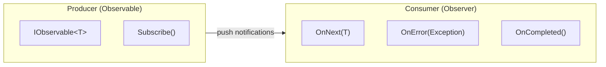
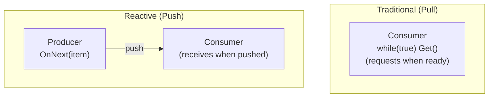
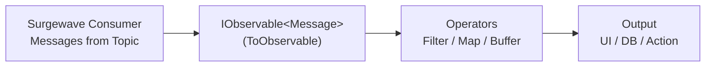

# Unit 8: Reactive Integration

Integrate Surgewave with reactive programming patterns using IObservable and IObserver.

## Learning Objectives

By the end of this unit, you will be able to:

- Understand reactive programming fundamentals with IObservable and IObserver
- Convert Surgewave consumers to observable sequences
- Implement custom reactive operators for stream processing
- Handle backpressure in reactive pipelines
- Bridge Surgewave with other reactive frameworks

## Lessons

| Lesson | Topic | Description |
|--------|-------|-------------|
| [12.1](lesson-1/README.md) | Reactive Basics | IObservable<T>, IObserver<T>, subscriptions |
| [12.2](lesson-2/README.md) | Surgewave as Observable | Converting Surgewave consumers to IObservable |
| [12.3](lesson-3/README.md) | Rx Operators | Using reactive operators with Surgewave |
| [12.4](lesson-4/README.md) | Backpressure | Handling flow control with reactive streams |
| [12.5](lesson-5/README.md) | Integration Patterns | Bridging with other reactive libraries |

## Prerequisites

- Completed Unit 1: Surgewave Fundamentals
- Completed Unit 3: Advanced Messaging (recommended)
- Basic understanding of async/await in C#

## Why Reactive Integration?

Reactive programming provides a declarative approach to handling asynchronous data streams:

| Benefit | Description |
|---------|-------------|
| Composability | Chain operations in a fluent, readable way |
| Backpressure | Handle fast producers with slow consumers |
| Error Handling | Unified error propagation through the pipeline |
| Cancellation | Clean subscription disposal |
| Testability | Easy to test with marble diagrams |

## Key Concepts

### The Observer Pattern



### Push vs Pull Model



### Surgewave + Reactive



### Built-in .NET Reactive Types

This unit uses only built-in .NET types - no external packages required:

```csharp
// Core interfaces
IObservable<T>  // Represents a push-based data source
IObserver<T>    // Receives push notifications
IDisposable     // Subscription handle for cleanup

// Creating observables
Observable.Create<T>()  // Custom observable
Subject<T>              // Both observable and observer

// Basic operators (we implement ourselves)
Where()                 // Filter elements
Select()               // Transform elements
Buffer()               // Batch elements
Throttle()             // Rate limiting
```

## Common Patterns

### Converting Surgewave Consumer to Observable

```csharp
public class SurgewaveObservable<TKey, TValue> : IObservable<ConsumeResult<TKey, TValue>>
{
    private readonly SurgewaveConsumer<TKey, TValue> _consumer;

    public IDisposable Subscribe(IObserver<ConsumeResult<TKey, TValue>> observer)
    {
        var cts = new CancellationTokenSource();

        Task.Run(async () =>
        {
            while (!cts.Token.IsCancellationRequested)
            {
                var result = await _consumer.ConsumeAsync(TimeSpan.FromSeconds(1));
                if (result != null)
                    observer.OnNext(result);
            }
        });

        return new Subscription(() => cts.Cancel());
    }
}
```

### Implementing Custom Operators

```csharp
public static IObservable<TResult> Select<TSource, TResult>(
    this IObservable<TSource> source,
    Func<TSource, TResult> selector)
{
    return new SelectObservable<TSource, TResult>(source, selector);
}
```

## Decision Framework

When integrating Surgewave with reactive patterns, consider:

1. **What's the consumption pattern?** Push (reactive) vs Pull (traditional)
2. **Do you need backpressure?** Buffer, sample, or drop?
3. **What operators do you need?** Filter, map, aggregate?
4. **How to handle errors?** Retry, dead letter, circuit breaker?
5. **What's the lifecycle?** Long-running or bounded?

---

**Ready?** [Start Lesson 12.1: Reactive Basics](lesson-1/README.md)
