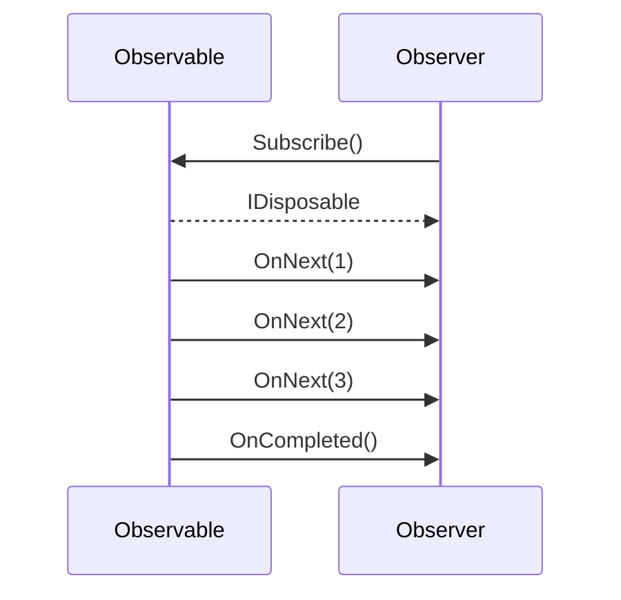

# Lesson 12.1: Reactive Basics

> **Difficulty:** Advanced | **Duration:** 45 min | **Prerequisites:** Unit 11 completion

## Overview

Learn the fundamentals of reactive programming using .NET's built-in IObservable<T> and IObserver<T> interfaces.

## Learning Objectives

- Understand the Observer design pattern
- Implement IObservable<T> and IObserver<T>
- Manage subscriptions and cleanup
- Handle OnNext, OnError, and OnCompleted

## Why Reactive Programming?

Traditional imperative programming pulls data when needed. Reactive programming pushes data to subscribers as it becomes available:

| Aspect | Imperative (Pull) | Reactive (Push) |
|--------|-------------------|-----------------|
| Control | Consumer requests | Producer notifies |
| Blocking | Often blocks | Non-blocking |
| Composition | Manual loops | Operator chaining |
| Error handling | try/catch | OnError callback |

## Key Concepts

### IObservable<T> - The Data Source

```csharp
public interface IObservable<out T>
{
    IDisposable Subscribe(IObserver<T> observer);
}
```

The observable is the producer that emits values over time.

### IObserver<T> - The Data Consumer

```csharp
public interface IObserver<in T>
{
    void OnNext(T value);        // New value received
    void OnError(Exception error); // Error occurred
    void OnCompleted();          // Stream finished
}
```

The observer receives notifications from the observable.

### Subscription Lifecycle



### Subject<T> - Both Observable and Observer

A Subject is both an observable and an observer, making it useful for bridging imperative and reactive code:

```csharp
var subject = new Subject<int>();

// As Observable - others can subscribe
subject.Subscribe(x => Console.WriteLine(x));

// As Observer - you can push values
subject.OnNext(1);
subject.OnNext(2);
subject.OnCompleted();
```

## Exercise

In this exercise, you'll:

1. Create a custom observable that emits numbers
2. Implement a custom observer that processes values
3. Use Subject<T> to bridge imperative code
4. Handle proper cleanup with IDisposable

---

**Instructions:** [INSTRUCTIONS.md](INSTRUCTIONS.md)
