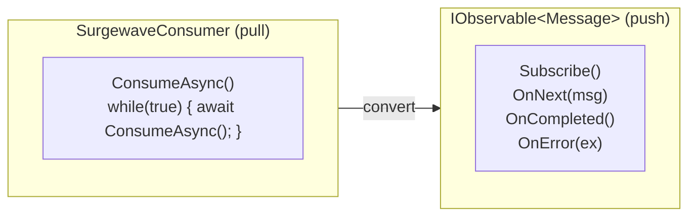

# Lesson 12.2: Surgewave as Observable

> **Difficulty:** Advanced | **Duration:** 45 min | **Prerequisites:** Lesson 12.1

## Overview

Learn how to convert Surgewave consumers into IObservable<T> streams, enabling reactive consumption of messages.

## Learning Objectives

- Convert SurgewaveConsumer to IObservable
- Handle subscription lifecycle properly
- Manage cancellation and cleanup
- Build a reusable reactive wrapper

## Why Observable Consumers?

Converting Surgewave consumers to observables provides several benefits:

| Traditional Consumer | Observable Consumer |
|---------------------|---------------------|
| Manual polling loop | Push-based notification |
| Explicit error handling | OnError propagation |
| Manual cancellation | Dispose() cleanup |
| Hard to compose | Operator chaining |

## Key Concepts

### The Conversion Pattern



### Wrapper Architecture

```csharp
public class SurgewaveObservable<TKey, TValue> : IObservable<ConsumeResult<TKey, TValue>>
{
    private readonly Func<SurgewaveConsumer<TKey, TValue>> _consumerFactory;

    public IDisposable Subscribe(IObserver<ConsumeResult<TKey, TValue>> observer)
    {
        var cts = new CancellationTokenSource();
        var consumer = _consumerFactory();

        Task.Run(async () =>
        {
            while (!cts.Token.IsCancellationRequested)
            {
                var result = await consumer.ConsumeAsync(TimeSpan.FromSeconds(1));
                if (result != null)
                    observer.OnNext(result);
            }
        });

        return new CompositeDisposable(
            new Subscription(() => cts.Cancel()),
            consumer
        );
    }
}
```

### Proper Resource Management

When converting to observable, ensure:

1. Consumer is disposed when subscription ends
2. Cancellation token stops the consume loop
3. Errors are propagated via OnError
4. Multiple subscriptions create separate consumers

## Exercise

In this exercise, you'll:

1. Create a SurgewaveObservable wrapper class
2. Handle proper lifecycle management
3. Support multiple subscribers
4. Integrate with the Surgewave producer/consumer pattern

---

**Instructions:** [INSTRUCTIONS.md](INSTRUCTIONS.md)
