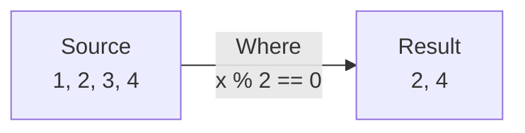

# Lesson 12.3: Rx Operators

> **Difficulty:** Advanced | **Duration:** 45 min | **Prerequisites:** Lesson 12.2

## Overview

Learn how to implement and use reactive operators with Surgewave streams for powerful data transformations.

## Learning Objectives

- Implement common reactive operators (Where, Select, etc.)
- Chain operators in a fluent pipeline
- Build custom operators for Surgewave messages
- Understand operator composition

## Why Operators?

Operators transform observable sequences in a declarative way:

| Operator | Purpose | Example |
|----------|---------|---------|
| Where | Filter elements | Remove invalid messages |
| Select | Transform elements | Extract payload from message |
| SelectMany | Flatten nested | One message to many events |
| Buffer | Batch elements | Collect N messages |
| Distinct | Remove duplicates | Dedupe by key |

## Key Concepts

### Operator Anatomy

Every operator:
1. Takes an IObservable as input
2. Returns a new IObservable as output
3. Subscribes to the source internally
4. Transforms notifications before forwarding



### Operator Pipeline

```csharp
source
    .Where(x => x > 0)           // Filter
    .Select(x => x * 2)          // Transform
    .Buffer(3)                   // Batch
    .Subscribe(batch => ...);    // Consume
```

### Implementation Pattern

```csharp
public class WhereObservable<T> : IObservable<T>
{
    private readonly IObservable<T> _source;
    private readonly Func<T, bool> _predicate;

    public WhereObservable(IObservable<T> source, Func<T, bool> predicate)
    {
        _source = source;
        _predicate = predicate;
    }

    public IDisposable Subscribe(IObserver<T> observer)
    {
        return _source.Subscribe(new WhereObserver<T>(observer, _predicate));
    }
}
```

### With Surgewave Messages

```csharp
surgewaveObservable
    .Where(msg => msg.Value != null)
    .Select(msg => JsonSerializer.Deserialize<Order>(msg.Value))
    .Where(order => order.Total > 100)
    .Subscribe(order => ProcessHighValueOrder(order));
```

## Exercise

In this exercise, you'll:

1. Implement Where, Select, and Take operators
2. Create extension methods for fluent chaining
3. Build a Buffer operator for batching
4. Apply operators to Surgewave message streams

---

**Instructions:** [INSTRUCTIONS.md](INSTRUCTIONS.md)
