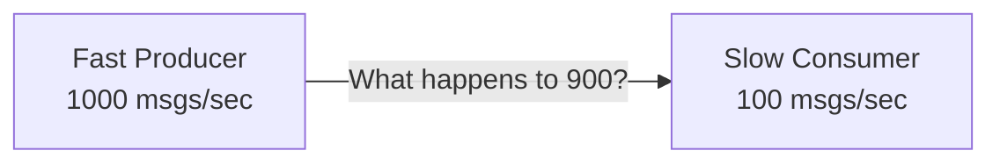
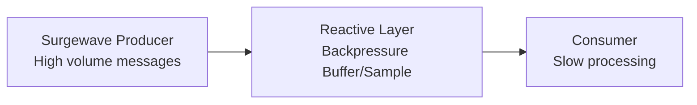

# Lesson 12.4: Backpressure

> **Difficulty:** Advanced | **Duration:** 45 min | **Prerequisites:** Lesson 12.3

## Overview

Learn how to handle flow control when producers are faster than consumers using backpressure strategies.

## Learning Objectives

- Understand the backpressure problem
- Implement buffering strategies
- Create sampling and throttling operators
- Handle overflow scenarios gracefully

## Why Backpressure?

When a producer emits data faster than a consumer can process it:

| Problem | Consequence |
|---------|-------------|
| Unbounded buffer | Memory exhaustion |
| Dropped messages | Data loss |
| Blocked producer | System deadlock |
| Slow consumer | Cascading delays |

## Key Concepts

### The Backpressure Problem

### Backpressure Strategies

| Strategy | Behaviour | Memory | Data Loss |
|----------|-----------|--------|-----------|
| Buffer | Keep all, batch emit | Grows | None |
| Sample | Take one per interval | Constant | High |
| Throttle | Time-based windowing | Bounded | Some |
| Drop | Discard old when full | Bounded | Controlled |

### Strategy Comparison

| Strategy | Data Loss | Memory | Use Case |
|----------|-----------|--------|----------|
| Buffer | None | Grows | Must process all |
| Sample | High | Constant | Latest value matters |
| Throttle | Some | Bounded | Rate limiting |
| Drop Oldest | Controlled | Bounded | Freshness priority |
| Drop Newest | Controlled | Bounded | Order priority |

### With Surgewave

## Exercise

In this exercise, you'll:

1. Create a bounded buffer with overflow policies
2. Implement a Sample operator
3. Build a Throttle operator
4. Handle high-volume Surgewave streams

---

**Instructions:** [INSTRUCTIONS.md](INSTRUCTIONS.md)
