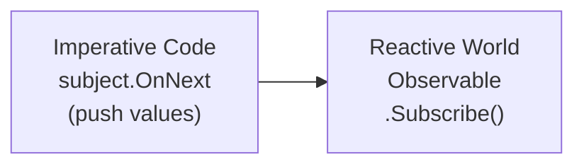
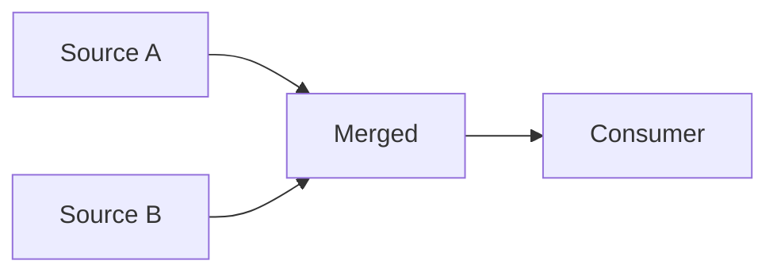
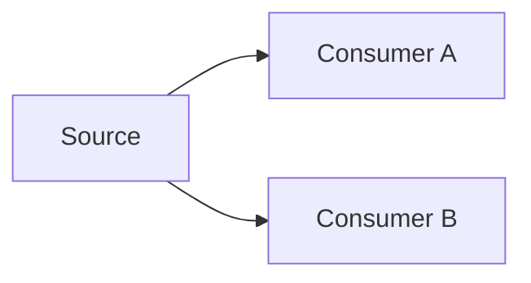
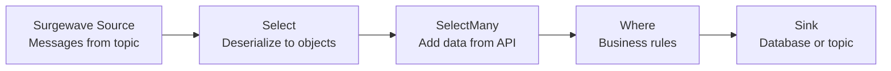

# Lesson 12.5: Integration Patterns

> **Difficulty:** Advanced | **Duration:** 45 min | **Prerequisites:** Lesson 12.4

## Overview

Learn patterns for bridging Surgewave with other reactive components and building complete reactive pipelines.

## Learning Objectives

- Bridge imperative and reactive code
- Connect multiple observable sources
- Build reactive processing pipelines
- Implement common integration patterns

## Why Integration Patterns?

Real applications need to integrate Surgewave with:

| Component | Integration Need |
|-----------|-----------------|
| UI/Web | Push updates via observables |
| Databases | Reactive CRUD operations |
| External APIs | Async request/response |
| Other Message Systems | Protocol bridging |
| Timers/Schedulers | Time-based triggers |

## Key Concepts

### Pattern 1: Subject as Bridge



### Pattern 2: Merge Multiple Sources



### Pattern 3: Fork (One-to-Many)



### Pattern 4: Reactive Pipeline



### Pattern 5: Request-Response Bridge

```csharp
// Convert request/response to observable
public IObservable<Response> GetDataAsync(Request request)
{
    return Observable.FromAsync(async () =>
    {
        var response = await _httpClient.PostAsync(url, content);
        return await response.Content.ReadAsAsync<Response>();
    });
}
```

### Pattern 6: Timer Integration

```csharp
// Periodic polling as observable
public IObservable<Status> PollStatus(TimeSpan interval)
{
    return Observable.Interval(interval)
        .SelectMany(_ => GetCurrentStatus());
}
```

## Exercise

In this exercise, you'll:

1. Use Subject to bridge imperative code
2. Merge multiple Surgewave topic streams
3. Build a complete reactive pipeline
4. Implement async enrichment patterns

---

**Instructions:** [INSTRUCTIONS.md](INSTRUCTIONS.md)
