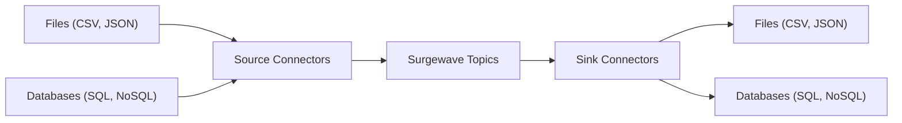

# Unit 9: Data Integration

Connect external data sources and sinks with Surgewave.

## Overview

Data Integration covers patterns for moving data in and out of Surgewave:
- Source connectors to ingest data into topics
- Sink connectors to export data to external systems
- Change Data Capture (CDC) for database synchronization
- File-based data pipelines

## Architecture



## Lessons

| Lesson | Topic | What You'll Build |
|--------|-------|-------------------|
| [8.1](lesson-1/README.md) | Connect Concepts | Understand source/sink architecture |
| [8.2](lesson-2/README.md) | File Connectors | CSV/JSON file ingestion and export |
| [8.3](lesson-3/README.md) | Database Connectors | SQL database integration |
| [8.4](lesson-4/README.md) | Change Data Capture | Track database changes in real-time |
| [8.5](lesson-5/README.md) | Custom Connectors | Build your own connectors |

## Prerequisites

- Completed Unit 1 (Fundamentals)
- Completed Unit 3 (Advanced Messaging)
- Basic understanding of databases and file I/O

## Key Concepts

### Source vs Sink

| Aspect | Source Connector | Sink Connector |
|--------|------------------|----------------|
| Direction | External → Surgewave | Surgewave → External |
| Use Case | Data ingestion | Data export |
| Examples | File reader, DB poller | File writer, DB inserter |

### Connector Modes

| Mode | Description | Use Case |
|------|-------------|----------|
| Bulk | One-time full load | Initial data migration |
| Incremental | Track changes over time | Ongoing synchronization |
| CDC | Capture every change | Real-time replication |

## Connector Plugin System

Surgewave connectors are discovered at runtime through a plugin architecture. Each connector assembly is annotated with `ConnectorMetadata` attributes that describe its capabilities:

```csharp
[ConnectorMetadata(
    DisplayName = "PostgreSQL CDC",
    Icon = "database",
    Category = "Database",
    Description = "Captures row-level changes from PostgreSQL using logical replication")]
public class PostgresCdcSourceConnector : ISourceConnector { ... }
```

The broker scans the configured `PluginsDirectory` (default: `plugins`) on startup and registers all connectors it finds. Extended manifest fields -- `DisplayName`, `Icon`, and `Category` -- are surfaced in the Control UI's node palette and the REST API (`GET /api/connectors`), making it easy to browse and select connectors visually.

### Deployment Modes

Connectors can run in two modes:

| Mode | Description | Use Case |
|------|-------------|----------|
| **Local** | Connector runs inside the broker process | Low latency, simple deployment |
| **Remote Worker** | Connector runs on a separate worker node | Resource isolation, horizontal scaling |

Remote workers register with the broker and advertise their available connector types. The Pipeline Editor shows worker availability badges and lets you select a target worker when configuring a node (see Unit 16 for the visual workflow).

## Learning Objectives

By the end of this unit, you will be able to:

1. Design data integration pipelines with Surgewave
2. Ingest data from files (CSV, JSON, etc.)
3. Connect to SQL databases for import/export
4. Implement Change Data Capture patterns
5. Build custom connectors for any data source
6. Annotate connectors with `ConnectorMetadata` for plugin discovery
