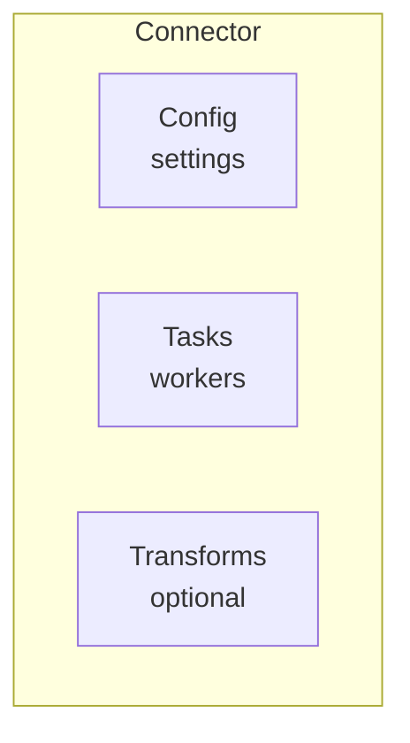

# Lesson 8.1: Connect Concepts

> **Difficulty:** Intermediate | **Duration:** 30 min | **Prerequisites:** Unit 7 completion

Understand the architecture of data connectors for Surgewave.

## Objectives

- Understand source and sink connector patterns
- Learn connector lifecycle and configuration
- Design data integration pipelines

## Concepts

### What are Connectors?

Connectors are reusable components that move data between Surgewave and external systems:
- **Source Connectors**: Read from external systems, write to Surgewave topics
- **Sink Connectors**: Read from Surgewave topics, write to external systems

### Connector Architecture



### Key Interfaces

```csharp
// Source connector interface
public interface ISourceConnector
{
    void Configure(Dictionary<string, string> config);
    Task StartAsync(CancellationToken ct);
    Task StopAsync();
}

// Sink connector interface
public interface ISinkConnector
{
    void Configure(Dictionary<string, string> config);
    Task ProcessAsync(IEnumerable<Message> messages);
}
```

## Exercise

In this lesson, you'll:
1. Explore the connector interfaces
2. Understand configuration patterns
3. Build a simple in-memory source connector

## Plugin Discovery & ConnectorMetadata

Surgewave discovers connectors at runtime from the configured `PluginsDirectory`. Each connector class is annotated with a `ConnectorMetadata` attribute that provides a `DisplayName`, `Icon`, `Category`, and `Description`. These manifest fields are used by the Pipeline Editor's node palette and the REST API to present connectors in a browsable, categorized format. Connectors can run locally inside the broker process or on remote worker nodes for resource isolation.

## Key Takeaways

- Connectors decouple data integration from business logic
- Source connectors produce, sink connectors consume
- Configuration makes connectors reusable
- `ConnectorMetadata` attributes enable plugin discovery and UI integration
