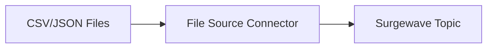

# Lesson 8.2: File Connectors

> **Difficulty:** Intermediate | **Duration:** 45 min | **Prerequisites:** Lesson 8.1

Ingest and export data using CSV and JSON file connectors.

## Objectives

- Build source connectors for CSV and JSON file ingestion
- Build sink connectors for file export
- Handle data transformation and serialization
- Implement batch processing for file data

## Concepts

### File Source Connectors

File sources read data from files and produce records to Surgewave topics:



### File Sink Connectors

File sinks consume from Surgewave topics and write to files:


### Supported File Formats

| Format | Use Case | Key Considerations |
|--------|----------|-------------------|
| CSV | Tabular data, spreadsheets | Headers, delimiters, escaping |
| JSON | Structured data, APIs | Schema flexibility, nesting |
| JSON Lines | Streaming JSON | One record per line |

### Connector Configuration

```csharp
var csvSource = new CsvSourceConnector();
csvSource.Configure(new Dictionary<string, string>
{
    ["file.path"] = "/data/input.csv",
    ["topic"] = "csv-data",
    ["has.header"] = "true",
    ["delimiter"] = ","
});
```

## Exercise

In this lesson, you'll:
1. Build a CSV source connector that reads simulated CSV data
2. Build a JSON source connector for JSON data
3. Create file sink connectors for export
4. Implement data transformation pipelines

## Key Takeaways

- File connectors bridge batch files and streaming topics
- CSV and JSON require different parsing strategies
- Sink connectors enable data export and backup
- Batch processing can be converted to streaming with connectors
