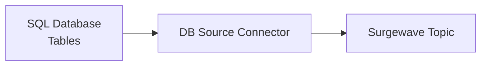
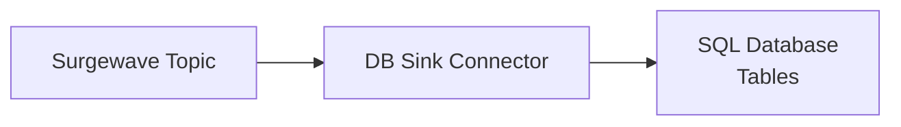

# Lesson 8.3: Database Connectors

> **Difficulty:** Intermediate | **Duration:** 45 min | **Prerequisites:** Lesson 8.2

Integrate Surgewave with SQL and NoSQL databases for data import and export.

## Objectives

- Build database source connectors for data ingestion
- Create database sink connectors for data persistence
- Implement batch and incremental load patterns
- Handle database transactions and error recovery

## Concepts

### Database Source Connectors

Database sources query tables and produce records to Surgewave:



### Database Sink Connectors

Database sinks consume from Surgewave and write to database tables:



### Load Patterns

| Pattern | Description | Use Case |
|---------|-------------|----------|
| Bulk Load | Full table export | Initial data migration |
| Incremental | Query new/changed rows | Ongoing sync |
| Time-based | Query by timestamp column | Event data |
| ID-based | Query by auto-increment ID | Sequential data |

### Connector Configuration

```csharp
var dbSource = new DatabaseSourceConnector();
dbSource.Configure(new Dictionary<string, string>
{
    ["connection.string"] = "Server=localhost;Database=mydb",
    ["table"] = "orders",
    ["topic"] = "db-orders",
    ["mode"] = "incremental",
    ["incrementing.column"] = "id"
});
```

### MongoDB Source Connector

Surgewave provides a native MongoDB connector that supports both Change Streams (real-time CDC) and polling modes:

```csharp
// MongoDB Source Connector Configuration
using Kuestenlogik.Surgewave.Connector.MongoDB;

var mongoConfig = new Dictionary<string, string>
{
    // Connection
    [MongoDbConnectorConfig.ConnectionString] = "mongodb://localhost:27017",
    [MongoDbConnectorConfig.Database] = "shop",
    [MongoDbConnectorConfig.Collection] = "products",

    // Source mode: change_stream (CDC) or poll (periodic queries)
    [MongoDbConnectorConfig.SourceMode] = MongoDbConnectorConfig.SourceModeChangeStream,

    // Topic configuration
    [MongoDbConnectorConfig.TopicPrefix] = "mongo",
    [MongoDbConnectorConfig.TopicPattern] = "${database}.${collection}",

    // Change stream options (for CDC mode)
    [MongoDbConnectorConfig.ChangeStreamFullDocument] = MongoDbConnectorConfig.FullDocumentUpdateLookup,

    // Polling options (for poll mode)
    [MongoDbConnectorConfig.PollField] = "_id",
    [MongoDbConnectorConfig.PollIntervalMs] = "1000",

    // Batch configuration
    [MongoDbConnectorConfig.BatchMaxRecords] = "500"
};
```

**MongoDB Change Stream Mode:**
- Real-time change notifications using MongoDB's native Change Streams
- Captures INSERT, UPDATE, REPLACE, and DELETE operations
- Resume token support for exactly-once delivery
- Requires MongoDB replica set (even single-node)

**MongoDB Poll Mode:**
- Periodic queries for new/updated documents
- Uses an incrementing field (e.g., `_id` or timestamp)
- Suitable for MongoDB deployments without replica set

**MongoDB CDC Event Format:**
```json
{
  "op": "c",
  "ns": { "db": "shop", "coll": "products" },
  "documentKey": "{\"_id\": {\"$oid\": \"507f1f77bcf86cd799439011\"}}",
  "fullDocument": "{\"_id\": ..., \"name\": \"Widget\", \"price\": 29.99}",
  "updateDescription": null,
  "ts_ms": 1706300000000
}
```

### MongoDB Sink Connector

```csharp
// MongoDB Sink Connector Configuration
var mongoSinkConfig = new Dictionary<string, string>
{
    [MongoDbConnectorConfig.ConnectionString] = "mongodb://localhost:27017",
    [MongoDbConnectorConfig.Database] = "analytics",
    [MongoDbConnectorConfig.Collection] = "processed_events",
    [MongoDbConnectorConfig.Topics] = "events,metrics",

    // Write mode: insert, upsert, or replace
    [MongoDbConnectorConfig.WriteMode] = MongoDbConnectorConfig.WriteModeUpsert,

    // Document ID strategy
    [MongoDbConnectorConfig.DocumentIdStrategy] = MongoDbConnectorConfig.DocumentIdStrategyKey,
    [MongoDbConnectorConfig.DocumentIdField] = "_id",

    // Write concern
    [MongoDbConnectorConfig.WriteConcern] = MongoDbConnectorConfig.WriteConcernMajority,

    // Batching
    [MongoDbConnectorConfig.BatchSize] = "100",

    // Retry configuration
    [MongoDbConnectorConfig.RetryMax] = "3",
    [MongoDbConnectorConfig.RetryBackoffMs] = "1000"
};
```

## Exercise

In this lesson, you'll:
1. Build a simulated database source connector
2. Implement bulk and incremental load patterns
3. Create a database sink connector with batching
4. Handle upsert (insert/update) semantics

## Key Takeaways

- Database connectors bridge relational data and streaming
- Incremental loads track position with offset columns
- Sink connectors need idempotent write operations
- Batching improves database write performance
- MongoDB Change Streams provide real-time CDC capabilities
- Use write concerns appropriately for data consistency
