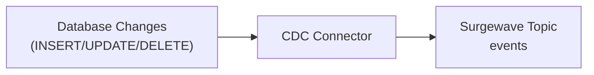

# Lesson 8.4: Change Data Capture

> **Difficulty:** Intermediate | **Duration:** 45 min | **Prerequisites:** Lesson 8.3

Track database changes in real-time with CDC patterns.

## Objectives

- Understand Change Data Capture (CDC) concepts
- Implement CDC event generation for database changes
- Build CDC consumers that react to data changes
- Handle different CDC event types (insert, update, delete)

## Concepts

### What is Change Data Capture?

CDC captures row-level changes from a database and streams them as events:



### CDC Event Structure

```csharp
public class CdcEvent
{
    public string Operation { get; set; }  // INSERT, UPDATE, DELETE
    public string Table { get; set; }
    public Dictionary<string, object>? Before { get; set; }  // Previous state
    public Dictionary<string, object>? After { get; set; }   // Current state
    public long Timestamp { get; set; }
    public long Position { get; set; }  // Log position for resumability
}
```

### CDC Operations

| Operation | Before | After | Use Case |
|-----------|--------|-------|----------|
| INSERT | null | new row | New data created |
| UPDATE | old row | new row | Data modified |
| DELETE | old row | null | Data removed |

### CDC vs Polling

| Aspect | CDC | Polling |
|--------|-----|---------|
| Latency | Real-time | Interval-based |
| Load | Log-based | Query-based |
| Deletes | Captured | Hard to detect |
| Ordering | Guaranteed | May miss changes |

### PostgreSQL CDC with Logical Replication

Surgewave provides a native PostgreSQL CDC connector that uses logical replication with the pgoutput plugin:

```csharp
// PostgreSQL CDC Source Connector Configuration
using Kuestenlogik.Surgewave.Connector.PostgreSql;

var config = new Dictionary<string, string>
{
    [PostgreSqlConnectorConfig.ConnectionConfig] = "Host=localhost;Database=orders;Username=cdc_user;Password=secret",
    [PostgreSqlConnectorConfig.SlotNameConfig] = "orders_slot",
    [PostgreSqlConnectorConfig.PublicationNameConfig] = "orders_pub",
    [PostgreSqlConnectorConfig.TablesConfig] = "public.orders,public.order_items",
    [PostgreSqlConnectorConfig.CreateSlotConfig] = "true",
    [PostgreSqlConnectorConfig.CreatePublicationConfig] = "true",
    [PostgreSqlConnectorConfig.TopicPrefixConfig] = "cdc.",
    [PostgreSqlConnectorConfig.TopicPatternConfig] = "${schema}.${table}",
    [PostgreSqlConnectorConfig.SnapshotModeConfig] = PostgreSqlConnectorConfig.SnapshotModeInitial,
    [PostgreSqlConnectorConfig.IncludeBeforeValuesConfig] = "true"
};
```

**PostgreSQL Prerequisites:**
```sql
-- Enable logical replication in postgresql.conf
-- wal_level = logical
-- max_replication_slots = 4
-- max_wal_senders = 4

-- Create a dedicated CDC user
CREATE USER cdc_user WITH REPLICATION PASSWORD 'secret';
GRANT SELECT ON ALL TABLES IN SCHEMA public TO cdc_user;

-- For UPDATE/DELETE before values, set REPLICA IDENTITY
ALTER TABLE orders REPLICA IDENTITY FULL;
ALTER TABLE order_items REPLICA IDENTITY FULL;
```

**CDC Event Format from PostgreSQL:**
```json
{
  "op": "c",           // c=create, u=update, d=delete, r=read(snapshot)
  "source": {
    "schema": "public",
    "table": "orders",
    "lsn": "0/16B3740"
  },
  "before": null,
  "after": {
    "id": 1001,
    "customer_id": 42,
    "amount": 299.99,
    "status": "pending"
  },
  "ts_ms": 1706300000000
}
```

## Exercise

In this lesson, you'll:
1. Build a CDC event generator that simulates database changes
2. Create a CDC connector that produces change events
3. Implement CDC consumers that react to changes
4. Build a materialized view from CDC events

## Key Takeaways

- CDC captures all changes including deletes
- Events contain before/after state for full context
- Position tracking enables exactly-once delivery
- CDC enables real-time data synchronization
- PostgreSQL CDC uses logical replication slots for reliable streaming
- Use REPLICA IDENTITY FULL for UPDATE/DELETE before values
