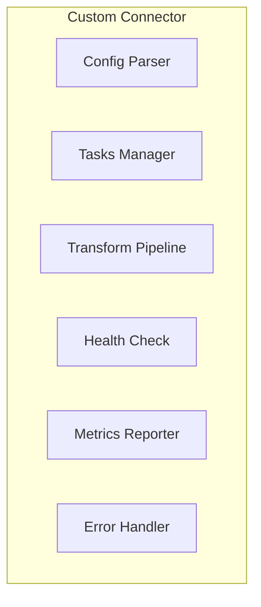

# Lesson 8.5: Custom Connectors

> **Difficulty:** Intermediate | **Duration:** 45 min | **Prerequisites:** Lesson 8.4

Build your own connectors to integrate any data source or sink.

## Objectives

- Design custom connector interfaces
- Implement source connectors with proper lifecycle management
- Build sink connectors with error handling and batching
- Create connector factories for configuration-driven instantiation

## Concepts

### Custom Connector Architecture

Custom connectors follow a standard pattern:



### Connector Lifecycle

```
Configure -> Validate -> Start -> Poll/Process -> Stop -> Cleanup
```

### Source Connector Template

```csharp
public interface ICustomSourceConnector
{
    void Configure(Dictionary<string, string> config);
    Task ValidateAsync();
    Task StartAsync(CancellationToken ct);
    Task StopAsync();
    ConnectorHealth GetHealth();
    event Action<string, string, byte[]>? OnRecord;
}
```

### Sink Connector Template

```csharp
public interface ICustomSinkConnector
{
    void Configure(Dictionary<string, string> config);
    Task ValidateAsync();
    Task ProcessAsync(IEnumerable<ConnectorRecord> records);
    Task FlushAsync();
    ConnectorHealth GetHealth();
}
```

### Connector Factory Pattern

```csharp
public class ConnectorFactory
{
    public ISourceConnector CreateSource(string type, Dictionary<string, string> config)
    {
        var connector = type switch
        {
            "http" => new HttpSourceConnector(),
            "websocket" => new WebSocketSourceConnector(),
            "mqtt" => new MqttSourceConnector(),
            _ => throw new ArgumentException($"Unknown connector type: {type}")
        };
        connector.Configure(config);
        return connector;
    }
}
```

## Exercise

In this lesson, you'll:
1. Build a custom HTTP polling source connector
2. Create a custom webhook sink connector
3. Implement connector health monitoring
4. Build a connector factory for dynamic instantiation

## Registering Custom Connectors as Plugins

To make your custom connector discoverable by the broker, annotate it with `ConnectorMetadata` and build it as a class library placed in the `PluginsDirectory`:

```csharp
[ConnectorMetadata(
    DisplayName = "MQTT Source",
    Icon = "wifi",
    Category = "IoT",
    Description = "Subscribes to MQTT topics and ingests messages")]
public class MqttSourceConnector : ISourceConnector { ... }
```

After building, run `.\scripts\collect-connectors.ps1` to copy the DLL into the plugins folder. The broker will discover it on the next startup and surface it in the Node Palette with its display name, icon, and category.

## Key Takeaways

- Custom connectors extend Surgewave's integration capabilities
- Proper lifecycle management ensures clean startup/shutdown
- Health checks enable monitoring and alerting
- Factory pattern enables configuration-driven connector creation
- `ConnectorMetadata` attributes register connectors for plugin discovery
